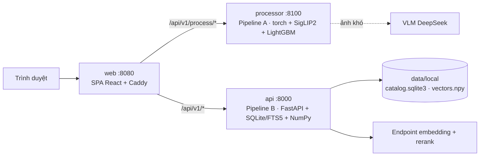

# Heritage Image Retrieval

Hệ thống xử lý và truy xuất ảnh di sản / địa danh Việt Nam, gồm **hai pipeline độc lập**:

- **Pipeline A — Xử lý dữ liệu:** tải lên file CSV ảnh vừa crawl. Hệ thống tự lọc và kiểm duyệt qua các tầng rule → SigLIP2 → LightGBM → router → VLM (chỉ cho ảnh khó), rồi trả CSV quyết định kèm lý do. Chi phí đo được là **$0,020 / 1.000 ảnh**.
- **Pipeline B — Tìm kiếm:** truy xuất **130.428 ảnh** cho truy vấn single intent, multi-intent và multi-hop. **82/82 test case dưới 3 s** (p95 914 ms).

Demo: https://heritage-image-retrieval.vercel.app (tìm kiếm) · tài liệu: [docs/](docs/README.md)

| Tài liệu | Nội dung |
|---|---|
| [Tài liệu kỹ thuật](docs/technical-report.vi.md) | Kiến trúc, schema, pipeline xử lý data, cách retrieve từng loại query, lý do chọn giải pháp, hạn chế |
| [Performance & benchmark](docs/performance-benchmark.vi.md) | Metric chất lượng, latency, throughput, chi phí, load test, cách đo |
| [Test case](docs/test-cases.vi.md) | Phương pháp dựng test case, kết quả từng ca, ma trận test tự động |
| [Tối ưu Pipeline A](docs/verify-router-benchmark.md) | So sánh classifier, ngân sách VLM 5–20%, chọn cấu hình production |
| [Deploy & CI/CD](docs/deploy.md) | Vercel + HF Space, GitHub Actions |

## 1. Kiến trúc



| Service | Image | Vai trò |
|---|---:|---|
| `web` | 94 MB | SPA hai chức năng (Tìm kiếm · Xử lý dữ liệu), proxy `/api` gắn `X-API-Key` phía server |
| `api` | 411 MB | Pipeline B, không torch; healthcheck `/v1/health` |
| `processor` | 1,9 GB | Pipeline A, torch CPU; healthcheck `/v1/process/health` |

## 2. Chạy bằng Docker Compose

Yêu cầu: Docker (Compose v2), khoảng 8 GB RAM trống, và một endpoint embedding + rerank tương thích OpenAI / Jina, vì index được dựng bằng `qwen3-embedding-4b`.

```bash
git clone <repo> heritage-image-retrieval && cd heritage-image-retrieval
cp .env.example .env
# Sửa .env:
#   EMBED_API_BASE, EMBED_API_KEY   bắt buộc (embedding truy vấn + rerank)
#   DEEPSEEK_API_KEY                tuỳ chọn: VLM cho ảnh khó ở Pipeline A
#   OPENROUTER_API_KEY              tuỳ chọn: parse câu mơ hồ, tra KG online
#   TEST_API_KEY                    đổi nếu mở ra ngoài
```

**Dữ liệu index** (`data/local/`, khoảng 1,7 GB, không nằm trong git). Container `api` không mở thẳng thư mục này. Khi khởi động, nó chép các file mới hơn vào volume `apidata`, vì SQLite chạy không ổn định trên bind mount Windows/macOS. Sau khi dựng lại index thì chạy `docker compose restart api`. Chọn một trong hai cách:
- **Có quyền đọc HF dataset dựng sẵn:** đặt `HF_DATASET=<user>/heritage-data` và `HF_TOKEN=<token Read>` trong `.env`. Container `api` tự kéo index khi khởi động lần đầu (khoảng 3 phút).
- **Tự dựng từ CSV:** xem §3.

```bash
docker compose up -d --build        # build ~5 phút lần đầu
docker compose ps                   # api, processor, web: healthy
open http://localhost:8080          # Tìm kiếm  |  Xử lý dữ liệu
```

Kiểm tra nhanh:

```bash
curl http://localhost:8080/api/v1/health
curl -X POST http://localhost:8080/api/v1/search -H 'Content-Type: application/json' \
     -d '{"query":"lăng của con trai vua Gia Long","top_k":10}'
curl http://localhost:8080/api/v1/process/health
```

Thử Pipeline A: mở **Xử lý dữ liệu** → *Tải CSV mẫu (307 ảnh có nhãn)* → chọn file đó → **Chạy pipeline xử lý**. Trên CPU job mất khoảng 1 phút; kết quả gồm tiến độ 8 tầng, ma trận nhầm lẫn so với nhãn người, ảnh theo từng lý do, và nút tải CSV kết quả.

## 3. Dựng index từ đầu (Pipeline B)

```bash
python -m venv .venv && .venv/Scripts/activate      # Linux/macOS: source .venv/bin/activate
pip install --extra-index-url https://download.pytorch.org/whl/cpu -r requirements-local.lock.txt
python -m pipeline --csv data/data_anh_pass_master.csv --mode approved
```

| Bước | Thời gian đo được (130.428 ảnh) |
|---|---|
| Import CSV → SQLite + FTS5 | 35 s |
| Embed metadata (106.093 đoạn khác nhau) | 35,6 phút, bị chặn bởi hạn mức 100 request/phút của endpoint |
| Seed KG multi-hop (`python -m scripts.kg_seed`) | xem [multihop-kg.md](docs/multihop-kg.md) |

Kết quả nằm trong `data/local/`; `docker compose up` sẽ mount thư mục này vào container `api`.

## 4. Chạy dev không Docker

```bash
# Pipeline B
uvicorn api.main:app --port 8000
# Pipeline A (GPU: dùng venv có torch CUDA, SigLIP2 nhanh hơn ~35 lần)
pip install lightgbm==4.6.0 python-multipart==0.0.32 transformers==5.20.1
uvicorn processing.main:app --port 8100
# Web
cd web/spa && npm ci && npm run dev           # http://localhost:5173
```

Proxy của Vite chuyển `/api/v1/process/*` sang `PROCESS_URL` (mặc định :8100), còn lại sang `BACKEND_URL` (:8000), và gắn `TEST_API_KEY` phía server.

## 5. Test, benchmark, load test

```bash
pytest -q                                            # 351 test backend
(cd web/spa && npm test)                             # 26 test frontend
python -X utf8 -m scripts.eval_testcases --pace 2.5  # 82 test case Phần B -> reports/testcases/
docker compose --profile loadtest run --rm k6        # load test qua web -> reports/loadtest/raw.json
python -m loadtest.make_report reports/loadtest/raw.json -o reports/loadtest/report.html
```

Huấn luyện lại classifier Pipeline A (cần `data/test.csv` có nhãn người): xem [docs/test-cases.vi.md §5](docs/test-cases.vi.md#5-lệnh-tái-lập). Lệnh cuối `python -m scripts.train_verify_model` ghi `models/verify/`, và processing service nạp thư mục này khi khởi động.

## 6. Deploy và CI/CD

GitHub Actions ([ci.yml](.github/workflows/ci.yml)):
1. ruff + pytest + compileall.
2. vitest + build SPA.
3. Build và boot 3 image Docker.
4. Deploy API lên Hugging Face Space (private).
5. Deploy web lên Vercel.
6. Smoke test 3 loại truy vấn (chặn nếu ≥ 3 s).
7. k6 + báo cáo HTML.

Thiết lập lần đầu và secrets: [docs/deploy.md](docs/deploy.md). Bản cloud chạy Pipeline B. Pipeline A cần torch / GPU nên chạy bằng docker compose; muốn mở trên cloud thì đặt `PROCESS_URL` cho proxy Vercel.

## 7. Cấu trúc repo

```text
api/            FastAPI Pipeline B (/v1/search, /v1/health, /v1/reports …)
retrieval/      parse, hybrid retrieve, fusion, rerank, multi-hop (hop.py), hạn chờ (budget.py)
storage/        SQLite catalog, FTS5, cache, tải ảnh
processing/     Pipeline A service: đọc CSV, chạy luồng, hàng đợi job, API; samples/sample.csv
pipeline/       các tầng Pipeline A (pipeline/verify: gate, fetch, encoder, features, router, vlm) + dựng index
models/verify/  classifier production (5 LightGBM + model_card.json)
web/spa/        giao diện React/Vite; api/proxy.ts = Vercel Edge proxy
deploy/         Dockerfile (backend, processor, web), Caddyfile, HF Space / dataset
scripts/        benchmark, dựng test case, train model, seed KG
evals/          bộ test case Phần B (evals/testcases/cases.jsonl)
loadtest/       k6 (loadtest.js, queries.json) + make_report.py
reports/        kết quả benchmark được trích dẫn trong docs
docs/           tài liệu kỹ thuật, performance, test case, deploy
db/schema.dbml  schema dữ liệu
tests/          351 test pytest
```

`web/app/` (Next.js) và `pipeline/stage*.py` là bản thử nghiệm ban đầu, không còn nằm trên đường chạy.
