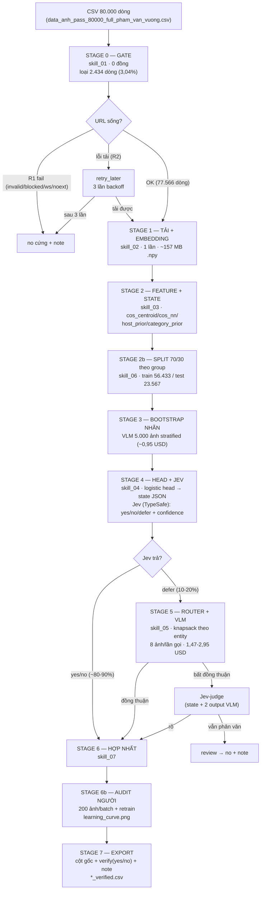

# Pipeline & Workflow chi tiết — Verify ảnh 2 tầng (Gate → Encoder → Jev → VLM)

> Bản vận hành đầy đủ: từng stage dùng skill nào, bàn giao gì, đường lỗi/retry, sơ đồ Mermaid.
> JEV = **Jev của TypeSafe** (System One Model — quyết định có kiểu + confidence hiệu chỉnh, không đọc ảnh).
> Dữ liệu nền: `data_anh_pass_80000_full_pham_van_vuong.csv` (80.000 dòng, 11.294 entity) — đo thật 19/10/2026.

---

## 1. Sơ đồ tổng thể (Mermaid)

---

## 2. Bảng stage → skill → chi phí

| Stage | Skill | Nội dung | Chi phí | Thời gian |
|---|---|---|---|---|
| S0 | skill_01_gate_dinh_dang.md | Gate R1 (thêm `R1_noext`), bỏ R4/R5, R2 → retry_later | 0 | < 1 phút |
| S1 | skill_02_embedding_anh.md | Tải 15,6 GB + DINOv3/SigLIP2 embedding 77.566 ảnh | 0 (API) | 20–40 phút |
| S2 | skill_03_feature_state.md | 7 feature + state ≤500 token/ảnh cho Jev | 0 | < 5 phút |
| S2b | skill_06_split_danh_gia.md | Split 70/30 theo group chuẩn hoá, stratified category | 0 | < 1 phút |
| S3 | skill_05 (phần bootstrap) | VLM 5.000 ảnh stratified để dạy head | ~0,95 USD đêm | ~30 phút |
| S4 | skill_04_head_jev_decision.md | Head logistic + Jev quyết định 100% ảnh | ~1,63 USD (Jev, state 500 token) | ~10 phút |
| S5 | skill_05_router_vlm_budget.md | Router knapsack + VLM chỉ trên defer | 1,47–2,95 USD (α=10–20%, đêm) | ~30–60 phút |
| S6 | skill_07_hop_nhat_active_learning.md | Hợp nhất + audit người 200 ảnh/batch + retrain | chi phí người | — |
| S7 | skill_07 | Export CSV giao (`*_verified.csv`) | 0 | < 1 phút |

**Tổng một lượt đầy đủ (α=15%, ban đêm): ≈ 5,8 USD** so với 14,74 USD nếu gọi VLM 100%.

---

## 3. Handoffs (bàn giao giữa các stage)

| Từ → Đến | Bàn giao | Kiểm tra trước khi nhận |
|---|---|---|
| S0 → S1 | Bảng dòng sống + `retry_later` | tổng dòng = 77.566; 0 URL blocked còn sót |
| S1 → S2 | `emb_all.npy` + thư viện ảnh cache theo sha256 | số vector = số dòng sống; không NaN |
| S2 → S4 | `X.npy` + `states.jsonl` | mỗi state ≤ 500 token; `n_siblings` có mặt |
| S2b → S4/S5 | `split.json` | không group nào nằm cả 2 phía; tỉ lệ 70,5/29,5 |
| S3 → S4 | `labels_boot.csv` | đủ 5.000 dòng; stratified theo 479 bucket |
| S4 → S5 | `decisions.parquet` | ECE của Jev trên val ≤ 0.05; defer rate khớp conformal |
| S5 → S6 | `vlm_results.csv` | không còn ca pending trong entity được xuất |
| S6 → S7 | nhãn hợp nhất + audit | nhãn người không bị ghi đè |

---

## 4. Đường lỗi & retry (tổng hợp)

| Lỗi | Ở stage | Xử lý |
|---|---|---|
| Link chết tạm thời (R2) | S0/S1 | retry 3 lần backoff → mới `no` (24% ca này người vẫn giữ) |
| Ảnh decode hỏng (~4%) | S1 | sau 3 retry → `dead` → `no`, không gọi API |
| HTTP 402/401/403 hết tiền | S3/S5 | dừng mềm ngay, phần còn lại = pending; chạy lại dùng cache 0 đồng |
| 429 concurrency | S5 | hạ concurrency xuống N−1 (không coi là hết tiền) |
| Jev defer > α | S4 | conformal rank: chỉ defer confidence thấp nhất đi VLM |
| ECE Jev trên val > 0.05 | S4 | thêm nhãn người vào val, đo lại; nếu vẫn lệch → dùng conformal thay confidence raw |
| 2 lượt VLM bất đồng thuận | S5 | Jev-judge → vẫn phân vân → `no` + note "máy không chắc chắn" |
| Entity chấm dở | S5/S6 | bỏ entity khỏi file giao (không có dòng verify trống) |

---

## 5. Điều kiện nghiệm thu (từ skill 06)

- `acc_tổng = (1 − α)·A_keep + α·A_VLM|deferred`; ở α=15% cần **A_keep ≥ 0,82** để đạt 78%.
- Test chỉ chạm 1 lần; ≥300–500 ảnh test do người chấm là thước đo duy nhất để tuyên bố 75–80%.
- Báo cáo bắt buộc: risk–coverage curve, AURC, ECE, defer rate vs θ, %entity ≥3 yes (chỉ tiêu ≥5 bất khả thi với 41% entity), bảng chéo category/host, chi phí/1k ảnh.
