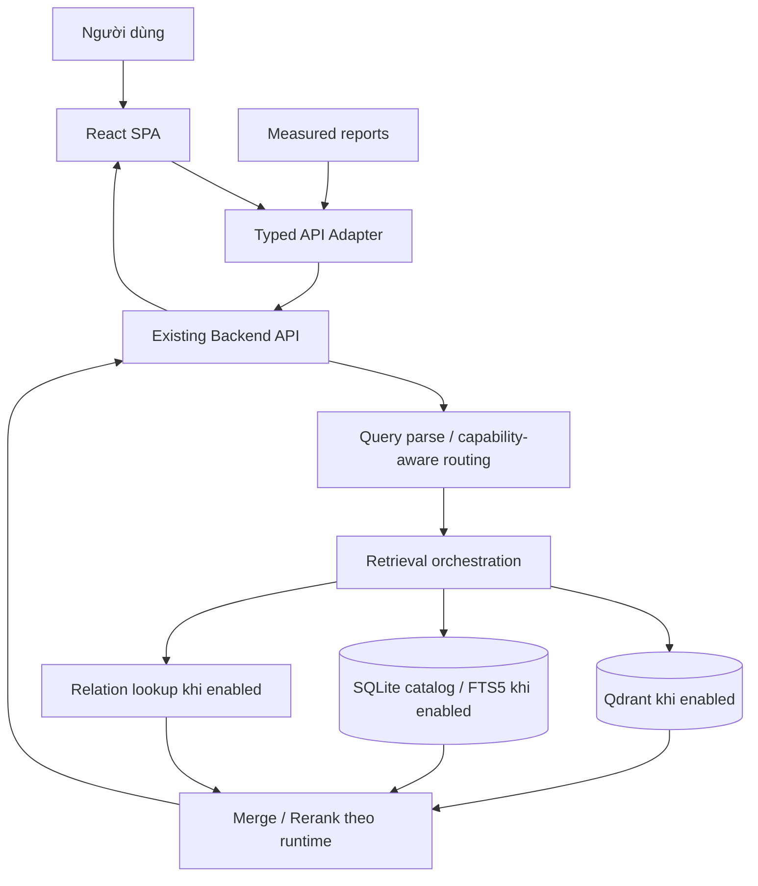

# PROMPTS — Image Processing & Retrieval Capstone UI (v2 · Live-first)

> Bộ prompt dùng với **`SKILL.md` (v2)** cùng thư mục. Giữ 4 trang `/`, `/moderation`, `/benchmark`, `/docs` và phong cách thiết kế bản cũ; sửa những điểm chưa đủ chuẩn Capstone: tích hợp backend, phân rã query chính xác, multi-hop có nguồn, an toàn nội dung, số liệu thật, Docker toàn hệ thống và kiểm thử tái lập.

## Cách sử dụng đúng

- **Dùng Claude Code trên repo có backend:** đưa `SKILL.md` + `PROMPTS.md` vào context. Chạy **P0 → P1 → ... → P9** theo thứ tự, mỗi bước có thể chia commit. Không yêu cầu AI viết lại backend đã có hoặc thay database khi không cần.
- **Dùng v0.dev/Lovable:** P0 tạo UI scaffold; P1–P7 tinh chỉnh bố cục và interactive states trên fixture có gắn nhãn. Sau đó đưa code vào repo và **bắt buộc** chạy P8/P9 bằng công cụ có quyền đọc source, chạy terminal/test.
- **Mục tiêu bắt buộc:** >=80.000 ảnh index *và retrieve được*; ba loại query; API demo thực; latency <3.000ms/query phải có phép đo; throughput, cost, accuracy Phần A; Docker Compose, docs, benchmark, README. Không có số liệu thì hiện `Chưa đo`.
- **Không tự bịa:** endpoint/backend schema, model name, hardware, entity relation, thư viện graph, image URLs, báo cáo p95/RPS, kết quả chạy test, Github/domain. Không bao giờ nói `PASS` chỉ vì đã vẽ dashboard đẹp.
- **Chế độ:** `DATA_MODE=live` cho demo chấm điểm, `DATA_MODE=mock` chỉ để phát triển UI. Mock có watermark/nhãn minh họa tại mọi trang; không silent fallback nếu live API thất bại.
- **Đầu ra ở cuối MỖI prompt:** (1) files changed, (2) architectural choices mapped to repo, (3) commands/tests actually run and their output, (4) acceptance checklist pass/fail, (5) unimplemented dependencies. Không báo tests passed nếu không thật sự chạy.

## Luồng chuẩn mong muốn



**Những thành phần ghi “khi enabled” phải kiểm tra code đang chạy.** Đây là kiến trúc tham chiếu, không phải bằng chứng hiện trạng.

---

# P0 — MASTER: audit, scaffold, API contract, theme, four pages
**Target:** Claude Code (preferred); v0/Lovable for layout-only scaffold.

```text
You are implementing a Vietnamese image retrieval and post-crawl moderation Capstone UI. Read SKILL.md v2 first. Build the shell without faking backend readiness or benchmark success.

FIRST: if a repository is available, INSPECT BEFORE MODIFYING:
- Locate Python API entrypoint/routes, request/response payloads, auth, health check, Qdrant collection names/counts, SQLite catalog, FTS5, image serving policy, processing scripts and actual reranker/parser config.
- Write docs/backend-inventory.md with sources (file path + symbol), known/unknown capabilities, observed index image count, vector index count, current embeddings and reranker. As historical context, a prior snapshot reported 79,999 images and SigLIP2 visual vectors not enabled; VERIFY CURRENT ACTUAL VALUES. Do not fabricate a graph DB, PostgreSQL, Go API gateway, visual retrieval, API endpoint, or new embedding deployment.
- Only if repo is absent, implement the frontend against typed mocks and a configurable interface, prominently label "DỮ LIỆU MINH HỌA". Clearly list integration blockers.

STACK: Vite + React 18 + TypeScript + Tailwind + shadcn/ui + react-router-dom; TanStack Query for async server-state, TanStack Virtual for large grids, Recharts (lazy load), react-markdown and Mermaid (lazy load), zod (or equivalent) response validation.

BRAND: Kho Ảnh Thông Minh. VIETNAMESE COPY throughout. html lang=vi. Use Be Vietnam Pro (with Vietnamese characters) and JetBrains Mono for code/time. Colors: bg #F8FAFC, surface white, text #0F172A, muted #64748B, border #E2E8F0, indigo #4F46E5. Query badges: SINGLE #2563EB, MULTI_INTENT #7C3AED, MULTI_HOP #0E7490. Cards radius 8px, buttons with focus ring, max-width 1280. Responsive 360/768/1280/1920.

ROUTES: / (search), /moderation (processing), /benchmark (measurement), /docs (architecture). Sticky 56px header, nav, appropriate GitHub link if available, loading/empty/error states, skip link, shared UI components.

DATA ARCHITECTURE (REQUIRED):
- src/api/{backendClient,searchAdapter,metricsAdapter,validators}.ts and src/types/{search,metrics}.ts.
- src/mocks only for DATA_MODE=mock; never fallback into mock on live error.
- Query state reflected in URL ?q=...&type=auto&view=grouped; browser refresh/share re-fetches actual results.
- Build a typed normalized SearchResponse interface following SKILL.md section 4.1 (statuses ok/partial/unsupported/unverified/error, image IDs, intents, constraints, trace steps with evidence, moderation, timings, dataset provenance).
- Runtime-validation of backend payload, graceful handling of missing optional fields.
- Add feature capability detection (actual backend route/config if available); disable unsupported actions or show "Chưa được triển khai / Chưa xác minh".
- Do not display 80,000 indexed images by default; read count from backend. An observed count of 79,999 does not satisfy >=80,000.

SPECIFIC UI:
- /: centered hero before submit, search bar, example chips; results toolbar, safe thumbnail grid, type and latency chips.
- /moderation: four evidence-based stat cards, branch-aware pipeline, charts, review queue state.
- /benchmark: measured run selector + empty state and 3 query-type slots; no fake PASS.
- /docs: As-Is/To-Be tabs with documented gaps and Mermaid placeholders until repo inspection fills them.

ENGINEERING:
- Keep API base path configurable via same-origin /api proxy; never ship model/API secrets to browser.
- Integrate React Query queryKeys with query/type/constraints/filters/pagination; cancel stale requests; show 404, 429, 5xx, timeout distinctly.
- Provide typed fixtures ONLY for visual states. Fixture values/URLs must be labeled "DỮ LIỆU MINH HỌA — KHÔNG PHẢI KẾT QUẢ ĐO".
- No non-functional buttons. If service is missing, disable feature and explain reason.

DELIVER: working scaffold and actual files, docs/backend-inventory.md (or an explicit 'repo unavailable' blocker), README preliminary run steps, checks performed, and list remaining integration gaps. Do not claim overall Capstone acceptance yet.
```

**Acceptance P0**
- [ ] Four pages and navigation work; Vietnamese typography correct.
- [ ] Adapter/types exist; mock/live are isolated and labeled.
- [ ] No hardcoded 80k count, fake model names, fake benchmark PASS.
- [ ] Available backend features and missing endpoints documented with evidence.
- [ ] Responsive shell tested at requested widths.

---

# P1 — SINGLE intent search with real retrieval
**Target:** Claude Code (API integration); v0 for UI component layout.

```text
Read SKILL.md and the P0 source. Implement / Search for SINGLE queries using the EXISTING backend search route discovered in docs/backend-inventory.md. Do not invent a new endpoint if one already exists. Keep exact request/response mapping isolated inside src/api/searchAdapter.ts.

UI STATES:
- Before search: prominent h1 "Tìm kiếm ảnh theo ý định", 640px search bar, Enter submit, examples from verified query suite.
- After search: compact sticky search bar, toolbar showing query type source (backend / override), actual total results (or "Chưa xác định"), runtime latency, sort/filter and copy-link.
- Results grid: 1 column <=640, 2 around 768, 3-4 above 1280; stable aspect ratios and lazy safe thumbnails. Pagination 20/page or adapt to actual backend cursor/page_size. More than 60 DOM items: virtualization with variable-height/masonry correctness or use virtualized rows and stable cards.
- Each card: entity title, relevance score WITH score_kind, original dimensions if returned, real source, safe moderation label; fallback card when media cannot be served.

RETRIEVAL AND LATENCY:
- Example SINGLE: "bãi biển Nha Trang". Submit it through actual API (not pre-canned results).
- The frontend measures client_observed_ms; use backend total_ms (if returned) separately; never display a synthetic sum as the backend time. Unmeasured stage breakdown = "—".
- LatencyBadge shows "⏱ {actual} ms / SLA 3.000 ms" only when actual measured, else "Chưa có số đo". Exact 3,000ms is breach (strict <3s).
- Do not claim the whole query meets SLA from one example; the report page evaluates repeated tests and p95/p99/max/breaches.

FILTERING AND URL:
- Filter: min resolution, source, "Chỉ ảnh an toàn" always on for PUBLIC. Filtering on full indexed set must be server-backed; client-side-only filter explicitly labeled "trong kết quả đang tải".
- Do not expose rejected/nsfw images or original URLs through public API. If a missing field, hide related filter rather than invent data.
- Update URL on deliberate search, sort, constraints; refresh/back restores query; pagination reset when search/filter changes.
- Async: loading, empty, partial, error, timeout, 429 (Retry-After), image load error. Abort obsolete requests.

TESTS:
- Unit adapter contract with real backend sample JSON (sanitized), query-key/filter tests, Playwright submit + restore URL + error state.
- Show actual HTTP method, response shape, measured result count and count-check method. No fabricated numbers.

DELIVER: Search UI + API connection + tests and any backend contract deviations in docs/backend-inventory.md.
```

**Acceptance P1**
- [ ] Query result image IDs are actual backend IDs, not Picsum placeholders.
- [ ] Pagination/filter scopes are truthful; URL refresh works.
- [ ] Stage timing sums are not assumed and no arbitrary score normalization.
- [ ] Public frontend cannot request prohibited image bytes.

---

# P2 — MULTI_INTENT: intent chips + shared constraints + AND/grouped semantics
**Target:** Claude Code (planner mapping) / v0 UI refinement.

```text
Refine the / Search page for MULTI_INTENT queries. Read SKILL.md section 4.3 and preserve the original design of removable chips, grouped results, and merged view. FIX THE SEMANTIC ERROR FROM OLD PROMPTS: geography is a constraint, not automatically a separate intent.

GOLDEN EXAMPLE:
User query: "hồ bơi và công viên nước ở Phú Quốc"
Recognize TWO intents: (1) "hồ bơi", (2) "công viên nước"; shared location constraint: "Phú Quốc" applicable to both. Do NOT create an extra "Phú Quốc" intent unless backend explicitly establishes it as an independent retrieval goal.

UI:
- Above results show "Hệ thống phát hiện 2 ý định" with IntentChips and below "Điều kiện áp dụng: Phú Quốc" as a separate ConstraintChip with location icon.
- Tabs: "Theo ý định" (two grids), "Gộp tất cả" (dedupe by image_id, preserve all intent_ids), optionally "Phải đáp ứng cả hai" ONLY WHEN THE BACKEND SUPPORTS conjunction on image level. Tooltips explain OR-grouping vs AND matching.
- Each intent section: count returned by backend (not invented), 8-12 initial thumbs, "Xem tất cả" and independent cursor/empty/error states. If one intent is empty while other succeeds, show partial state and keep successful results.
- Shared constraint must be visible in EACH section's metadata and actual API plan. Do not show out-of-location results as matches merely because the overall query mentions Phú Quốc.
- UI remove/add intent and edit location must regenerate normalized query request and REQUERY backend. Do not rewrite raw ?q= silently; represent chips in URL or explicit user-edited query state.

RETRIEVAL CONSISTENCY:
- Use backend parsed intents/constraints; local input heuristic ("và") may only preview "dự đoán" before submit and must not be treated as ground truth.
- Map one image appearing in both groups to one ID in merged view; a count of unique images is different from sum of group counts.
- Show honest status when backend can't expose parsing, groups, or conjunction: "Backend chưa hỗ trợ phân nhóm thực" and disable unsupported tab. Mock state is never falsely presented as live.
- If backend returns fused only, do not reverse-engineer group assignments without evidence.

QUALITY TESTS:
- At least one shared-geography query, a two-category query with different locations, ambiguous "và" query, repeated intent, missing-intent query and mixed spelling/diacritics.
- Assert constraints propagate to every intent, image deduplication by image_id, AND/OR correctness, group partial state.

DELIVER: UI components IntentChip, ConstraintChip, IntentModeSwitch and adapter tests with actual payload when available.
```

**Acceptance P2**
- [ ] Phú Quốc is a shared geographic condition, not a third intent.
- [ ] Backend receives the edited constraints/intents.
- [ ] `AND` feature not exposed unless supported; no fabricated image-group membership.
- [ ] Group and merged counts do not double count duplicate image IDs.

---

# P3 — MULTI_HOP: verified entity relationship trace
**Target:** Claude Code for backend-capable multi-hop; v0 for visual states only.

```text
Implement MULTI_HOP UI without hallucinated entities, source citations, or graph capabilities. Read SKILL.md sections 4.1, 4.3, 6.

EXAMPLE FROM ASSIGNMENT: "ảnh con trai chủ tịch Phạm Nhật Vượng". This is a query example, NOT permission to invent a son's name or a hasSon link. Only render a target person if backend provides a verified target entity_id and relationship evidence. Otherwise display status unverified/unsupported.

LAYOUT:
- Desktop >=1024: 320px left timeline "Quá trình truy xuất nhiều bước", right result grid; mobile: expandable trace above results.
- Timeline step types: `entity_linking`, `relation_lookup`, `retrieval`, `rerank` (only those actually executed). Fields: number, input_summary, output_summary, status, elapsed_ms if measured, entity_id, relation, evidence/source references. Safe JSON expandable for engineers (redact secrets/PII tokens).
- Example UI labels: "Xác định thực thể", "Tra cứu quan hệ", "Truy xuất ảnh", "Xếp hạng". No hardcoded fake candidate counts or target person names.
- Clicking timeline step highlights cards via producer_step_ids/image_ids actually returned by backend; if link missing, disable highlight.
- Show entity resolution ambiguity with selectable candidates ONLY if backend supports a new lookup/query; otherwise ask user to refine wording.

STATE MACHINE:
1. ok: relation verified and image retrieval completed; image cards linked to entity IDs.
2. unverified: relation missing/unsupported by evidence; no 'verified' checkmarks; explanatory message and optional ordinary search fallback labeled "Tìm kiếm theo từ khóa (không xác minh quan hệ)".
3. unsupported: "Hệ thống hiện chưa hỗ trợ truy vấn quan hệ này"; don't fake trace.
4. partial/error/timeout: show completed steps plus exact failure reason if safe.

BACKEND INTEGRATION:
- Parse MultiHopTrace from actual API; no client-made chain-of-thought. Display operational retrieval steps only. Do not expose hidden model reasoning or private source information.
- Evidence URL must come from trusted backend, validated and opened safely; if no source, mark "Chưa có nguồn xác minh".
- The trace can refer to metadata/text retrieval; do not label step "visual pixel retrieval" unless visual capability really enabled.
- Sum of shown stage timings need not equal total_ms; explain unavailable/unattributed time instead of fabricating.

TESTS:
- Verified relation with supporting source, two ambiguous entities, unverified relation, missing target images, unsupported query type, backend error.
- Verify no imaginary names/evidence hardcoded in fixtures of live mode.

DELIVER: HopTrace, EvidenceLink, UnsupportedState, tests and actual integration status.
```

**Acceptance P3**
- [ ] Verified results require backend entity ID and evidence.
- [ ] Unverified/unsupported flow works and cannot show fake verified success.
- [ ] Trace clicks never highlight arbitrary top-3 images as "khớp thực thể".

---

# P4 — Shared image grid, lightbox, moderation safety and state UX
**Target:** v0 for UI, Claude Code for security/integration.

```text
Build shared ImageGrid, ImageCard, Lightbox, ModerationOverlay, PolicyPlaceholder and states for all 3 search types, preserving the original elegant neutral image-first style.

IMAGE CARD:
- Stable aspect (real width/height), object-fit cover, lazy img, decoding async, failed-thumbnail fallback. Hover reveals domain/source, entity, dimensions, score and score_kind, with accessible touch equivalent.
- Responsive masonry or row-grid plus virtualization after >60 loaded items; do not combine raw CSS column-masonry with incompatible virtual scrolling if it breaks ordering/keyboard navigation.
- Use keyboard Tab + Enter; arrows as enhancement with visible focus, not the only way to navigate.

CONTENT POLICY (CRITICAL):
- PUBLIC search always receives APPROVED media only, enforced by API/media proxy. Do NOT embed rejected/nsfw image URLs or pixels in browser HTML, even behind CSS blur or overlay. A CSS blur is not content security.
- Only users authorized as moderation reviewers may inspect REVIEW items using a protected media endpoint. Hard-blocked REJECTED/NSFW/QUARANTINED show a neutral policy placeholder; no click-to-reveal workaround.
- A safe redacted moderation status can be displayed in admin report; no uncensored sensitive thumbnail in public fixture. Global "Chỉ ảnh an toàn" must never enable unsafe results for public users.

LIGHTBOX:
- Accessible dialog with original-size IMAGE ONLY IF approved/authorized; zoom 2x via controls, previous/next, swipe where supported; Esc closes and returns focus, focus trap, scroll lock.
- Sidebar: entity name and ID, original source link when policy allows, resolution, caption, fetch date if available, score_kind, moderation labels, relation step ID if provided. Do not display missing data as sample values.
- Open external sources with target=_blank and rel=noopener noreferrer, and validate URL.

STATES:
- Loading skeletons with no large CLS; empty messages and relevant suggestions; partial data (one intent unavailable); network error with request_id; image 404/broken source; 429 retry timer if header available; timeout; unsupported capability; offline.
- Make every action meaningful: download/copy URL if real, retry if server request exists, back/forward history; no dead UI controls.

TESTS:
- Public response contains no rejected/nsfw media URL; media endpoint denies unauthorized access.
- Lightbox focus behavior and screen reader labels; responsive viewport; safe broken-image fallback.
- No exception for unknown/null metadata.

DELIVER: shared components, policy test, a11y tests and confirmed media source strategy.
```

**Acceptance P4**
- [ ] Unauthorized client cannot retrieve blocked media bytes.
- [ ] Lightbox and navigation work with keyboard/touch.
- [ ] Graceful broken image and missing metadata.

---

# P5 — Processing / Moderation Dashboard with actual evidence
**Target:** Claude Code + v0 for visual refinement.

```text
Implement /moderation as an evidence-based dashboard for Capstone Part A (post-crawl filtering and verification), NOT a set of fictional success metrics. Read SKILL.md section 5.2 and section 7.2.

DATA SOURCE PRIORITY:
1. Real backend processing metrics/observability endpoint if present.
2. Real report artifacts `reports/processing/*.json` generated from pipeline logs and evaluation scripts, with run_id, timestamp, dataset, stage counts, sampling protocol and hardware.
3. If missing: render "Chưa có số liệu xử lý thực tế" with a measurement protocol and disabled export. Do not use template mock data in live mode.

TOP SUMMARY CARDS:
- "Ảnh đã xử lý" [images in selected run/time period]; optionally show input count, approved/review/rejected and unknown.
- "Thông lượng" [sustained img/s] with elapsed wall-clock, batch size, CPU/GPU model, worker count, warm-up and error rate.
- "Chi phí / 1.000 ảnh" [USD, defined scope] plus separated compute/API/storage/annotation and assumptions.
- "Chất lượng kiểm duyệt" [precision/recall/FPR/FNR by policy class] plus n labeled samples, evaluator and date. If no labels, show "Chưa gán nhãn — chưa thể tính".

PIPELINE FLOW (BRANCHES, NOT FALSE LINEAR CHAIN):
- Main: crawl/ingest -> exact/near dedupe (if actually enabled) -> technical quality -> policy safety -> approved -> indexed.
- Side branch: suspicious/uncertain -> selective reviewer or LLM verification -> approved/rejected/quarantine. Count reviewed sample on branch; DO NOT depict every input image passing LLM.
- Stage cards: input, output, rejected, failed, skipped, retried; for multi-label rejection counts, warn overlap (do not sum reasons as disjoint).
- Only name models (YOLO, OCR, CLIP, NSFW classifier, LLM) if runtime confirms use. A proposed component belongs on To-Be docs.

CHARTS:
- Sustained images/sec by time; cost breakdown USD/1k per stage; quality precision and recall per class per run with sample count; backlog/queue or rejection mix. Recharts lazy loaded; tooltip includes run source and units.
- Add run/date selector, ACTUAL/TARGET/ESTIMATE badges, export raw data where available.

REVIEW QUEUE:
- Real records: image_id, safe thumbnail, label, model_version, confidence, threshold, reason, reviewer state, last action and audited_at.
- Authorized reviewer only; mutating actions require server write endpoint, confirmation and audit metadata. Optimistic updates rollback on failure. If API lacks mutation, UI read-only with "Chưa tích hợp thao tác duyệt"; NEVER say "Đã ghi đè" without server success.

SCALABILITY PANEL (Part A mandatory):
- Show sustained measured throughput and extrapolations for 10,000,000 and 100,000,000 images, time=images/throughput, cost=images/1000*measured_cost_per_1k, but label ESTIMATE and list I/O/network/GPU/multi-worker assumptions, errors, retries, slow tail.
- Include precision/recall/specificity/confusion-matrix when truth sample exists, with sampling method and per-class cost of FN/FP.

TESTS:
- Stage count invariants when branches/retries occur; missing measurement/provenance empty state; amount/denominator validation; no confidential or rejected media leak; mutation deny and rollback.

DELIVER: accurate dashboard, JSON measurement schema, generators/readers where pipeline artifacts exist, audit and validation tests.
```

**Acceptance P5**
- [ ] Never present mock 1.240.000 images, 143 img/s, 0.081 USD, or 97.1% as ACTUAL unless backed by measured report.
- [ ] LLM/reviewer stage is a branch; sample risk group not confused with full stream.
- [ ] 10M/100M scale estimates have formulas and caveats.
- [ ] Moderator actions require backend authorization and durable audit.

---

# P6 — Benchmark report: measured SLA, retrieval quality, load test
**Target:** Claude Code with access to tests/reports.

```text
Implement /benchmark as a reproducible evidence page. Do NOT reuse the old fake p50/p95/p99 rows, fake 96 RPS or 'all PASS'. Read SKILL.md sections 5.3 and 7.

INGEST:
- Consume a real run manifest from reports/benchmarks/<run_id>/summary.json (served safely via API or bundled after run), with run_id, measured_at, git_sha, dataset/index version, backend model versions, hardware, runner, load profile, cache mode, metrics per query type, raw sample artifact refs, and data provenance ACTUAL.
- Allow run selector; if absent show helpful empty state "Chưa có báo cáo benchmark thực" and CLI reproduction instructions. Never replace absent run with fixture.

LATENCY TABLE + CHART (per SINGLE/MULTI_INTENT/MULTI_HOP):
- n requests, successful requests, p50, p95, p99, max, SLA breach count >=3000ms, breach rate, error/timeout rate, achieved RPS. Dashed 3,000ms reference line; show separate server_time and browser/client_observed_time when both exist.
- All row PASS/FAIL decisions must use an explicit rule, document its denominator and measurement scope. Because the assignment says <3s for each query, p95 <3s alone is NOT sufficient to claim complete compliance. If n insufficient, data partial or backend unsupported, show NOT_MEASURED / NOT_SUPPORTED, never PASS.
- Show breakdown stages when backend returns them; missing stages are not zeros. If parse+retrieve+rerank < total, display 'thời gian khác/chưa phân bổ' only when measurable and correctly defined.

RETRIEVAL QUALITY:
- Table for Recall@10, Hit@10, MRR, nDCG@10 where labels permit, entity correctness, multi-intent per-intent group correctness and shared-constraint consistency, multi-hop relation evidence accuracy and unsupported rate.
- Gold cases are independent of the model outcome, kept in versioned benchmarks/queries.jsonl. Per query class show sample n, seed source, labeling protocol, adjudication and split held-out vs tuning.
- Real data crosscheck: indexed_retrievable_images >= 80,000; flag 79,999 as below minimum. Verify Qdrant point count AND catalog mapping, broken media and index filters, not only CSV row count.

LOAD TEST:
- k6 / Locust script `loadtest/retrieve.js`: real query mix from labeled suite; request tags by query_type, warmup, cold/warm runs, concurrency/ramp (document selected profile), measured throughput/errors/p95/p99/max, write raw results.
- It must run with documented `BASE_URL`, auth if needed, `DATA_MODE=live`, `RUN_ID`, random seed; fail visibly if no backend or tests.
- No 'performance pass' badge until raw data + environment + commands are present.
- UI downloadable report is real JSON of selected run; include button "Xem phương pháp đo" linking to docs/measurement-protocol.md.

BENCHMARK SAMPLE MANIFEST SHAPE (fields are illustrative, NOT measured values):
{
  "run_id": "example-not-an-actual-run",
  "provenance": "FIXTURE",
  "measured_at": null,
  "dataset": { "indexed_retrievable_images": null, "index_version": null },
  "environment": { "cpu": null, "gpu": null, "ram_gb": null, "git_sha": null },
  "cache_mode": null,
  "metrics": { "SINGLE": null, "MULTI_INTENT": null, "MULTI_HOP": null }
}

TESTS:
- Zod schema validation, SLA breach strict boundary, n=0, partial/missing metric, case count and per-group breakdown, invalid report, provenance filter.
- Reproduce e.g. `docker compose up --build -d` then use the repo's actual backend endpoint to run `k6 run loadtest/retrieve.js`; document host/port.

DELIVER: /benchmark page, reproducible scripts or wiring to existing ones, sample tests, report schema, and any unmeasured areas plainly marked.
```

**Acceptance P6**
- [ ] Dashboard reports real run ID, timestamp, environment, sample size and provenance.
- [ ] Strict `<3000ms` breach count and ratio; p95 alone never defines full SLA success.
- [ ] Quality scores use real gold labels, not fictional percentages.
- [ ] Report download only includes the actual selected run.

---

# P7 — Architecture, processing flow, three query diagrams, schema, limits
**Target:** Claude Code (ground against repo).

```text
Implement /docs using react-markdown + lazy Mermaid renderer, keeping a sticky table of contents on desktop and responsive tab navigation on mobile. This is a technical Capstone artifact, not decorative sample diagrams.

TABS:
1. "Kiến trúc hiện tại (As-Is)" — from docs/backend-inventory.md and actual code/routes/config.
2. "Kiến trúc đề xuất (To-Be)" — future possibilities, clearly marked 'Chưa triển khai'.
3. "Xử lý ảnh (Phần A)" — current processing steps, optional selective-review branch, measured throughput/cost/accuracy and scalability assumptions.
4. "Truy xuất (Phần B)" — single, multi-intent, multi-hop with error/unverified branches.
5. "Schema & phương pháp đo" — actual SQLite tables/Qdrant payload or normalized schema, schema proposed separated; dataset count evidence and run protocol.

REQUIRED MERMAID DIAGRAMS:
- As-Is system: React/Nginx if deployed, actual Python API, metadata catalog SQLite, actual Qdrant collections, actual lexical retrieval, actual parser/reranker, storage/media. No invented Go, Postgres, graph DB, CLIP visual route.
- To-Be: distinguish optional visual SigLIP2/pixel search, relation store, scalable workers/queues, admin API; label dashed edges/proposed components.
- Processing graph: ingest, hash/exact and near dedupe only if implemented, quality, safety, selective review branch, final index. Use real volumes or 'N/A' without fabricated values.
- Three sequence diagrams: (a) single retrieve and rerank, (b) intents+shared constraints to parallel/repeated retrieval and merge, (c) entity linking->verified relation lookup->retrieve->rerank OR unverified/unsupported.
- Data model erDiagram based on actual SQLite/Qdrant payload; separate proposed tables for moderation decision, entity relations, query logs if absent.

DOCUMENT CONTENT:
- Explain retrieval method that is ACTUALLY enabled. If Qdrant currently embeds textual metadata, say "tìm kiếm vector từ metadata" rather than "hiểu nội dung pixel". Proposed visual embedding belongs in To-Be only.
- Explain why lexical + vector (when present), fusion/rerank, constraints and evidence are used; limitations for hallucination, recall and incomplete relations.
- Phase A: cost/throughput/memory/storage and 10M/100M extrapolations with assumptions, ethical/safety scope and review sampling.
- Query taxonomy and how golden testcases were generated: real query distribution if available + controlled templates; manual labels with independent reviewer; adversarial/negative/ambiguous cases, held-out split.
- Observability and what is not measured; feature capability matrix and a list of gaps against assignment.
- Caption EVERY diagram as actual/proposed, include reproducible commands/code pointers. Lazy-load Mermaid with preformatted fallback if parsing fails; safely sanitize content.

TESTS:
- Render all Mermaid examples; verify As-Is components against code inventory; no claims of successfully running missing services; links to real files; keyboard navigation/scroll-margin-top.

DELIVER: completed /docs, diagrams, matching docs/*.md, and limitation disclosures.
```

**Acceptance P7**
- [ ] As-Is reflects actual source rather than a target architecture.
- [ ] Multi-hop diagrams include failure/unverified path.
- [ ] No metadata vectors presented as pixel-aware vision vectors.
- [ ] Benchmark protocol and dataset provenance documented.

---

# P8 — Hardening: security, accessibility, Docker Compose, UI performance
**Target:** Claude Code with build/test permissions.

```text
Perform a hardening pass across the existing source, WITHOUT redesigning the visual identity. Read SKILL.md sections 6-9. Fix issues, verify by actually running commands, and write down measured results.

SECURITY & PRIVACY:
- Public search and /media endpoint must enforce approved-only content server-side. Test that nsfw/rejected image bytes and URLs cannot be fetched with direct paths. CSS blur is not a policy control.
- Reviewer/admin mutations require verified auth, authorization, audit trail, CSRF protection appropriate to auth mechanism. Disable review actions if write API missing.
- Avoid XSS via captions, untrusted markdown, image URLs; validate URLs and same-origin/proxy or allowlist sources; rate-limit requests, sanitize logs, do not expose LLM/API secrets/client environment vars.
- Nginx proxy /api and /media only to configured backend; no public direct Qdrant port unless required and secured.

A11Y & VIETNAMESE:
- WCAG 2.1 AA target, focus rings, contrast, semantic grid/list, aria-live, skip link, dialogs trap focus+restore, mouse/keyboard/touch parity, reduced motion.
- Check glyphs: "Phạm Nhật Vượng", "Phú Quốc", "truy xuất nhiều bước", "Ẹ Ệ Ị Ụ Đ" at mobile and desktop widths. Use Intl.NumberFormat('vi-VN'), no one-line truncation of long Vietnamese entity titles.

PERFORMANCE:
- Lazy WebP/AVIF thumbnails when service supports, fixed aspect size; virtualization safe at 60+ items; code-split /benchmark and /docs charts/mermaid.
- Target JS main bundle <250KB gzip; Lighthouse Performance >=85/A11y >=90; CLS <0.1. Report actual measurements, targets missed and why. Do not assert success if metrics not run.

DOCKER (COMPLETE SYSTEM, NOT WEB-ONLY):
- web/Dockerfile: node:20-alpine builder installing with lockfile, production static build; nginx:alpine runtime with explicit listen 8080, /healthz, cache immutable assets, SPA fallback, same-origin proxy. For multi-stage output size, print actual docker image ls; <30MB is aspirational, not guaranteed.
- Use existing backend Dockerfile or create a backend build consistent with its actual dependencies (Python service). Do not install model weights during frontend build.
- compose.yaml: web + backend API + actual Qdrant service + persistent volumes + env_file + healthchecks + depends_on health conditions, if those services are truly needed. SQLite persisted or bind mount and read-only where appropriate. Do NOT boot a made-up PostgreSQL or Go gateway.
- Add .env.example (no secrets), .dockerignore, restart rules, port mappings and README for CPU vs GPU/external API key requirements. Remote data/index volume availability must be documented; compose image is NOT equivalent to shipping 80k indexed data.
- Ensure SPA Nginx proxy works for /api and image/media; do not expose localhost URLs in client JS in domain deployment.

VERIFY (ACTUALLY EXECUTE):
- `npm ci`, TypeScript check, build, relevant unit tests, Playwright smoke across all 4 routes, media-policy checks.
- `docker compose config`, `docker compose up --build -d`, `docker compose ps`, curl /healthz and /api/... health and one SINGLE search from container network. If no daemon/runtime available, state precisely NOT RUN, do not invent success.
- Print Docker size/build time when measurable; verify /docs/benchmark route reload; console free of fatal errors.

DELIVER: code, compose, Dockerfiles, nginx, README commands, security/a11y results, failures/blockers, deployed status.
```

**Acceptance P8**
- [ ] All four routes served by Nginx on refresh and deep links.
- [ ] API and media reachable within Compose; no unsafe content leakage.
- [ ] Container healthchecks reflect working services, not only static frontend.
- [ ] Real build/test outputs reported; results not manufactured.

---

# P9 — FINAL: end-to-end integration, evidence report, handoff checklist
**Target:** Claude Code on the actual repository (mandatory for Capstone submission).

```text
You are the final integration and evidence engineer for the Capstone. Use SKILL.md v2, the P0-P8 implementation, assignment requirements and actual repository/files. Do not produce another static UI demo. Connect, run, measure, and report honestly.

STEP 1 — INVENTORY & CHANGE SAFETY:
- Read current source and docs/backend-inventory.md; discover real API routes and capabilities; inspect original data and indexing scripts without corrupting indices.
- State the real indexed_retrievable_images. If a previous 79,999 snapshot persists, mark DATA gate failed and provide a safe, tested plan to add/index >=1 additional valid, unique and retrievable image; DO NOT fabricate an image, manually modify counts or remove required filters.
- Verify actual text/vector model, collection sizes, reranker/parser, multi-hop available relations, moderation pipeline and original image serving.

STEP 2 — LIVE CONNECTIVITY:
- DATA_MODE=live. Test SINGLE from UI -> API -> index -> actual image card + lightbox. Verify image IDs, entity IDs, source, safe thumbnail and authoritative count.
- Test MULTI_INTENT ("hồ bơi và công viên nước ở Phú Quốc"): two intentions + shared geography applied to both, grouped/merged results; record backend support for AND vs OR. Do not infer groups when unsupported.
- Test MULTI_HOP ("ảnh con trai chủ tịch Phạm Nhật Vượng") with VERIFIED relation evidence if real data supports it, else present unsupported/unverified state; never hardcode a relative's name or say multi-hop is complete. Include at least one verified multi-hop test from the dataset if available, and show its grounded evidence.
- Test network errors, rate limits, image access and public moderation restrictions.

STEP 3 — PERFORMANCE & QUALITY (ONLY REAL MEASUREMENTS):
- Create/version test cases for each query type: real or seeded queries, label protocol, gold entity IDs, relevances, geographic constraints, relation evidence, ambiguous/negative cases, held-out vs tuning split. Separate setup time from inference; log warm/cold cache.
- Run end-to-end and backend latency measurements on all available query types, at a documented load profile; collect per-request raw times, p50/p95/p99/max, breach_count >=3000ms, breach_rate, timeouts, errors and achieved RPS. Specify measurement clock boundary.
- Run retrieval-quality evaluation: Recall@K/Hit@K/MRR/nDCG when gold labels support them, intent group accuracy and multi-hop evidence correctness. Never invent unavailable metrics.
- Run Part A sample evaluation using real images/labels where present: per-class confusion matrix, precision, recall, processing throughput, cost/1k and 10M/100M scenario estimates with all assumptions.
- Save reports to reports/benchmarks/<run_id>/ and reports/processing/<run_id>/ with environment (hardware, versions, git_sha, sample n, timestamp, seed, profile). Expose them read-only in /benchmark and /moderation, labels ACTUAL vs ESTIMATE.

STEP 4 — REPRODUCIBILITY:
- `docker compose up --build -d` works on documented machine or list exact prerequisites/blocker. Exercise all web pages, API proxy, media proxy, health checks, search and bench scripts. Record Docker image size, build/start time if measurable.
- Document in README: prerequisites, obtain 80k valid data and index (or how user supplies persisted index), .env, launch, demo queries, how to run tests/benchmarks, known limitations, screenshot/video optional, public domain and GitHub/CI if actually published.
- If performance target or coverage is not met, record failed gate and most plausible measured bottleneck; propose short fixes. Never optimize metrics by ignoring errors, excluding slow queries, or using mocked data.

STEP 5 — FINAL REPORT (MUST CREATE docs/submission-checklist.md):
- Gate A (processing accuracy/throughput/cost/scale), Gate B (>=80k index), Gate C (all 3 query types), Gate D (<3s latency), Gate E (Docker), Gate F (docs), Gate G (reproducible benchmark); mark each PASS / FAIL / NOT_MEASURED / NOT_SUPPORTED with evidence path and exact reason.
- Attach test outputs, source report paths and observed dataset/commit versions; distinguish what is implemented, what is in progress and what is proposed.
- Produce final user-visible summary listing actual files changed, commands executed, observed result counts, measurement scope and all unresolved blockers.
```

**Acceptance P9**
- [ ] Search live actually returns approved images from catalog/index.
- [ ] >=80k count is verified or explicitly flagged below target.
- [ ] All 3 query types shown accurately; unsupported multi-hop does not masquerade as finished.
- [ ] All performance/quality metrics trace back to measured reports.
- [ ] Full Docker stack and reproducible README are verified or limitations honestly reported.
- [ ] `docs/submission-checklist.md` shows PASS/FAIL/NOT_MEASURED with evidence.

---

## Required data fixtures for VISUAL PREVIEW only (not measurement evidence)

These are only used when `DATA_MODE=mock`. Clearly annotate the entire interface "DỮ LIỆU MINH HỌA". Use safe generated placeholders or local permitted assets; do not add prohibited photos to fixtures. Numbers below are example values to test UI formatting, NOT actual system results.

```ts
import type { SearchResponse } from './types';

export const mockSingle: SearchResponse = {
  request_id: 'mock-single-1', query: 'bãi biển Nha Trang',
  query_type: 'SINGLE', query_type_source: 'fixture', status: 'ok',
  dataset: { indexed_images: undefined, index_version: 'mock-only' },
  results: [], // populate with explicitly mock, SAFE images if needed for visual design
  total_results: 0, timings: {}, provenance: 'FIXTURE'
};

export const mockMulti: SearchResponse = {
  request_id: 'mock-multi-1', query: 'hồ bơi và công viên nước ở Phú Quốc',
  query_type: 'MULTI_INTENT', query_type_source: 'fixture', status: 'ok',
  dataset: { index_version: 'mock-only' },
  constraints: { locations: [{ label: 'Phú Quốc', scope: 'ALL_INTENTS' }] },
  intents: [
    { id: 'i1', text: 'hồ bơi', images: [], status: 'empty' },
    { id: 'i2', text: 'công viên nước', images: [], status: 'empty' }
  ],
  results: [], timings: {}, provenance: 'FIXTURE'
};

export const mockHop: SearchResponse = {
  request_id: 'mock-hop-1', query: 'ảnh con trai chủ tịch Phạm Nhật Vượng',
  query_type: 'MULTI_HOP', query_type_source: 'fixture', status: 'unverified',
  message: 'Chưa có quan hệ và nguồn xác minh được hệ thống cung cấp',
  dataset: { index_version: 'mock-only' }, results: [], timings: {},
  trace: [{ id:'h1', step:1, kind:'relation_lookup', status:'unverified',
    input_summary:'Tra quan hệ từ truy vấn', output_summary:'Chưa có dữ liệu xác minh' }],
  provenance: 'FIXTURE'
};
```

> **Note for builders:** These mock objects must typecheck against the project’s real `src/types/search.ts`. Reuse SKILL v2's full types; adjust the import path and add more labeled mock results if useful for visual QA, but never mix fixtures into live reports.

## Final delivery checklist for AI builder

| Area | Deliverable | Evidence |
|---|---|---|
| UI | Four responsive pages, safe image grid, 3 query states | Screenshots/Playwright tests |
| Backend | Real search API adapter and image proxy | Actual HTTP request/response and source path |
| Part A | Processing dashboard from actual runs | Raw labels/logs + summary and scope |
| Part B | >=80k actually retrievable images | Index and catalog counts + sampled retrieval |
| Latency | <3000ms assessed by query class | Raw samples + p50/p95/p99/max/breaches |
| Multi-hop | Verified evidence or explicit limitation | Relation source / unsupported trace |
| Reporting | Load test, accuracy, throughput, costs, scale estimates | Versioned JSON and reproducible commands |
| Docs | Actual/proposed diagrams and schema | Mermaid + code paths |
| Deployment | Web, API, actual stores in Compose | `docker compose ps`, health, search |
| Handoff | README, env example, limitations | `docs/submission-checklist.md` |

**STOP CONDITION:** A polished UI alone is not enough. Only declare a gate completed if its evidence exists. If repo/data/credentials/benchmarks are unavailable, complete as much as possible and explicitly list what's impossible to verify; NEVER invent results.
