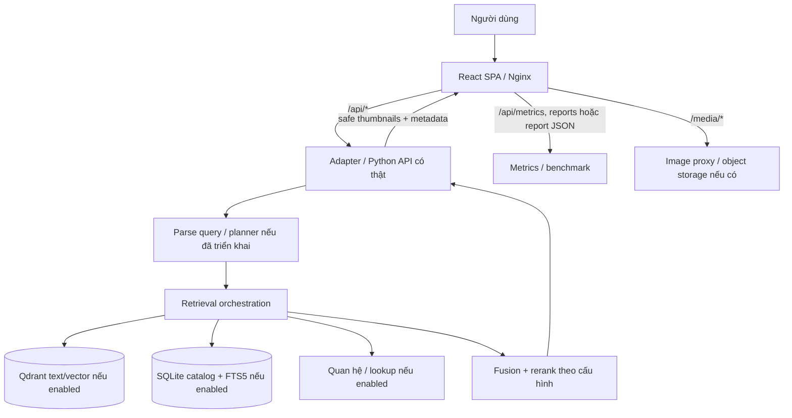

# SKILL — Image Processing & Retrieval UI · Capstone v2

> **Purpose:** skill chuẩn để v0/Lovable/Claude Code tạo **UI kết nối backend thật** cho Capstone xử lý và truy xuất ảnh. Dùng cùng `PROMPTS.md` trong thư mục này. File này là **đặc tả và tiêu chí nghiệm thu**, không phải bằng chứng hệ thống đã hoàn thành.

## 0. Mục tiêu, phạm vi và nguồn sự thật

### 0.1 Điều kiện bắt buộc của Capstone

1. **Phần A — Processing:** tự động sàng lọc/kiểm duyệt ảnh sau crawl, tối ưu chi phí, phân tích lộ trình mở rộng lên **10–100 triệu ảnh**. Báo cáo throughput, precision/recall theo loại lỗi, chi phí và giả định scale; không đồng nhất phép ngoại suy với kết quả thực nghiệm.
2. **Phần B — Retrieval:** ít nhất **80.000 ảnh đã index và retrieve được**; phục vụ `SINGLE`, `MULTI_INTENT`, `MULTI_HOP` với chỉ tiêu **latency < 3.000 ms/truy vấn**. Báo cáo phép đo rõ ràng, bao gồm tỷ lệ truy vấn đạt SLA chứ không chỉ p95.
3. **Deliverables:** web demo có tìm kiếm và kết quả ảnh; kiến trúc + pipeline + schema bằng Mermaid; benchmark + test case + phương pháp tạo test case; source + README; `Dockerfile`, `docker compose`; ưu tiên k6/Locust có thể chạy lại. Domain và CI/CD là bonus.
4. **Không biến ước lượng thành thành tích:** không bao giờ dùng số fixture, số mục tiêu hay số extrapolation để khẳng định đạt yêu cầu.

### 0.2 Inventory hệ thống — khảo sát repo trước khi code

Những thông tin được mô tả trong lịch sử dự án (mốc 20/10/2026) chỉ là **mốc tham chiếu, cần kiểm tra lại từ source, config, health endpoint và dữ liệu hiện tại**:

| Thành phần | Mốc tham chiếu | Quy tắc thực hiện |
|---|---|---|
| Catalog ảnh | 79.999 ảnh, 11.294 entities | Đọc COUNT thực tế; **79.999 chưa đạt 80.000** |
| Metadata | SQLite | Không tự chuyển sang PostgreSQL |
| Lexical retrieval | SQLite FTS5/BM25 (nếu có trong code) | Chỉ công bố bộ tìm kiếm được xác nhận |
| Vector store | Qdrant (cấu hình từng môi trường) | Đọc URL, collection, dimension, distance, số point và index version thực |
| Text embedding | Đã có lần dùng MiniLM 384 chiều; có kế hoạch/thử nghiệm model khác | Không tuyên bố model mới đã hoạt động nếu chưa kiểm tra runtime |
| Visual embedding | SigLIP2 `img_visual` được mô tả là chưa bật | Không hiển thị "đã tìm bằng pixel" nếu chưa có đường visual retrieval thực |
| Parsing / reranking | Có thử nghiệm Gemini và Jina | Chỉ công bố model, version, cache, ruleset đang thực sự chạy |
| Multi-hop | Có mục tiêu entity→relation→images, chưa chứng minh graph đầy đủ | Có `unsupported`/`unverified` thay vì tạo quan hệ giả |
| API search | `/v1/search` đã được đề xuất/thảo luận | **Xác minh route/method/schema từ repo trước khi tích hợp**, không ép backend theo đường dẫn đoán |

**Bước 0 cho AI coding agent:** xem route definitions, OpenAPI (nếu có), Docker, collection, schema CSV/SQLite, script indexing, benchmark. Tạo `docs/backend-inventory.md` gồm đường dẫn file, phiên bản model thực, endpoint có thật, capability bật/tắt, bằng chứng lệnh/HTTP. Nếu thiếu khả năng, đánh dấu `NOT_IMPLEMENTED` và dựng UI fallback trung thực.

### 0.3 Modes và quy tắc nguồn dữ liệu

- `DATA_MODE=live` (production/demo chấm điểm): dữ liệu từ backend hoặc báo cáo thật, mặc định khi deploy chấm điểm; lỗi API **phải là lỗi**, không âm thầm thay bằng mock.
- `DATA_MODE=mock` (Storybook/dev/preview UI): typed fixture được dán nhãn dễ thấy **“DỮ LIỆU MINH HỌA — KHÔNG PHẢI KẾT QUẢ ĐO”**; không được hiển thị `PASS` nghiệm thu.
- `DATA_MODE=report` (benchmark import): số liệu từ JSON/CSV có metadata + timestamp + provenance; nếu chưa có file, hiện `Chưa có dữ liệu đo`.
- `TARGET`/`ESTIMATE`/`ACTUAL` phải phân biệt bằng nhãn và field type rõ ràng trên mọi KPI, chart, export.
- UI không được khẳng định đã có index 80k, GPU T4, HNSW ef=200, 96 RPS hay p95<3s nếu backend/báo cáo không chứng minh.

## 1. Công nghệ và nguyên tắc triển khai

- Frontend: **Vite + React 18 + TypeScript**, Tailwind CSS, shadcn/ui, `react-router-dom`, **TanStack Query** (requests/cache/error), **TanStack Virtual** (grid), Recharts (charts), `react-markdown` + Mermaid (docs). Sử dụng React Router URL params cho trạng thái chia sẻ; `zod` hoặc tương đương để runtime-validate HTTP payload.
- API: **adapter layer** `src/api/*` nhận dữ liệu từ API Python hiện hữu, không gắn cứng JSX vào field của backend; backend có thể ở container `api`, frontend được phục vụ bằng Nginx.
- Web production: Nginx reverse proxy `/api/*` và `/media/*` tới backend/image proxy nếu có, tránh CORS và mixed content. Không hardcode `localhost` trong bundle triển khai public.
- Demo generation: dùng fixtures cho dựng layout, rồi **chuyển live thành đường chính**, mock là tùy chọn cho phát triển. Không ghi local overrides thành quyết định moderation thật.
- Ngôn ngữ UI: tiếng Việt UTF-8, `html[lang="vi"]`; prompt cho công cụ code có thể bằng tiếng Anh nhưng thông báo UI tiếng Việt.
- Target được đề xuất (không phải kết quả đo): initial JS main bundle <250 KB gzip, Lighthouse Performance ≥85/A11y ≥90, CLS<0.1, không làm mất chức năng để đạt target.
- Không thêm Go gateway, PostgreSQL, graph DB, CLIP hoặc model thứ hai chỉ để khớp hình vẽ; chỉ mô tả dịch vụ thực hoặc kế hoạch có gắn nhãn.

## 2. Design system giữ từ bản gốc

| Token | Giá trị | Ứng dụng |
|---|---|---|
| `--bg` | `#F8FAFC` | App background |
| `--surface` | `#FFFFFF` | Card, header |
| `--text` / `--muted` | `#0F172A` / `#64748B` | Nội dung |
| `--border` | `#E2E8F0` | Đường viền |
| `--brand-600` / hover / tint | `#4F46E5` / `#4338CA` / `#EEF2FF` | CTA, tab, focus |
| Query labels | Single `#2563EB` · multi-intent `#7C3AED` · multi-hop `#0E7490` | Chip loại query |
| Moderation | approved `#16A34A` · review `#F59E0B` · rejected `#DC2626` · nsfw `#DB2777` · quarantined `#64748B` | Nhãn trạng thái, không chỉ dựa vào màu |
| SLA | `<3000` tốt · `>=3000–5000` cảnh báo · `>5000` lỗi | **Chỉ màu số ACTUAL**, chưa đo hiện “—” |

- Font: Be Vietnam Pro (Vietnamese) / Inter; JetBrains Mono cho mã/lệnh/latency.
- Typography: 12 caption, 13 table, 14 body, 16 lead, 18 h3, 20 h2, 24 h1, 30 hero; body line-height ≥1.5, nhãn uppercase ≥1.4.
- Spacing base 4px, max container 1280px, card radius 8px, input 6px, chips full; motion 120/180/240ms, tôn trọng `prefers-reduced-motion`.
- Responsive QA tại 360 / 768 / 1280 / 1920px; toolbar có thể wrap; touch-accessible labels; logo, nav và GitHub link có URL thực hoặc disabled hợp lý.
- Badge là phép hiển thị trạng thái, không phải bằng chứng hệ thống đã đạt target.

## 3. Kiến trúc triển khai UI (logical — thích ứng backend)



- Các nút chứa `nếu enabled` **không phải xác nhận hạ tầng đang chạy**. Trang `/docs` phải có 2 sơ đồ: **As-Is** trích xuất từ repo, **To-Be** vạch kế hoạch (hình trên là blueprint, phải chỉnh lại khi triển khai).
- Web UI không gọi trực tiếp SQLite/Qdrant từ browser, không đưa API key embedding/LLM lên client.
- Trace chỉ hiển thị **các stage thực tế do backend ghi lại**; frontend không phát minh stage hay thời gian còn thiếu.

## 4. Hợp đồng dữ liệu frontend và tích hợp API

### 4.1 Types chuẩn hoá trong UI (adapter output, không khẳng định là backend schema)

```ts
export type QueryType = 'SINGLE' | 'MULTI_INTENT' | 'MULTI_HOP';
export type RunStatus = 'ok' | 'partial' | 'unsupported' | 'unverified' | 'error';
export type ModerationStatus = 'approved' | 'review' | 'rejected' | 'nsfw' | 'quarantined' | 'unknown';
export type DataProvenance = 'ACTUAL' | 'TARGET' | 'ESTIMATE' | 'FIXTURE';

export interface QueryConstraints {
  locations?: Array<{ entity_id?: string; label: string; scope: 'ALL_INTENTS' | 'INTENT' }>;
  time?: string;
  must_match_all_intents?: boolean;
  other?: Record<string, string | number | boolean>;
}
export interface ImageResult {
  image_id: string;
  entity_id?: string;
  entity_name?: string;
  thumbnail_url?: string; // safe, permitted image endpoint
  original_url?: string;  // only if policy permits
  width?: number;
  height?: number;
  score?: number;         // raw score: label metric/source when known
  score_kind?: 'cosine' | 'reranker' | 'hybrid' | 'other';
  source_name?: string;
  source_url?: string;
  caption?: string;
  intent_ids?: string[];
  producer_step_ids?: string[];
  moderation: { status: ModerationStatus; labels?: string[]; confidence?: number };
}
export interface IntentGroup {
  id: string;
  text: string;
  expansion?: string;
  estimated_count?: number; // unknown allowed
  images: ImageResult[];
  status: 'ok' | 'empty' | 'error';
}
export interface TraceStep {
  id: string;
  step: number;
  kind: 'entity_linking' | 'relation_lookup' | 'retrieval' | 'rerank' | 'other';
  status: 'ok' | 'unverified' | 'not_supported' | 'failed';
  input_summary: string;
  output_summary?: string;
  entity_id?: string;
  relation?: string;
  evidence?: Array<{ label: string; url?: string; source_id?: string }>;
  elapsed_ms?: number;
  image_ids?: string[];
}
export interface Timing {
  total_ms?: number; // backend measured server-side end-to-end processing
  parse_ms?: number;
  retrieve_ms?: number;
  rerank_ms?: number;
  relation_ms?: number;
  overhead_ms?: number;
  client_observed_ms?: number; // separately observed by browser
}
export interface SearchResponse {
  request_id: string;
  query: string;
  query_type: QueryType;
  query_type_source: 'backend' | 'user_override' | 'fixture';
  status: RunStatus;
  message?: string;
  dataset: { indexed_images?: number; index_version?: string; measured_at?: string };
  constraints?: QueryConstraints;
  intents?: IntentGroup[];
  trace?: TraceStep[];
  results: ImageResult[];
  total_results?: number;
  pagination?: { next_cursor?: string | null; has_more: boolean };
  timings: Timing;
  provenance: DataProvenance;
}
```

**Invariant:** không hiển thị số vô nghĩa; time breakdown chỉ tính bằng các stage có đo; nếu tổng lớn hơn tổng stage, đặt `other/unattributed` khi được xác định từ hệ thống, **không đoán** giá trị. `client_observed_ms` là kết quả đo frontend khác với server latency. `score` không tự chuẩn hoá [0,1] hay gọi là “xác suất đúng” nếu không có calibration.

### 4.2 API discovery & mapping

1. Trước khi code: xác nhận HTTP method, route, request body, pagination, CORS/auth, image URL, OpenAPI, envelope, error codes bằng code/test thật; ghi vào `docs/backend-inventory.md`.
2. Nếu endpoint đã có: tạo `src/api/backendClient.ts`, `src/api/searchAdapter.ts`, `src/api/metricsAdapter.ts`, `src/api/validators.ts`. Các endpoint trong bảng dưới đây là **mẫu đề xuất** và chỉ được tạo khi backend thiếu, sau khi thống nhất với code repo.

| Nhu cầu | Endpoint ví dụ | Không có endpoint thì |
|---|---|---|
| Search | `POST /api/v1/search` (Nginx proxy tới route thực, ví dụ `/v1/search`) | Dùng route thật thông qua adapter, không giả lập response live |
| Capabilities | `GET /api/v1/capabilities` | Render feature detection từ config server hoặc trạng thái "chưa xác minh" |
| Dataset/index statistics | `GET /api/v1/stats` | Hiển thị “Chưa xác minh số ảnh trong index” |
| Moderation metrics | `GET /api/v1/moderation/metrics` | Đọc `reports/processing/*.json` có provenance hoặc hiển thị empty state |
| Review queue / action | `GET/POST /api/v1/moderation/reviews` | Chỉ đọc; không bật nút cập nhật thật |
| Benchmark report | `GET /api/v1/reports/latest` | Đọc artifacts JSON đã tạo, không sinh số giả |
| Media | `GET /media/{id}` | Dùng thumbnail URL backend đã cho phép; fallback an toàn |
| Health | `GET /api/healthz` hoặc route đã xác nhận | Kiểm tra container health theo ứng dụng thật |

3. Queries: dùng TanStack Query với `queryKey` gồm query/type/constraints/sort/filter/cursor/index_version khi cần; cancel/ignore stale requests bằng AbortController; không gửi request cho mỗi ký tự chỉ vì local heuristic; debounce input hợp lý.
4. `type=auto` trên UI là **gợi ý chưa xác nhận**; backend phải trả `query_type` cuối cùng. Nếu user override, gửi rõ `forced_type` (nếu backend hỗ trợ) và hiển thị nhãn override.
5. Mutation moderation chỉ được hiển thị với authorized reviewer; idempotency/audit; cập nhật cache sau khi API thành công, optimistic rollback khi lỗi. Public frontend không thể tự biến `rejected` thành `approved`.
6. Không bao giờ fallback từ `live` sang `mock` khi API lỗi; dùng error state và hướng dẫn xem logs.

### 4.3 Query semantics

- `SINGLE`: một đối tượng / intent và các thuộc tính ràng buộc. Kết quả một grid; thể hiện entity/score/resolution và nguồn.
- `MULTI_INTENT`: tách **ý định độc lập** khỏi **constraint dùng chung**. Ví dụ “hồ bơi và công viên nước ở Phú Quốc” → intents `hồ bơi`, `công viên nước`; constraint `location = Phú Quốc` áp dụng cho **cả hai**. `và` có thể là: (a) cần **cả hai ý định trên từng ảnh** (`must_match_all_intents=true`) hoặc (b) kết quả theo **hai nhóm**; parser/backend phải công bố hoặc UI yêu cầu user chọn. Không tự coi “Phú Quốc” là intent thứ ba.
- `MULTI_HOP`: lấy entity (có thể đa nghĩa) → tra quan hệ **có provenance** → truy xuất ảnh entity đích → rerank. Nếu quan hệ không được chứng minh: `status=unverified`, không tạo tên, nguồn hoặc ảnh giả. Nếu chưa hỗ trợ: `unsupported` + fallback có nhãn.
- Hệ thống search ảnh này hiện có metadata; UI phải phân biệt "text/metadata retrieval" và "visual/pixel retrieval" theo `capabilities` thực.

## 5. Các trang và component

### 5.1 `/` — Search & Results

- Header: “Kho Ảnh Thông Minh” + Tìm kiếm / Kiểm duyệt / Benchmark / Tài liệu + Github (URL thật nếu có).
- Hero với thanh tìm kiếm (Enter submit) và ba query ví dụ lấy từ cấu hình/test cases; ví dụ multi-hop chỉ chạy nếu có quan hệ được xác minh. Nếu không, demo trạng thái “chưa xác minh quan hệ” một cách minh bạch.
- Toolbar: `QueryTypeBadge` (source backend/override), tổng kết quả server cung cấp, `LatencyBadge` actual vs SLA (hoặc “Chưa có số đo”), sort/filter server-backed hay client-current-page được dán nhãn, copy link.
- SINGLE: image grid + infinite pagination. MULTI_INTENT: nhóm theo intent + constraint chung + tab “Theo ý định”/“Gộp tất cả”/“Cần đủ mọi ý định” **chỉ khi backend hỗ trợ**. MULTI_HOP: trace status-aware và evidence references; trang mobile mở rộng trace.
- URL query state: `?q=...&type=auto&view=grouped&loc=...`; thay đổi chip/filter giữ query nguyên, không ghi lại câu gốc trừ khi người dùng thật sự chỉnh text.
- Empty/loading/error/partial/timeout/rate-limit; retry không được âm thầm đổi `live` thành `mock`.

### 5.2 `/moderation` — Processing Dashboard

- 4 KPI: ảnh xử lý trong kỳ (đơn vị & thời gian), throughput (ảnh/s và hardware), chi phí USD/1k ảnh (có công thức và scope), precision/recall từ dữ liệu gán nhãn (có cỡ mẫu).
- Stage volumes: `ingest -> dedupe -> quality -> safety -> index`, **nhánh review/LLM** nhận riêng số ảnh flagged/sampled và kết quả trả về; đừng vẽ LLM như một bước bắt buộc của mọi ảnh.
- Lọc các nhóm: blur, độ phân giải, hỏng file, trùng/near-duplicate, watermark, NSFW, nội dung bị cấm theo chính sách thực tế. Một ảnh có thể mang **nhiều lỗi**: không cộng các lý do reject như các nhóm loại trừ nhau.
- Charts: throughput theo giờ, cost theo stage, precision/recall theo thời gian (kèm số mẫu/CI nếu có), queue backlog. Phân biệt `ACTUAL`, `TARGET`, `ESTIMATE`.
- Review table hiển thị ảnh mà **quyền reviewer cho phép**; record có audit metadata, lý do, model version và threshold; action bị disable khi thiếu write endpoint/permission.
- Phải có **measurement protocol** cho Phase A: thời gian đo, batch, concurrency, CPU/GPU, I/O, breakdown latency/stage, duplicates, warm-up, error/retry, nguồn giá cloud/token/điện nếu ước tính, assumptions khi nhân lên 10M/100M. `10M / measured_throughput` chỉ là ngoại suy lý thuyết, không đo được bottleneck hệ phân tán.

### 5.3 `/benchmark` — Performance & Quality Evidence

- Không hardcode số benchmark PASS. Dùng dữ liệu từ script chạy thật: `reports/benchmarks/<run_id>/summary.json` + raw samples / request traces + config + git commit + hardware + model/index versions.
- Trình bày **ba nhóm query riêng**: n, quality metrics (`Recall@K`, `Hit@K`, `MRR`, `nDCG@K`, entity/group correctness, relation evidence), latency p50/p95/p99/max, % requests dưới **3.000 ms**, timeout/error, RPS achieved và concurrency.
- SLA `<3.000ms / request`: **p95 đạt không đồng nghĩa 100% đạt**. Trên bảng hiện riêng `breach_count`, `breach_rate`, `pass_rate` và tiêu chí PASS theo hợp đồng bài tập. Nếu chưa đủ mẫu hoặc chưa có bằng chứng, status = `NOT_MEASURED`.
- Benchmark đo cả **warm vs cold** nếu có cache, `server_total_ms` và `client_observed_ms` riêng, tải `concurrency` khác nhau; tuyệt đối không so hai reranker với các điều kiện khác nhau.
- `total_count >= 80_000` kiểm tra qua index thật (không dựa tên CSV), số image IDs có thể query/serve, không tính ảnh bị xoá/quarantine nếu không truy xuất được.
- Nút download chỉ cung cấp **JSON thật đã import/generate**, kèm ngày đo và hash; không trình bày fixture export là báo cáo chính thức.
- Load test có script k6/Locust + seed, query suite, environment, thresholds, warmup, duration, repetitions; có lệnh chạy lại trên README.

### 5.4 `/docs` — Architecture & Method

- Tabs “Kiến trúc hiện tại (As-Is)” / “Dự kiến (To-Be)” / “Phần A” / “3 loại truy vấn” / “Schema” / “Phương pháp kiểm thử”.
- Bắt buộc ít nhất 4 Mermaid diagram: As-Is topology, processing branches, 3 query sequence diagrams, DB/schema. **Sơ đồ phải được kiểm tra khớp source/config**, không tự vẽ Go/Postgres/graph khi chưa tồn tại.
- `MULTI_INTENT`: shows intents + location constraints and fusion/AND semantics; `MULTI_HOP`: `unsupported/unverified` branch.
- Thuật toán, trade-off, quality/cost scaling, limitations; giải thích chính xác metadata-based retrieval vs pixel-based retrieval; có link tới version tài liệu/báo cáo trong repo.
- Mermaid được lazy-load, fallback source text khi parse thất bại, bố cục không ép 1 màn nếu phải hy sinh thông tin quan trọng.

### 5.5 Components inventory (giữ và bổ sung)

| Component | Hành vi quan trọng |
|---|---|
| `SearchBar`, `QueryTypeBadge` | Submit, type=auto, source backend/override, examples from test cases |
| `IntentChip`, `ConstraintChip`, `IntentModeSwitch` | Ý định vs điều kiện chung; remove/edit bằng API query mới; không giả lọc toàn bộ 80k trên client |
| `HopTrace`, `EvidenceLink`, `CapabilityNotice` | Step status, entity ID, evidence, unsupported/unverified; chỉ hiển thị dữ liệu thật |
| `ImageGrid`, `ImageCard`, `Lightbox` | Lazy thumbs, navigation, safe media, metadata thật, moderation-aware |
| `ModerationOverlay`, `PolicyPlaceholder` | Hard-block không tải image bytes; review không thể bỏ qua auth |
| `LatencyBadge`, `StageTimingPopover` | Actual measured stage breakdown; missing => '—'; client/server separate |
| `DataSourceBadge`, `EvidenceFootnote` | ACTUAL/TARGET/ESTIMATE/FIXTURE + run ID/method/sample |
| `PipelineFlow`, `StatCard`, `MetricsChart` | Stage counts + branch + n samples + scope/cost units |
| `BenchTable`, `RunSelector`, `SlaViolationBadge` | p50/p95/p99/max + violation rate + not measured |
| `MermaidDoc`, `DownloadReport` | Grounded diagrams, source fallback, export real JSON |
| `SkeletonGrid`, `EmptyState`, `ErrorState` | Loading/empty/partial/error/timeout/429/unsupported states |

## 6. Safety, privacy, authorization

- **Public `/` only serves approved content** (default and enforced at API); never send rejected/nsfw original URLs or bytes to a public browser. A blurred CSS overlay is **not** a security boundary.
- Admin `/moderation` only for authorized reviewers; image reveal and mutation require server-side authorization and audit trail; no local-only approval that implies backend updated.
- Sanitize URL, captions and HTML; no `dangerouslySetInnerHTML` for metadata; `react-markdown` disallow raw HTML unless sanitized. External link `rel="noopener noreferrer"`.
- Image proxy must validate sources/allowlist, set size limits/timeouts, avoid SSRF and arbitrary local-file reads. Avoid exposing signed URLs or credentials.
- Do not mislabel sensitive imagery from an arbitrary confidence number; moderation thresholds must come from running model/config, not demo defaults.
- Limit/validate query length, set network timeouts and cancellation, handle rate limiting (429) and retry with backoff.

## 7. Metric definitions, evidence and acceptance gates

### 7.1 Retrieval

- `latency_server_ms = t(response_ready) − t(request_received)` theo backend; tách external model calls, retrieval/fusion/rerank; `client_observed_ms` gồm mạng/serialization/render wait (không trộn vào server latency).
- `SLA_breach = (client_or_server_metric_chosen >= 3000ms)`; **định nghĩa trước** phép đo nghiệm thu (khuyến nghị thêm E2E client). Với đề bài nói `<3s`, mốc 3.000 chính xác được coi là vi phạm.
- `throughput RPS = số request hoàn thành / khoảng thời gian đo` (ghi rõ requests success vs total và error rate), `max` trên từng query type, cảnh báo slow requests.
- `Recall@K = relevant_items_in_topK / all_relevant_items` theo gold labels; `Hit@K = 1 nếu ít nhất một relevant item trong topK`; `MRR = mean reciprocal first relevant rank`; `nDCG@K` dùng graded relevance nếu đã gán nhãn. Khi gold không đầy đủ, ghi là pooled/estimated recall, không tự xưng recall chuẩn.
- Entity correctness, multi-intent group coverage, multi-hop evidence correctness là **metrics riêng**; không sử dụng search success rate thay cho accuracy.
- Test suite ít nhất có các trường: `case_id`, `query_type`, `query`, `expected_entity_ids`, `intent_labels`, `constraints`, `relation_evidence`, `relevance_labels`, `source`, `labeler`, `review_status`; tách train/tune và held-out evaluate; có negative/adversarial/ambiguous cases.

### 7.2 Processing

- `throughput_images_s = successful_processed_images / measured_wall_clock_s`; báo cáo ingest/fail/skip, đồng thời stage throughput và pipeline sustained throughput.
- Safety evaluation coi nội dung không an toàn là positive hoặc định nghĩa rõ positive class; báo cáo confusion matrix, precision, recall, FPR/FNR, hard-block false positives, per-class và CI khi có.
- Quality filters (resolution, watermark, blur, duplicates) đánh giá trên mẫu nhãn riêng; không đánh đồng `approval_rate` với precision.
- Cost/1k = `(compute amortized + storage + I/O + external API + retry + labeling nếu scope bao gồm) / successful processed images * 1000` cùng kỳ đo, currency/exchange timestamp và giả định.
- Ước lượng 10M/100M bằng mô hình bottleneck và đơn giá; ghi `ESTIMATE`, assumptions, throughput sustained vs peak, storage/network and operational overhead.

### 7.3 Acceptance gate và minh chứng

| Gate | Điều kiện kiểm tra | Bằng chứng cần có |
|---|---|---|
| DATA | `indexed_retrievable_images >= 80_000` | Backend count + index count + sample retrieve IDs, time/version |
| SEARCH | 3 query types có xử lý thật hoặc trạng thái giới hạn trung thực | API traces, cases, error/fallback outcomes |
| SLA | Tất cả loại query có báo cáo `<3000ms` và vi phạm rõ ràng | Raw per-request samples + p50/p95/p99/max + breach rate |
| QUALITY | Ground truth và metric theo intent/hop | Labeled suite, scoring script, report run ID |
| PROCESSING | Throughput/accuracy/cost đo thật và scale estimate | Logs, confusion matrix, timing, configs, cost formulas |
| DEPLOY | `docker compose up --build -d` và healthcheck, search hoạt động | Commands/logs, test report, image size/build time |
| DOCS | Mermaid khớp As-Is; README tái lập đo | Diagrams, commands and assumptions |
| UI | Responsive/a11y/no leaking rejected data | Playwright + Lighthouse + policy test |

**Chính sách PASS:** nếu backend hiện chưa hỗ trợ `MULTI_HOP` hoặc index có <80k ảnh, UI **không tự tuyên bố PASS**; trạng thái demo cho phép trình bày tiến độ nhưng báo cáo phải phản ánh thiếu sót.

## 8. Testing, Docker, reporting

### 8.1 Suggested repo layout (adapt to existing structure)

```text
web/
  src/
    api/{backendClient,searchAdapter,metricsAdapter,validators}.ts
    components/{search,grid,trace,moderation,benchmark,shared}/
    pages/{Search,Moderation,Benchmark,Docs}.tsx
    mocks/   # only in mock mode, visibly labeled
    tests/
  Dockerfile
  nginx.conf
api/           # EXISTING python backend — reuse rather than overwrite
loadtest/retrieve.js
benchmarks/{queries.jsonl,score.py,run.sh}
reports/{benchmarks,processing}/
docs/{backend-inventory,architecture,measurement-protocol}.md
compose.yaml
README.md
```

- Frontend Docker multi-stage: lockfile install, Vite build, Nginx static/runtime proxy; `GET /healthz` (frontend) returns 200; image goal small, **record actual size** rather than promise a fixed number.
- Compose `web + api + qdrant + volumes`, plus optional image service if code truly depends on it; network env and health checks; avoid requiring API/model keys for **documented local demo mode** unless essential. No embedding/re-index on web container startup.
- CPU/GPU resources and API keys are `.env.example`; secrets not committed; README states backend startup/warmup and external service dependencies clearly.
- k6 `loadtest/retrieve.js` reads real `benchmarks/queries.jsonl` (or generated manifest), reports `query_type` tags, p50/p95/p99, throughput, rate-limits, errors, policy violations, and raw per-request output via configured output. A test run must include actual results and reproducible command.
- CI: TypeScript check, lint, unit tests for adapters/decomposition, Playwright smoke on 4 routes, Docker build, backend tests, benchmark schema-validation; **do not fake CI/CD if GitHub not connected**.
- Bonus: public domain + HTTPS + health/ready endpoint; display public status only when verified.

## 9. Accessibility, Vietnamese, performance

- WCAG 2.1 AA target: contrast text ≥4.5:1 (exceptions per WCAG), visible focus, skip-link, semantic roles, keyboard (Tab/Arrow/Enter/Esc), lightbox focus trap and return, zoom with accessible buttons, meaningful alt captions.
- Test Vietnamese: `Phạm Nhật Vượng`, `Phú Quốc`, `truy xuất nhiều bước`, `Ẹ Ệ Ị Ụ Đ`, combinations with long entity names; format numbers by `Intl.NumberFormat('vi-VN')`.
- Thumbnail explicit dimensions, `loading="lazy"`, WebP/AVIF **when available**; virtualization should support variable heights or use predictable aspect-ratio rows (avoid broken CSS masonry virtualization); provide pagination fallback without virtualization errors.
- SPA assets code-split, Mermaid/Recharts lazy loaded; measure JS bundle, Lighthouse score and startup time; do not claim target met without measurement.
- Error UX for network failure/404/429/timeout/offline/image broken/loading; preserve query and accessibility.

## 10. Workflow with PROMPTS.md

1. **P0**: scaffold UI + API contract, capabilities, live/mock distinction.
2. **P1–P4**: Search/single, multi-intent, multi-hop, grid/lightbox/moderation safety.
3. **P5–P7**: Processing dashboard, benchmark report, grounded architecture/docs.
4. **P8**: Docker/a11y/security/performance hardening.
5. **P9**: inspect existing backend, wire live adapters, test end-to-end, produce honest evidence and final handoff.

**Builder handoff rule:** mỗi prompt phải trả về file paths thay đổi, test/command đã chạy, kết quả PASS/FAIL, các capability thiếu, và mọi giả định chưa xác minh. Không ghi “done” khi chưa chạy test hoặc khi thiếu backend.

## 11. Final acceptance checklist

- [ ] UI tiếng Việt, responsive 360/768/1280/1920, 4 routes và states đầy đủ.
- [ ] `DATA_MODE=live` không fallback về fixtures; nguồn mock được dán nhãn lớn.
- [ ] API adapter đúng schema backend; query và image IDs đến từ index thật.
- [ ] Count >=80.000 **ảnh đã index và có thể retrieve**; hoặc báo thiếu minh bạch.
- [ ] Multi-intent tách intents và constraints; xử lý AND/grouping thật.
- [ ] Multi-hop có evidence và unsupported/unverified; không tự tạo quan hệ.
- [ ] Không render ảnh rejected/nsfw cho public, không bypass chỉ bằng CSS.
- [ ] Benchmark có run ID, hardware, git SHA, model/index versions, raw samples, p50/p95/p99/max, SLA breach rate, RPS; không có PASS giả.
- [ ] Phase A có throughput, cost/1k, nhãn confusion matrix, n mẫu, 10M/100M estimate và assumptions.
- [ ] Mermaid As-Is khớp code; To-Be có nhãn proposed; docs đầy đủ limitations.
- [ ] Docker Compose chạy end-to-end, healthchecks, README, load test chạy lại được.
- [ ] Unit/Playwright/policy tests và Lighthouse được chạy, kết quả lưu cùng report.
