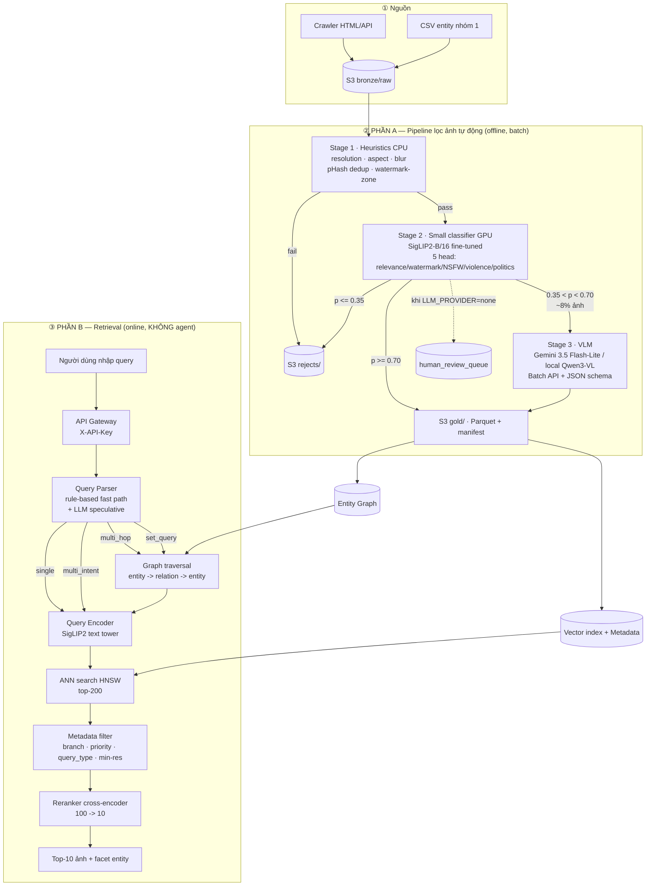
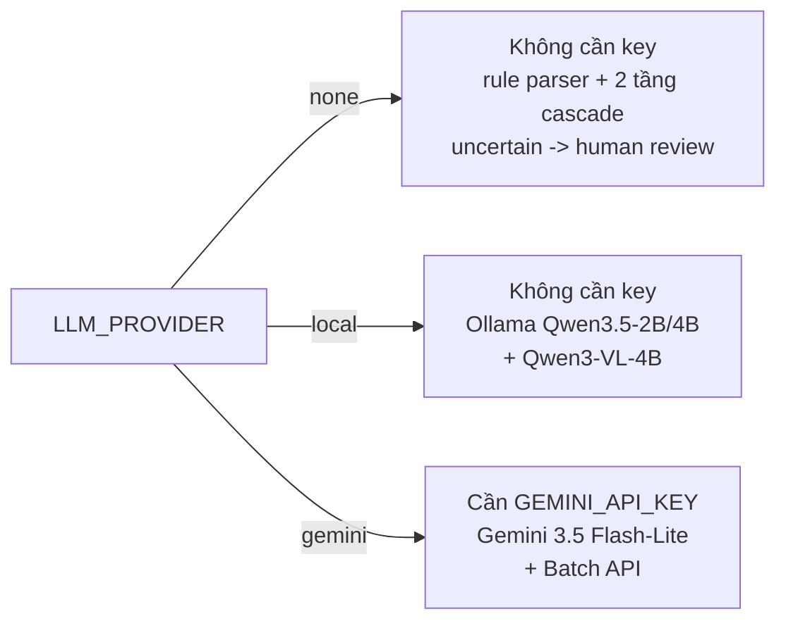

# Kiến trúc tổng thể

## 1. Sơ đồ

## 2. Nguyên tắc bất di bất dịch

Nhánh retrieval chỉ có `encode → ANN → filter → rerank`. **Không tool-calling, không vòng lặp suy luận,
không agent chọn ảnh.** LLM chỉ xuất hiện ở *trước* index (query parsing) — và ở đó nó chạy
**speculative**, không đồng bộ trên critical path (xem `docs/retrieval.md`).

## 3. Ánh xạ thành phần → thư mục

| Thành phần | Thư mục |
|---|---|
| Pipeline lọc ảnh (Phần A) | `pipeline/` |
| Retrieval (Phần B) | `retrieval/` |
| API gateway + middleware | `api/` |
| S3 bronze/silver/gold | `storage/` |
| Schema + migration | `db/` |
| Ngân sách latency + cascade config | `config/` |
| Đo chất lượng | `evals/` |
| Load test | `loadtest/` |
| Web demo | `web/` |
| CI/CD | `.github/workflows/` |
| Sơ đồ rời | `docs/diagrams/` |

## 4. Ba mode LLM

Key của bên thứ ba là **tuỳ chọn**; `X-API-Key` là key nội bộ cho auto test, luôn có.
