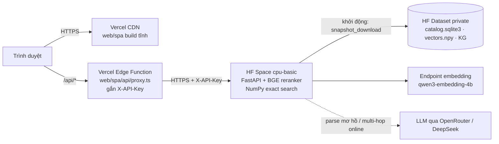
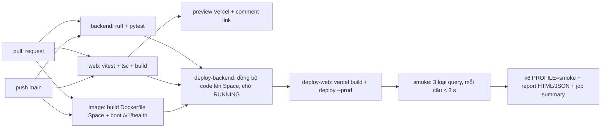

# Triển khai: Vercel + Hugging Face Spaces + GitHub Actions

## Kiến trúc



| Thành phần | Nơi chạy | Lý do |
|---|---|---|
| SPA `web/spa` | Vercel (static + CDN) | Build Vite thuần tĩnh, có preview cho từng PR |
| Proxy `/api/*` | Vercel Edge Function | Giữ `X-API-Key` phía server; chỉ cho qua `/v1/*` và `/thumbs/*` |
| FastAPI | HF Space Docker, 2 vCPU / 16 GB | Cần ~1,3 GB vector + 2,3 GB BGE trong RAM và SQLite ghi được; Vercel Functions không đáp ứng (giới hạn bundle, không có đĩa bền, cold start nạp lại model) |
| Index | HF Dataset private | 1,7 GB, không đưa vào git; Space tải về khi khởi động |

Vector search dùng backend NumPy (`VECTOR_BACKEND=numpy`, cosine chính xác trên 130.428 × 2.560) nên không cần Qdrant khi deploy.

## CI/CD (`.github/workflows/ci.yml`)



- Space chỉ build lại khi code backend đổi; `upload_folder` bỏ qua commit rỗng.
- Load test đầy đủ: *Actions → ci → Run workflow → loadtest_profile = full*. Kịch bản `full` vượt quota 100 request/phút của endpoint embedding; chỉ chạy khi chấp nhận tiêu quota.
- Report k6 nằm trong artifact `perf-report` và trong phần summary của lần chạy.

## Thiết lập lần đầu

Yêu cầu: tài khoản Vercel, tài khoản Hugging Face, `gh` đã đăng nhập. Thêm vào `.env` (đã gitignore):

```
VERCEL_TOKEN=...      # vercel.com/account/tokens
HF_TOKEN=...          # huggingface.co/settings/tokens, quyền Write
HF_READ_TOKEN=...     # tùy chọn, quyền Read: Space dùng token này để tải dataset
```

```bash
# 1. Index -> dataset private (tắt API local trước để SQLite nhất quán)
python -m deploy.hf_deploy upload-data
# 2. Tạo Space + đẩy code + secrets (sinh PROD_API_KEY vào .env)
python -m deploy.hf_deploy push-space
python -m deploy.hf_deploy set-secrets
python -m deploy.hf_deploy wait
# 3. Vercel: link project, đặt env cho proxy
cd web/spa
npx vercel@63.1.2 link --yes --project heritage-image-retrieval --token "$VERCEL_TOKEN"
printf '%s' "$(python -m deploy.hf_deploy url)" | npx vercel@63.1.2 env add BACKEND_URL production --token "$VERCEL_TOKEN"
printf '%s' "$PROD_API_KEY" | npx vercel@63.1.2 env add TEST_API_KEY production --token "$VERCEL_TOKEN"
# (lặp lại hai lệnh env add với "preview" cho preview của PR)
# 4. GitHub secrets / variables
gh secret set HF_TOKEN; gh secret set VERCEL_TOKEN
gh secret set VERCEL_ORG_ID --body "$(jq -r .orgId .vercel/project.json)"
gh secret set VERCEL_PROJECT_ID --body "$(jq -r .projectId .vercel/project.json)"
gh variable set HF_SPACE --body "<user>/heritage-api"
gh variable set APP_URL --body "https://<project>.vercel.app"
```

Sau bước này, mỗi lần push `main` sẽ chạy toàn bộ pipeline ở trên.

## Đổi dữ liệu / secret

- Index mới: chạy lại `upload-data`, rồi *Restart Space* (Settings của Space) để tải bản mới.
- Đổi khóa API trong `.env`: chạy lại `set-secrets` (Space tự khởi động lại).

## Hạn chế đã biết

- Space miễn phí **ngủ sau 48 giờ** không có truy cập; request đầu tiên sau đó chờ build/khởi động (vài phút). Proxy trả 502 trong lúc này.
- CPU 2 nhân: BGE rerank chạy CPU. Smoke test chặn deploy nếu một truy vấn vượt 3 s; nếu vượt, giảm `RERANK_TOP_K` hoặc đặt `RERANK_BACKEND=api` qua `set-secrets`.
- Proxy Vercel là public: ai mở web demo cũng gọi được `/api/v1/*` (đúng mục đích demo). Key chỉ chặn gọi thẳng vào Space; chưa có rate limit theo người dùng.
- Trang Moderation cần `data/verify` (2,6 GB ảnh pilot), không được đưa lên; trang Search và Benchmark hoạt động đầy đủ.
