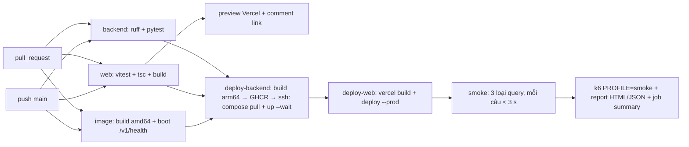

# Triển khai: Vercel + VM Oracle Always Free + GitHub Actions

## Kiến trúc


| Thành phần | Nơi chạy | Lý do |
|---|---|---|
| SPA `web/spa` | Vercel (static + CDN) | Build Vite tĩnh; preview riêng cho từng PR |
| Proxy `/api/*` | Vercel Edge Function | Giữ `X-API-Key` phía server; chỉ cho qua `/v1/*` và `/thumbs/*` |
| FastAPI | VM Oracle Always Free (ARM), `deploy/oracle/compose.yml` | Cần ~1,3 GB vector trong page cache và SQLite ghi được; Vercel Functions không đáp ứng (giới hạn bundle, không có đĩa bền, cold start). HF Docker Space cần gói PRO |
| Index | HF Dataset private | 1,6 GB, không đưa vào git; VM tải một lần vào volume `./data` |

- Vector search dùng NumPy (`VECTOR_BACKEND=numpy`, cosine chính xác trên 130.428 × 2.560), nên không cần Qdrant.
- Rerank chạy qua endpoint (`RERANK_BACKEND=api`), không dùng BGE local. Lý do và số đo ở mục dưới.

### Vì sao không dùng BGE local trên server

Đo bằng chính image production, container giới hạn `--cpus 2`, dữ liệu thật (21/10/2026):

| Rerank | Thời gian bước rerank | Tổng / truy vấn |
|---|---|---|
| `local_ce` BGE-v2-m3 trên CPU | **26.159 ms** | ~27 s |
| `embedding` (cosine qua endpoint) | 876–4.758 ms | 1,5–5,8 s |
| `api` jina-reranker-v2 | **146–418 ms** | 0,7–2,8 s |

Kết quả với `api`, 12 truy vấn chưa có trong cache, sau khởi động lạnh:

| Loại | Median | Max |
|---|---|---|
| single | 878 ms | 1.923 ms (truy vấn đầu tiên) |
| multi-intent | 1.702 ms | 2.798 ms |
| multi-hop | 664 ms | 743 ms |

Hai chỉnh sửa đã cần để giữ dưới 3 s:
- **Preload đọc trước `vectors.npy`:** truy vấn đầu tiên không còn mất ~3 s đọc đĩa.
- **`HOP_ONLINE_BUDGET_MS=1800`:** 600 ms chờ LLM + 1,8 s tra cứu online. Hết ngân sách thì trả `pending_online_lookup`.

Bỏ torch khỏi image production làm image giảm từ 5,69 GB xuống **~400 MB** và build còn ~30 s.

## CI/CD (`.github/workflows/ci.yml`)



- **Load test đầy đủ:** vào *Actions → ci → Run workflow*, chọn `loadtest_profile = full`. Kịch bản `full` vượt quota 100 request/phút của endpoint embedding, nên chỉ chạy khi chấp nhận tiêu quota.
- **Report k6:** nằm trong artifact `perf-report` và trong phần summary của lần chạy.

## Thiết lập lần đầu

### 1. Tạo VM Oracle

1. Đăng ký tại cloud.oracle.com và chọn home region có Ampere, ví dụ Singapore hoặc Tokyo.
2. Vào *Compute → Instances → Create instance*, chọn:
   - Image: **Canonical Ubuntu 24.04 (aarch64)**.
   - Shape: **VM.Standard.A1.Flex, 4 OCPU / 24 GB**. Nếu báo hết chỗ thì giảm còn 2/12.
   - Bật *Assign public IPv4*.
   - *Add SSH keys → Generate*, rồi tải private key về.
3. Mở cổng: vào *Networking → VCN → Subnet → Security List → Add Ingress Rules*, thêm nguồn `0.0.0.0/0`, TCP, cổng `80,443`.

### 2. Chuẩn bị server (từ máy local)

```bash
IP=<public-ip>; KEY=~/.ssh/oracle.key
ssh -i $KEY ubuntu@$IP 'sh -s' < deploy/oracle/bootstrap.sh       # Docker + iptables 80/443
python -m deploy.hf_data upload                                     # index -> HF dataset (một lần)
python -m deploy.env --out server.env --domain "${IP//./-}.sslip.io" # .env server, sinh PROD_API_KEY
scp -i $KEY server.env ubuntu@$IP:heritage/.env && rm server.env
```

### 3. Cấu hình Vercel và GitHub

```bash
cd web/spa
npx vercel@63.1.2 link --yes --project heritage-image-retrieval
printf 'https://%s' "${IP//./-}.sslip.io" | npx vercel@63.1.2 env add BACKEND_URL production
printf '%s' "$PROD_API_KEY" | npx vercel@63.1.2 env add TEST_API_KEY production
# lặp lại hai lệnh env add với "preview"
gh secret set VERCEL_TOKEN; gh secret set ORACLE_SSH_KEY < $KEY
gh secret set ORACLE_HOST --body "$IP"; gh secret set ORACLE_USER --body ubuntu
gh secret set VERCEL_ORG_ID --body "$(jq -r .orgId .vercel/project.json)"
gh secret set VERCEL_PROJECT_ID --body "$(jq -r .projectId .vercel/project.json)"
gh variable set API_DOMAIN --body "${IP//./-}.sslip.io"
gh variable set APP_URL --body "https://heritage-image-retrieval.vercel.app"
```

Push `main` lần đầu sẽ build image, deploy lên VM (VM tải 1,6 GB index trong lần đầu), rồi deploy Vercel và chạy smoke test.

## Vận hành

- **Index mới:**
  1. Chạy `python -m deploy.hf_data upload`.
  2. Trên VM chạy `docker compose restart api`. Lệnh `pull` chỉ tải các file đã đổi.
- **Đổi khóa API:** sinh lại `server.env` bằng `deploy.env`, `scp` lên VM, rồi chạy `docker compose up -d api`.
- **Log:** `ssh ubuntu@$IP 'cd heritage && docker compose logs -f --tail 100 api'`.

## Hạn chế đã biết

- **Một worker uvicorn:** limiter của endpoint embedding tính theo từng process. Throughput bị chặn bởi quota 100 request/phút của endpoint, không phải bởi CPU của VM.
- **Proxy Vercel là public:** ai mở web demo cũng gọi được `/api/v1/*`, đúng mục đích demo. Key chỉ chặn gọi thẳng vào VM; chưa có rate limit theo người dùng.
- **TLS qua sslip.io:** dùng chung giới hạn cấp chứng chỉ Let's Encrypt (Caddy tự chuyển sang ZeroSSL khi bị giới hạn). Có domain riêng thì chỉ cần đổi `API_DOMAIN`.
- **Trang Moderation** cần `data/verify` (2,6 GB ảnh pilot), phần này không được đưa lên. Trang Search và Benchmark hoạt động đầy đủ.
- **Truy vấn mẫu của đề** `ảnh con trai chủ tịch Phạm Nhật Vượng` trả `seed_not_linked`, vì KG chưa có người này.
