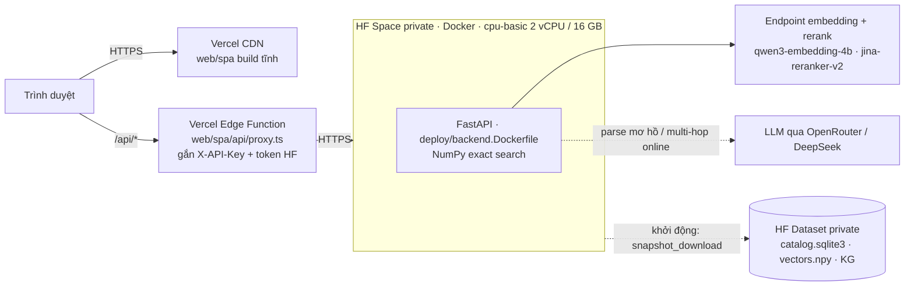
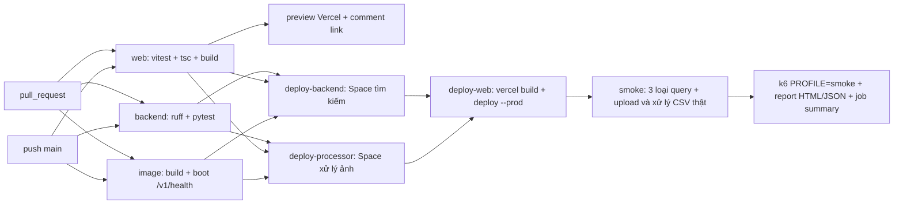

# Triển khai: Vercel + Hugging Face Space (PRO) + GitHub Actions

## Kiến trúc



| Thành phần | Nơi chạy | Lý do |
|---|---|---|
| SPA `web/spa` | Vercel (static + CDN) | Build Vite tĩnh; preview riêng cho từng PR |
| Proxy `/api/*` | Vercel Edge Function | Giữ `X-API-Key` và token HF phía server; chỉ cho qua `/v1/*` và `/thumbs/*` |
| FastAPI | HF Space Docker **private** (cần PRO) | Cần ~1,3 GB vector trong RAM và SQLite ghi được; Vercel Functions không đáp ứng (giới hạn bundle, không có đĩa bền, cold start nạp lại dữ liệu) |
| Index | HF Dataset private `vuongej/heritage-data` | 1,6 GB, không đưa vào git; Space tải về mỗi lần khởi động |

- Vector search dùng NumPy (`VECTOR_BACKEND=numpy`, cosine chính xác trên 130.428 × 2.560), nên không cần Qdrant.
- Rerank chạy qua endpoint (`RERANK_BACKEND=api`), không dùng BGE local. Lý do và số đo ở mục dưới.
- Space để private nên code backend không công khai. Proxy gửi `Authorization: Bearer <token đọc>` để HF cho request đi qua, và `X-API-Key` để FastAPI chấp nhận.

### Vì sao không dùng BGE local trên server

Đo bằng chính image production, container giới hạn `--cpus 2` (bằng CPU của Space cpu-basic), dữ liệu thật (21/10/2026):

| Rerank | Thời gian bước rerank | Tổng / truy vấn |
|---|---|---|
| `local_ce` BGE-v2-m3 trên CPU | **26.159 ms** | ~27 s |
| `embedding` (cosine qua endpoint) | 876–4.758 ms | 1,5–5,8 s |
| `api` jina-reranker-v2 | **146–418 ms** | 0,7–2,8 s |

Kết quả với `api`, 12 truy vấn chưa có trong cache, sau khởi động lạnh:

| Loại | Median | Max |
|---|---|---|
| single | 878 ms | 1.923 ms (truy vấn đầu tiên) |
| multi-intent | 1.702 ms | 2.798 ms |
| multi-hop | 664 ms | 743 ms |

Hai chỉnh sửa đã cần để giữ dưới 3 s:
- **Preload đọc trước `vectors.npy`:** truy vấn đầu tiên không còn mất ~3 s đọc đĩa.
- **`HOP_ONLINE_BUDGET_MS=1800`:** 600 ms chờ LLM + 1,8 s tra cứu online. Hết ngân sách thì trả `pending_online_lookup`.

Bỏ torch khỏi image production làm image giảm từ 5,69 GB xuống **~400 MB** và build còn ~30 s.

## CI/CD (`.github/workflows/ci.yml`)



- `deploy-backend` chỉ đẩy các file git track mà Dockerfile cần (`deploy/hf_space.py`); không có gì đổi thì HF không tạo commit và Space không build lại.
- Job deploy bị bỏ qua (không tính là fail) cho tới khi đặt biến `HF_SPACE`.
- **Load test đầy đủ:** vào *Actions → ci → Run workflow*, chọn `loadtest_profile = full`. Kịch bản `full` vượt quota 100 request/phút của endpoint embedding, nên chỉ chạy khi chấp nhận tiêu quota.
- **Report k6:** nằm trong artifact `perf-report` và trong phần summary của lần chạy.

## Thiết lập lần đầu

### 1. Tài khoản và token Hugging Face

1. Đăng ký PRO tại https://huggingface.co/pro (tài khoản `vuongej`).
2. Tạo hai token tại https://huggingface.co/settings/tokens rồi dán vào `.env` local:

```
HF_TOKEN=...        # loại Write: tạo Space, đẩy code, cập nhật dataset (dùng ở máy local và GitHub Actions)
HF_READ_TOKEN=...   # loại Read: Space dùng để tải dataset, proxy Vercel dùng để gọi Space private
```

### 2. Tạo Space và đặt cấu hình (Git Bash, ở thư mục repo)

```bash
python -m deploy.hf_data upload    # index -> dataset private (chỉ khi index đổi)
python -m deploy.hf_space secrets  # tạo Space private, đẩy khóa API từ .env, sinh PROD_API_KEY nếu chưa có
python -m deploy.hf_space push     # đẩy code; Space bắt đầu build
python -m deploy.hf_space wait     # chờ build + tải index + /v1/health
```

`secrets` chỉ đẩy khóa API và cấu hình runtime. Các biến của máy local (`VERCEL_TOKEN`, `HF_TOKEN` quyền ghi, đường dẫn dữ liệu, cấu hình Postgres/Redis/S3...) không được đẩy, danh sách nằm trong `LOCAL_ONLY` ở `deploy/env.py`.

### 3. Vercel và GitHub

```bash
R=VSF-AR-ES-V-Lookup/PhamVanVuong_search_image
URL=$(python -m deploy.hf_space url)            # https://vuongej-heritage-api.hf.space
cd web/spa
for e in production preview; do
  printf '%s' "$URL" | npx vercel@63.1.2 env add BACKEND_URL $e
  printf '%s' "$HF_READ_TOKEN" | npx vercel@63.1.2 env add HF_SPACE_TOKEN $e --sensitive
done
cd ../..
printf '%s' "$HF_TOKEN" | gh secret set HF_TOKEN -R $R
gh variable set HF_SPACE -R $R --body vuongej/heritage-api   # bật job deploy-backend
gh workflow run ci -R $R
```

`TEST_API_KEY` trên Vercel, `VERCEL_TOKEN`, `VERCEL_ORG_ID`, `VERCEL_PROJECT_ID` và `APP_URL` trên GitHub đã được đặt sẵn.

## Vận hành

- **Index mới:** chạy `python -m deploy.hf_data upload`, rồi *Restart* Space (Settings của Space) để tải bản mới.
- **Đổi khóa API trong `.env`:** chạy lại `python -m deploy.hf_space secrets`; Space tự khởi động lại.
- **Log:** https://huggingface.co/spaces/vuongej/heritage-api?logs=container

## Phương án thay thế: VM + docker compose

`deploy/vm/` (compose + Caddy + `bootstrap.sh`) chạy cùng image trên một VM Ubuntu bất kỳ (Azure, VPS...):
`docker compose up -d` với `.env` sinh bởi `python -m deploy.env --out .env --domain <tên-miền>`. CI hiện chỉ tự deploy lên Space.

## Pipeline A (processing service) trên cloud

Pipeline A chạy ở Space private `vuongej/heritage-processor`, dùng `deploy/processor.Dockerfile`
(CPU Basic). Bucket private `vuongej/heritage-processor-data` gắn tại `/home/user/work` giữ job,
CSV kết quả, ảnh và cache model qua lần rebuild/restart. Không đưa CSV người dùng vào Git.

Thiết lập lần đầu từ máy local có `.env` production:

```bash
python -m deploy.hf_processor secrets  # cùng PROD_API_KEY; DeepSeek; bucket private + mount
python -m deploy.hf_processor push
python -m deploy.hf_processor wait
gh variable set HF_PROCESS_SPACE -R VSF-AR-ES-V-Lookup/PhamVanVuong_search_image --body vuongej/heritage-processor
```

Trên Vercel, đặt cho cả production và preview rồi redeploy:

- `PROCESS_URL=https://vuongej-heritage-processor.hf.space`
- `HF_PROCESS_SPACE=vuongej/heritage-processor`

Proxy tái dùng `HF_SPACE_TOKEN` sẵn có **chỉ khi** URL đích khớp chính xác origin HTTPS của
`HF_PROCESS_SPACE`. VM/host khác không nhận token này. Có thể đặt `PROCESS_HF_TOKEN` riêng
để thay thế; token chỉ nằm ở server. `TEST_API_KEY` của processor phải trùng với key Vercel.

CI triển khai cả hai Space trước frontend. Khi đã bật deploy bằng `HF_SPACE`, thiếu
`HF_PROCESS_SPACE` sẽ làm CI fail. Smoke production chạy `python -m deploy.smoke_processing`:
kiểm tra health, danh sách job, tải mẫu, upload 3 ảnh, chờ SigLIP2/classifier thật và tải CSV
kết quả; tắt VLM trong smoke để không tiêu quota. Vì thế CI không thể xanh chỉ nhờ test tìm kiếm
khi proxy xử lý ảnh còn trả 503.

Cloud giới hạn CSV **4 MB** (khớp proxy Vercel); bản `docker compose` mặc định 50 MB.
CPU Basic có thể ngủ khi không hoạt động; lần mở đầu sau đó cần chờ service nạp lại model.

## Hạn chế đã biết

- **Space cpu-basic ngủ** sau một thời gian không có truy cập (khoảng 48 giờ). Request đầu tiên sau đó phải chờ Space khởi động và tải lại index (vài phút), proxy trả 502 trong lúc này. Nên mở web trước buổi demo.
- **Đĩa của Space không bền:** mỗi lần khởi động lại đều tải lại 1,6 GB index từ dataset.
- **Một worker uvicorn:** limiter của endpoint embedding tính theo từng process. Throughput bị chặn bởi quota 100 request/phút của endpoint, không phải bởi CPU.
- **Proxy Vercel là public:** ai mở web demo cũng gọi được `/api/v1/*`, đúng mục đích demo. Chưa có rate limit theo người dùng.
- **Trang Moderation** cần `data/verify` (2,6 GB ảnh pilot), phần này không được đưa lên. Trang Search và Benchmark hoạt động đầy đủ.
- **Truy vấn mẫu của đề** `ảnh con trai chủ tịch Phạm Nhật Vượng` trả `seed_not_linked`, vì KG chưa có người này.
