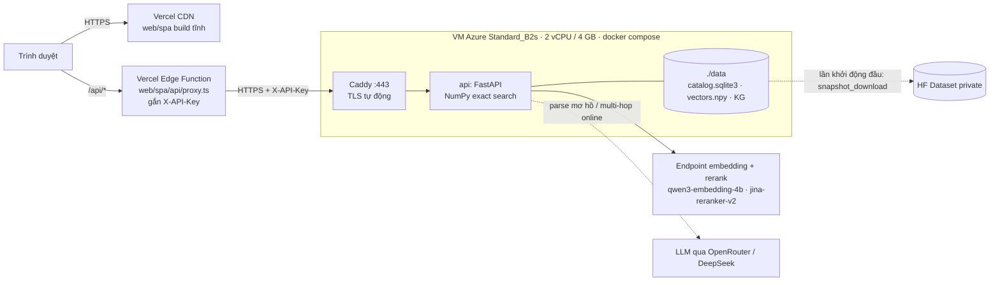

# Triển khai: Vercel + VM Azure for Students + GitHub Actions

## Kiến trúc



| Thành phần | Nơi chạy | Lý do |
|---|---|---|
| SPA `web/spa` | Vercel (static + CDN) | Build Vite tĩnh; preview riêng cho từng PR |
| Proxy `/api/*` | Vercel Edge Function | Giữ `X-API-Key` phía server; chỉ cho qua `/v1/*` và `/thumbs/*` |
| FastAPI | VM Azure for Students (Ubuntu 24.04 x64), `deploy/vm/compose.yml` | Cần ~1,3 GB vector trong page cache và SQLite ghi được; Vercel Functions không đáp ứng (giới hạn bundle, không có đĩa bền, cold start). HF Docker Space cần gói PRO |
| Index | HF Dataset private | 1,6 GB, không đưa vào git; VM tải một lần vào volume `./data` |

- Vector search dùng NumPy (`VECTOR_BACKEND=numpy`, cosine chính xác trên 130.428 × 2.560), nên không cần Qdrant.
- Rerank chạy qua endpoint (`RERANK_BACKEND=api`), không dùng BGE local. Lý do và số đo ở mục dưới.

### Vì sao không dùng BGE local trên server

Đo bằng chính image production, container giới hạn `--cpus 2`, dữ liệu thật (21/10/2026):

| Rerank | Thời gian bước rerank | Tổng / truy vấn |
|---|---|---|
| `local_ce` BGE-v2-m3 trên CPU | **26.159 ms** | ~27 s |
| `embedding` (cosine qua endpoint) | 876–4.758 ms | 1,5–5,8 s |
| `api` jina-reranker-v2 | **146–418 ms** | 0,7–2,8 s |

Kết quả với `api`, 12 truy vấn chưa có trong cache, sau khởi động lạnh:

| Loại | Median | Max |
|---|---|---|
| single | 878 ms | 1.923 ms (truy vấn đầu tiên) |
| multi-intent | 1.702 ms | 2.798 ms |
| multi-hop | 664 ms | 743 ms |

Hai chỉnh sửa đã cần để giữ dưới 3 s:
- **Preload đọc trước `vectors.npy`:** truy vấn đầu tiên không còn mất ~3 s đọc đĩa.
- **`HOP_ONLINE_BUDGET_MS=1800`:** 600 ms chờ LLM + 1,8 s tra cứu online. Hết ngân sách thì trả `pending_online_lookup`.

Bỏ torch khỏi image production làm image giảm từ 5,69 GB xuống **~400 MB** và build còn ~30 s.

## CI/CD (`.github/workflows/ci.yml`)


- **Load test đầy đủ:** vào *Actions → ci → Run workflow*, chọn `loadtest_profile = full`. Kịch bản `full` vượt quota 100 request/phút của endpoint embedding, nên chỉ chạy khi chấp nhận tiêu quota.
- **Report k6:** nằm trong artifact `perf-report` và trong phần summary của lần chạy.

## Thiết lập lần đầu (Azure for Students)

### 1. Kích hoạt tài khoản

1. Mở https://azure.microsoft.com/free/students, bấm *Start free* và đăng nhập bằng **email của trường**. Thường không cần thẻ.
2. Xác minh xong, vào https://portal.azure.com. Ô tìm kiếm → *Subscriptions* phải có **Azure for Students**.
3. Nên đặt cảnh báo chi phí: *Cost Management → Budgets → Add*, ví dụ $25, cảnh báo ở 80%.

### 2. Tạo VM

*Virtual machines → Create → Azure virtual machine*:

| Tab | Trường | Giá trị |
|---|---|---|
| Basics | Subscription / Resource group | Azure for Students / *Create new* `heritage-rg` |
| | Virtual machine name | `heritage-api` |
| | Region | **(Asia Pacific) Southeast Asia**. Nếu báo *not allowed by policy* thì chọn region khác trong danh sách được phép, ví dụ East Asia hoặc Japan East |
| | Availability options | No infrastructure redundancy required |
| | Image | **Ubuntu Server 24.04 LTS - x64 Gen2** |
| | Size | **Standard_B2s** (2 vCPU, 4 GiB). Hết hàng thì chọn B2as_v2 hoặc B2als_v2. Không chọn loại 1 GiB: index cần ~1,3 GB RAM |
| | Authentication type | SSH public key, Username `azureuser`, *Generate new key pair*, tên `heritage-api_key` |
| | Public inbound ports | Allow selected ports: **SSH (22), HTTP (80), HTTPS (443)** |
| Disks | OS disk type | Standard SSD, 30 GiB mặc định; tick *Delete with VM* |
| Networking | Public IP | (new); tick *Delete public IP and NIC when VM is deleted* |
| Management | Auto-shutdown | **Tắt** khi đang cho người khác xem demo. Bật nếu muốn tiết kiệm credit |

*Review + create → Create → **Download private key and create resource***. File `heritage-api_key.pem` chỉ tải được lúc này.

Chi phí tham khảo: B2s khoảng $30/tháng, đĩa và IP vài đô; $100 credit dùng được khoảng 3 tháng. Kiểm tra lại trên Azure Pricing Calculator. Không dùng thì *Stop* VM: trạng thái *Stopped (deallocated)* không tính tiền CPU.

### 3. Tên miền miễn phí cho API

VM → *Overview → DNS name: Not configured* → đặt *DNS name label*, ví dụ `heritage-api-vuong` → *Save*.
API có địa chỉ `heritage-api-vuong.<region>.cloudapp.azure.com`; Caddy tự xin chứng chỉ HTTPS cho tên này. IP của VM tạo mặc định (Standard SKU) là IP tĩnh.

### 4. Chuẩn bị server (Git Bash trên máy local, ở thư mục repo)

```bash
mkdir -p ~/.ssh && mv ~/Downloads/heritage-api_key.pem ~/.ssh/azure.pem
HOST=heritage-api-vuong.southeastasia.cloudapp.azure.com; KEY=~/.ssh/azure.pem
ssh -i $KEY azureuser@$HOST 'sh -s' < deploy/vm/bootstrap.sh   # cài Docker
python -m deploy.hf_data upload                                 # index -> HF dataset (chỉ khi index đổi)
python -m deploy.env --out server.env --domain "$HOST"          # .env server, sinh PROD_API_KEY nếu chưa có
scp -i $KEY server.env azureuser@$HOST:heritage/.env && rm server.env
```

Nếu ssh báo `UNPROTECTED PRIVATE KEY FILE` (OpenSSH của Windows), chạy trong PowerShell:
`icacls "$HOME\.ssh\azure.pem" /inheritance:r /grant:r "$($env:USERNAME):R"`.

### 5. Cấu hình Vercel và GitHub

```bash
R=VSF-AR-ES-V-Lookup/PhamVanVuong_search_image
cd web/spa
printf 'https://%s' "$HOST" | npx vercel@63.1.2 env add BACKEND_URL production
printf 'https://%s' "$HOST" | npx vercel@63.1.2 env add BACKEND_URL preview
cd ../..
gh secret set VM_SSH_KEY -R $R < $KEY
gh secret set VM_HOST -R $R --body "$HOST"
gh secret set VM_USER -R $R --body azureuser
gh variable set API_DOMAIN -R $R --body "$HOST"   # bật job deploy-backend
gh workflow run ci -R $R                          # hoặc push lên main
```

Lần chạy đầu sẽ build image, deploy lên VM (VM tải 1,6 GB index, khoảng 3 phút), rồi deploy Vercel và chạy smoke test.
`VERCEL_TOKEN`, `VERCEL_ORG_ID`, `VERCEL_PROJECT_ID`, `APP_URL` đã được đặt sẵn trên repo.

**Bảo mật:** VM chỉ cho đăng nhập bằng SSH key (Azure tắt mật khẩu khi chọn SSH key). Cổng 22 phải mở cho mọi IP vì GitHub Actions SSH vào từ dải IP thay đổi.

## Vận hành

- **Index mới:**
  1. Chạy `python -m deploy.hf_data upload`.
  2. Trên VM chạy `docker compose restart api`. Lệnh `pull` chỉ tải các file đã đổi.
- **Đổi khóa API:** sinh lại `server.env` bằng `deploy.env`, `scp` lên VM, rồi chạy `docker compose up -d api`.
- **Log:** `ssh -i $KEY azureuser@$HOST 'cd heritage && docker compose logs -f --tail 100 api'`.

## Hạn chế đã biết

- **Một worker uvicorn:** limiter của endpoint embedding tính theo từng process. Throughput bị chặn bởi quota 100 request/phút của endpoint, không phải bởi CPU của VM.
- **Proxy Vercel là public:** ai mở web demo cũng gọi được `/api/v1/*`, đúng mục đích demo. Key chỉ chặn gọi thẳng vào VM; chưa có rate limit theo người dùng.
- **Tên miền API** là tên `cloudapp.azure.com` miễn phí. Có domain riêng thì trỏ bản ghi A về IP VM rồi đổi `API_DOMAIN` (GitHub variable, `.env` trên VM, `BACKEND_URL` trên Vercel).
- **VM tắt (deallocated) thì demo ngừng.** Bật lại trong portal: container tự chạy lại (`restart: unless-stopped`).
- **Trang Moderation** cần `data/verify` (2,6 GB ảnh pilot), phần này không được đưa lên. Trang Search và Benchmark hoạt động đầy đủ.
- **Truy vấn mẫu của đề** `ảnh con trai chủ tịch Phạm Nhật Vượng` trả `seed_not_linked`, vì KG chưa có người này.
