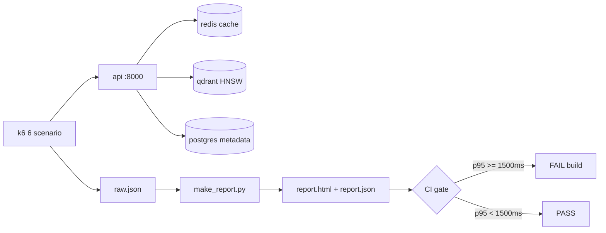

# Performance & cách đo

## 1. Ngân sách latency (SLO đã chốt: p95 < 1500 ms trên 80.000 ảnh)

| Bước | p50 | p95 |
|---|---|---|
| API key auth + rate limit | 5 | 15 |
| Query parse — **rule-based fast path** | 3 | 8 |
| Graph traversal (chỉ multi-hop / set query) | 10 | 40 |
| Embed query (SigLIP2 ONNX) | 15 | 40 |
| ANN HNSW top-200 | 8 | 25 |
| Metadata filter | 5 | 15 |
| Rerank 100 → 10 | 60 | 180 |
| Presign S3 / CDN URL | 10 | 30 |
| Serialize + network | 20 | 50 |
| **Tổng đường tất định** | **≈ 136** | **≈ 403** |

**Dư địa ≈ 3,7×** so với SLO 1.500 ms. Ngay cả khi LLM parse cache-miss (1,2 s) vẫn nằm dưới ngưỡng
nhờ cơ chế speculative.

### Ngân sách riêng theo loại query

| Loại | p50 | p95 |
|---|---|---|
| single_intent | 120 | 350 |
| multi_intent | 180 | 480 |
| multi_hop | 210 | 620 |
| set_query | 200 | 560 |

## 2. Cách đo (phải ghi rõ trong báo cáo)

1. Warm-up **200 request** trước khi ghi số.
2. Đo **song song** server-side (`X-Response-Time`) và client-side (k6 `http_req_duration`).
3. **10.000 request** mỗi loại query; chốt p50 / p95 / **p99**.
4. Tách bảng theo `single | multi_intent | multi_hop | set_query | embed | rerank`
   **và** theo `LLM_PROVIDER` (`none | local | gemini`) — chứng minh SLO giữ được ở mọi mode.
5. Ghi rõ cấu hình máy, số ảnh trong index, model, batch size, cache state.

## 3. Throughput



## 4. Reproducible

```bash
docker compose up -d --build
docker compose --profile loadtest run --rm k6 run /scripts/loadtest.js --out json=/reports/raw.json
python -m loadtest.make_report /reports/raw.json -o /reports/report.html
```
`make_report.py` tự so ngưỡng và **exit code != 0** nếu p95 ≥ 1500 ms → dùng trực tiếp làm CI gate.

## 5. Chỉ số chất lượng retrieval

| Chỉ số | Định nghĩa | Mục tiêu |
|---|---|---|
| Recall@10 | `|Top10 ∩ R| / min(10, |R|)` | ≥ 0,70 |
| Hit@10 | 1 nếu `|Top10 ∩ R| ≥ 1` ("10 ảnh, 1 ảnh trùng với trust") | ≥ 0,95 |
| nDCG@10 | chất lượng xếp hạng | ≥ 0,75 |
| MRR | vị trí ảnh đúng đầu tiên | ≥ 0,80 |
| Precision@10 (quality) | tỉ lệ ảnh pass watermark/NSFW | ≥ 0,95 |

Báo cáo **tách riêng theo từng loại query** và theo `LLM_PROVIDER`.
