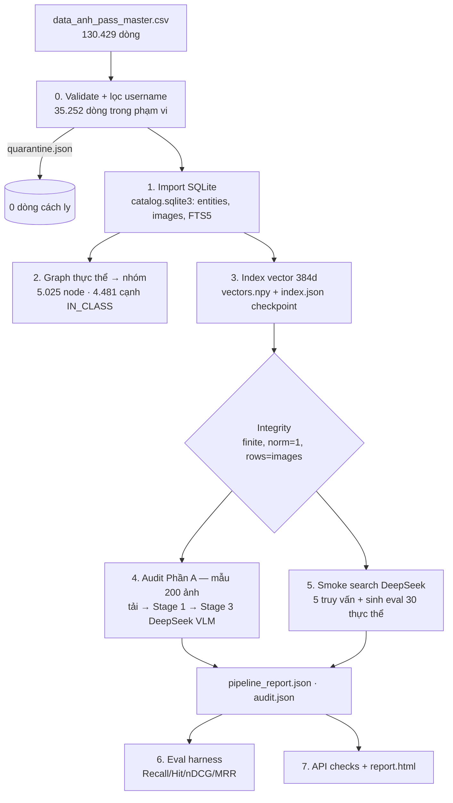

# Full pipeline — dữ liệu `username = pham_van_vuong` (DeepSeek)

Bản ghi chi tiết luồng đã hoàn thiện và **lần chạy thật** ngày 2026-10-19 trên máy local
(Windows 11, RTX 4050 Laptop 6 GB). Mọi con số dưới đây lấy từ file kết quả trong
`reports/pham_van_vuong/`, không phải ước lượng. Phạm vi: **không** deploy, **không** CI/CD.

| Mục | Giá trị |
|---|---|
| Nguồn | `data/data_anh_pass_master.csv` — 130.429 dòng, 8 username |
| Phạm vi | chỉ `username = pham_van_vuong` → **35.252 dòng** (95.177 dòng ngoài phạm vi bị bỏ qua) |
| LLM | DeepSeek `deepseek-flash` (DeepSeek-V4.1-Flash, nhận text + ảnh) |
| Embedding | `sentence-transformers/paraphrase-multilingual-MiniLM-L12-v2`, 384 chiều, CUDA |
| Kết quả | pipeline exit 0 · smoke 5/5 · eval 30 thực thể **pass** · API 9/9 check **pass** · pytest 46/46 |

---

## 1. Lệnh chạy (tái lập)

```powershell
# 0. (một lần) model embedding vào cache local
.\.venv\Scripts\python.exe -m scripts.prepare_local_model

# 1. Kiểm tra phạm vi trước khi chạy
.\.venv-gpu\Scripts\python.exe -X utf8 -m pipeline --csv data/data_anh_pass_master.csv `
  --username pham_van_vuong --dry-run
#   -> source_rows 130429, scoped_rows 35252

# 2. Full pipeline: import -> graph -> index -> audit Phần A (200 ảnh) -> smoke search DeepSeek
.\.venv-gpu\Scripts\python.exe -X utf8 -m pipeline --csv data/data_anh_pass_master.csv --mode approved `
  --username pham_van_vuong --audit-sample 200 --out reports/pham_van_vuong

# 3. Đánh giá retrieval (30 thực thể, nhãn = thành viên thực thể trong CSV)
.\.venv-gpu\Scripts\python.exe -X utf8 -m evals.harness `
  --goldset reports/pham_van_vuong/entity_smoke.jsonl --out reports/pham_van_vuong/evaluation.json

# 4. Kiểm tra API thật (TestClient, có X-API-Key) + báo cáo HTML
.\.venv-gpu\Scripts\python.exe -X utf8 -m scripts.verify_local_api
.\.venv\Scripts\python.exe -X utf8 -m scripts.report_approved_run reports/pham_van_vuong

# 5. Test + lint
.\.venv\Scripts\python.exe -m pytest
.\.venv\Scripts\ruff.exe check .
```

`.env` cần: `LLM_PROVIDER=deepseek`, `DEEPSEEK_API_KEY`, `DEEPSEEK_MODEL=deepseek-flash`,
`DEEPSEEK_BASE_URL=https://api.deepseek.com`, `RETRIEVAL_BACKEND=local`, `RERANK_TOP_K=24`.
Key chỉ đọc từ `.env`, không bao giờ in ra log hoặc ghi vào báo cáo.

`.venv-gpu` là venv chứa torch CUDA 2.6, nạp thêm site-packages của `.venv` qua
`local_runtime.pth`. Chạy bằng `.venv` (CPU) cũng cho kết quả tương đương nhưng bước
index chậm hơn khoảng 13 lần (lần chạy trước trên CPU: ~68 dòng/s, GPU lần này: ~925 dòng/s).

---

## 2. Tổng quan luồng



Thời gian từng bước (`pipeline_report.json → stage_seconds`):

| Bước | Giây |
|---|---|
| validate + quarantine | 0,69 |
| import SQLite | 4,93 |
| graph | 0,04 (build edges 0,017 s; ngân sách 5 s) |
| index vector (GPU) | 38,13 |
| audit Phần A (200 ảnh) | 93,00 |
| smoke search (5 truy vấn DeepSeek) | 12,94 |
| **Tổng pipeline** | **149,8** |

---

## 3. Chi tiết từng bước

### Bước 0 — Validate và lọc phạm vi (`pipeline/local_run.py`)

- Đọc CSV bằng `csv.DictReader` (`utf-8-sig`). Mỗi dòng đi qua `storage.local.in_scope()`:
  chỉ giữ dòng có `username` thuộc danh sách `--username` (lặp được nhiều lần).
- Trong phạm vi, dòng nào `flag != approved` hoặc `image_url` không phải `http(s)://`
  bị ghi vào `quarantine.json` kèm số dòng, entity và lý do.
- Lần chạy này: 35.252 dòng trong phạm vi, **0 dòng bị cách ly** (dòng `x-raw-image:///…`
  duy nhất của CSV thuộc username khác).
- Nếu `--username` không khớp dòng nào, pipeline dừng với `ValueError` thay vì tạo index rỗng.

### Bước 1 — Import SQLite (`storage/local.py → import_approved`)

- Bắt buộc có cột `entity_id, canonical_name, slug, category, image_url, flag` (+ `username`
  khi lọc). Thiếu cột → lỗi, catalog cũ giữ nguyên (cả bước import nằm trong một transaction).
- **Fingerprint catalog** = SHA-256(CSV) + danh sách username đã sắp xếp
  (`catalog_fingerprint`). Nhờ vậy index của tập con không bao giờ bị nhầm với index của
  toàn bộ CSV và ngược lại; chạy lại cùng phạm vi thì dùng lại (`reused: true`).
- Bảng tạo ra trong `data/local/catalog.sqlite3`:
  - `entities(entity_id, entity_name, entity_slug, parent_class)` — **4.481 thực thể**, 544 nhóm.
  - `images(rownum, image_id, entity_id, image_url, description, page_url, metadata_text, record_json)`
    — **35.252 ảnh**; `image_id = uuid5(URL)`; trùng URL bị bỏ (không có trùng trong phạm vi này).
  - `image_fts` (FTS5) chứa `metadata_text` đã bỏ dấu để tìm từ vựng.
  - `metadata`: `csv_sha256` (fingerprint), `source_csv_sha256`, `usernames`, `source_csv`.
- `metadata_text = canonical_name. category. description` — đây là thứ được embed.
  6.950 ảnh không có `description`, nên chỉ có tên + nhóm.

Kết quả thật:

```text
images 35252 · entities 4481 · out_of_scope_rows 95177 · skipped_rows 0
csv_sha256 (fingerprint)  f1a1f9b9028fce742c4022f420a70589c6eaa547883a27eab610a83bb2056342
source_csv_sha256         89badb0030b95dbdc79de25c6a537290761e6c658a247c341793a749bffb65d3
```

### Bước 2 — Graph (`retrieval/graph.py → build_from_csv`)

- Mỗi thực thể → cạnh `IN_CLASS` tới node `class:<category>`.
- 4.481 node thực thể + 544 node nhóm = **5.025 node**, **4.481 cạnh**, 0,017 s.
- Dùng cho `/v1/graph` (cha/anh em cùng nhóm). CSV **không có** quan hệ người/tổ chức,
  nên truy vấn multi-hop trả cảnh báo thay vì bịa quan hệ.

### Bước 3 — Index vector (`retrieval/local_index.py → build`)

- Đọc ảnh theo lô `INDEX_CHUNK_SIZE=512`, encode `metadata_text` (max 128 token,
  `normalize_embeddings=True`) → ghi thẳng vào `vectors.npy` (memmap float32, 35.252 × 384).
- Văn bản trùng hệt chỉ encode một lần: **29.908 văn bản duy nhất** cho 35.252 ảnh;
  5.344 ảnh còn lại copy vector của văn bản trùng (không gộp danh tính ảnh).
- Sau mỗi lô ghi checkpoint `index.json` (atomic replace). Bị ngắt thì chạy lại sẽ tiếp tục,
  nhưng chỉ khi fingerprint catalog, model, số chiều và backend đều khớp.
- **Integrity check** trước khi tiếp tục: toàn bộ vector hữu hạn, chuẩn trong
  [0,9999999; 1,0000001], số dòng vector = số ảnh trong catalog (35.252). Sai là dừng.
- 38,1 s trên RTX 4050.

### Bước 4 — Audit Phần A trên mẫu ảnh (`pipeline/audit.py`, `--audit-sample 200`)

Dữ liệu đã `approved`, nên audit **không xoá ảnh nào khỏi index**. Mục đích là đo xem
cascade Phần A đánh giá tập đã duyệt thế nào, và đo chi phí token Stage 3 thật.

1. **Lấy mẫu phân tầng**: seed 42, mỗi nhóm một ảnh theo thứ tự ngẫu nhiên → 200 ảnh phủ
   **200 nhóm khác nhau**.
2. **Tải ảnh** (`storage/images.py`, 16 luồng): chỉ http(s); host phải phân giải ra IP
   public (kiểm tra lại mỗi lần redirect, tối đa 3); giới hạn 15 MB; decode bằng Pillow.
3. **Stage 1** (`pipeline/stage1_heuristics.py`, CPU), ảnh thu về cạnh dài 1024 px để phân tích:
   - độ phân giải `w ≥ 600`, `h ≥ 400`; aspect ∈ [0,4; 3,0];
   - độ nét: phương sai Laplacian ≥ 60;
   - entropy histogram xám ≥ 3,0;
   - nghi watermark: mật độ cạnh lớn nhất ở 4 góc (15% mỗi chiều) ≤ 0,18. Cạnh tính bằng Sobel
     + non-maximum suppression, ngưỡng độ lớn 200 (thay cho Canny vì môi trường không có OpenCV);
   - trùng gần: pHash 64 bit, Hamming ≤ 6 so với các ảnh đã thấy.
4. **Stage 2**: repo **chưa có classifier đã huấn luyện** (SigLIP2 multi-head). Audit không
   giả lập Stage 2 mà gửi **mọi ảnh decode được** sang Stage 3, để đo được cả mức đồng thuận
   giữa Stage 1 và Stage 3.
5. **Stage 3** (`pipeline/stage3_vlm.py → judge_deepseek`, 6 luồng): ảnh thu về cạnh dài
   512 px, JPEG q85, gửi **base64** (máy chủ DeepSeek không tải được nhiều host ảnh, ví dụ
   Wikimedia trả lỗi khi thử) kèm `{entity, category, description}`. Model trả JSON
   `relevance, watermark, nsfw, violence, politics ∈ [0,1]` + `decision` + `reason`.
   Code kiểm tra schema và **không cho phép accept** nếu `relevance < 0,5` hoặc bất kỳ tiêu chí
   rủi ro nào ≥ 0,5, bất kể model nói gì.

Kết quả thật (`audit.json → summary`):

| Chỉ số | Giá trị |
|---|---|
| Tải + decode được | **194 / 200** (lỗi: 3 ConnectError, 2 HTTP 403, 1 host phân giải ra IP không public) |
| Stage 1 pass | **143 / 194** (73,7%) |
| Lý do Stage 1 (một ảnh có thể nhiều lý do) | width 18 · height 15 · watermark_zone 25 · blur 3 · entropy 1 |
| Ảnh dưới chuẩn độ phân giải | 26 ảnh (13,4%), trong đó VLM vẫn accept 18 |
| Stage 3 accept | **125 / 194** (64,4%), 0 lỗi gọi API |
| Stage 3 reject | 69 — **65 vì watermark/logo**, 5 vì `relevance < 0,5` (1 ảnh dính cả hai) |
| Accept nếu Stage 1 pass / reject | 62,2% / 70,6% |
| Kết quả nếu chạy cascade thật | Stage 1 loại 51 · Stage 3 accept 89 · Stage 3 reject 54 |
| Token Stage 3 / ảnh | **678 input + 82,7 output** (194 request tính phí) |
| Độ trễ Stage 3 trung bình | 1.442 ms / ảnh; 194 ảnh mất 48,3 s với 6 luồng |
| Thời gian | tải 37,6 s · Stage 1 7,1 s · Stage 3 48,3 s |

Nhận xét từ dữ liệu:

- **Tập approved vẫn chứa nhiều ảnh có watermark.** VLM nêu cụ thể logo nhìn thấy, ví dụ
  "logo TINNEWS ở góc", "watermark Dân Việt", "logo baosonla.vn", "chữ thương hiệu WELOFARM".
  Đây là ảnh báo/shop. Nếu chuẩn kho ảnh là không watermark thì khoảng 1/3 mẫu cần duyệt lại.
- **Lỗi relevance hiếm**: 5/194, ví dụ "Ảnh lễ hội cộng đồng, không phải vòng cổ cườm Mnông",
  "Ảnh chai rượu vang chung chung, không rõ là rượu sim Phú Quốc".
- **Heuristic watermark góc của Stage 1 gần như không trùng với VLM**: Stage 1 gắn cờ 25 ảnh,
  VLM thấy watermark ở 65 ảnh, chỉ **6** ảnh trùng. Mật độ cạnh góc chủ yếu bắt được cảnh
  nhiều chi tiết (cây lá, mái ngói), không phải logo. Kết luận: không nên dùng nó làm cổng
  loại cứng; cần head `watermark` của Stage 2 hoặc giữ VLM.
- Chi phí Stage 3: mỗi ảnh khoảng 680 token vào, 83 token ra. Tổng chi phí = token × đơn giá
  DeepSeek tại thời điểm chạy. Bản ghi này **không** ghi đơn giá vì không đo được từ API.

Ảnh bị gắn cờ được hiển thị kèm lý do trong `reports/pham_van_vuong/report.html`.

### Bước 5 — Smoke search DeepSeek + sinh eval set

Truy vấn được **sinh từ dữ liệu trong phạm vi** (không còn truy vấn cứng "cầu ở Sóc Trăng"):
3 thực thể đầu tiên, 1 truy vấn ghép 2 thực thể, 1 set query lấy từ nhóm lớn nhất.

| Truy vấn | Loại | Kết quả |
|---|---|---|
| Bản homestay Mai Hịch (Mai Châu, Hòa Bình) | single | 10/10 ảnh đúng thực thể · 2.684 ms |
| Bản homestay Sin Suối Hồ (Phong Thổ, Lai Châu) | single | 10/10 đúng · 2.369 ms |
| Bản homestay Ngọc Chiến (Mường La, Sơn La) | single | 10/10 đúng · 2.455 ms |
| Mai Hịch **và** Sin Suối Hồ | multi_intent | **5 + 5** (quota chia đều) · 2.700 ms |
| các đền thờ | set_query | 10 ảnh, 8/10 thuộc nhóm "Đền thờ" (class precision 0,8) · 2.576 ms |

Mỗi truy vấn đi qua DAG tất định (`retrieval/local_search.py`), không agent, không vòng
tool-calling. Thời gian đo được của truy vấn đầu:

| Bước | ms | Ghi chú |
|---|---|---|
| parse | 1.091 | rule parser chạy trước, rồi DeepSeek trả `intent_type` + `sub_queries` (JSON) |
| embed_query | 51 | MiniLM 384d |
| retrieve | 87 | mỗi sub-query: dense top-200 (cosine chính xác) + FTS5 + khớp tên thực thể → RRF (trọng số 1/1/3) |
| metadata_filter | 4 | lọc `entity_id / entity_slug / parent_class` |
| rerank | 1.451 | DeepSeek chấm 24 ứng viên (id gọn 0..23), bỏ điểm < 0,2; multi-intent áp quota theo sub-query |

Gọi lại cùng truy vấn thì trả từ cache SQLite trong khoảng 2 ms. Khoá cache gồm query,
top_k, filter, manifest index, provider và model.

Pipeline cũng ghi `entity_smoke.jsonl`: 30 thực thể lấy từ **30 nhóm khác nhau** (seed 42),
nhãn đúng là toàn bộ ảnh của thực thể đó.

### Bước 6 — Eval harness (`evals/harness.py`)

| Chỉ số | Kết quả | Ngưỡng |
|---|---|---|
| Recall@10 | **0,9933** | ≥ 0,70 |
| Hit@10 | **1,0000** | ≥ 0,95 |
| nDCG@10 | **0,9957** | ≥ 0,75 |
| MRR | **1,0000** | ≥ 0,80 |
| Độ trễ (lần đầu, có DeepSeek) | p50 2.483 ms · p95 2.825 ms · max 8.996 ms | SLO 1.500 ms |

29/30 truy vấn đạt tuyệt đối. Ca yếu duy nhất là "Lăng Ông Thủy Tướng (Vạn Thủy Tú khu vực ĐNB)"
(10 ảnh, Recall@10 = 0,8). Cả 10 ảnh đều nằm trong 24 ứng viên rerank, nhưng DeepSeek chấm
2 ảnh trong số đó ≤ 0,3, thấp hơn ảnh của thực thể **trùng tên** "Lăng Ông Thủy Tướng (Vàm Láng,
Tiền Giang)". Mô tả của 2 ảnh đó có ghi đúng tên thực thể. Đây là nhiễu của LLM rerank, không phải lỗi
truy hồi. Bản ghi giữ nguyên kết quả, không tinh chỉnh theo bộ smoke để tránh overfit.

`precision@10_quality = 0` chỉ vì không có `quality.json` cho tập này, không phải kết quả đo.

> Đây là **smoke test theo nhãn thực thể**: truy vấn chính là tên thực thể, nên điểm cao là điều
> dự kiến. Nó chưa thay thế goldset gán nhãn thủ công cho truy vấn mô tả, multi-hop hay set query.

### Bước 7 — API thật + báo cáo

`scripts/verify_local_api.py` gọi FastAPI app qua TestClient với `X-API-Key`
(`reports/approved_run/api_checks.json`):

| Endpoint | Kết quả | ms (server) |
|---|---|---|
| `GET /v1/health` | 200, `index_complete: true`, `catalog_scope.usernames = [pham_van_vuong]` | — |
| `POST /v1/search` | 200, parser `deepseek`, hit đầu đúng thực thể | cache |
| `POST /v1/embed` (text) | 200, 1 × 384 | 6.129 (lần đầu nạp model) |
| `POST /v1/embed` (image_urls) | 200, 1 × 384 — tải ảnh → DeepSeek caption → embed | 2.643 |
| `POST /v1/rerank` | 200, chọn đúng ảnh của thực thể được hỏi | 941 |
| `GET /v1/entities` | 200 | 11 |
| `GET /v1/graph` | 200 | 6 |
| CORS preflight | 200 | — |
| Không có key | 401 | — |

Báo cáo trực quan: `reports/pham_van_vuong/report.html` (ảnh kết quả từng truy vấn + ảnh bị audit gắn cờ).

### Token DeepSeek của lần chạy

Ghi trong `data/local/deepseek_usage.jsonl` (không chứa key). Số liệu `pipeline_report.json`
(tính đến cuối pipeline, gồm cả 1 request của lần chạy cũ): 205 request, 147.297 token vào,
17.665 token ra. Phần lớn là audit Stage 3 (194 request, 131.536 vào / 16.048 ra).
Eval và API check thêm 62 request; tổng log hiện tại là 267 request.

---

## 4. Những gì đã sửa / hoàn thiện trong lần review này

| Vấn đề tìm thấy khi review | Sửa |
|---|---|
| Pipeline luôn nạp cả 130k dòng; không lọc được theo người nhập. Lần chạy cũ dừng ở 44.544/130.428 vector | `--username` (lặp được) → `import_approved(..., usernames)`; fingerprint catalog gắn với phạm vi; `catalog_scope()` hiển thị ở `/v1/health` |
| Smoke set query cứng "các cây cầu ở Sóc Trăng" không có trong tập con | Truy vấn smoke sinh từ dữ liệu; set query kèm `class_precision` |
| Eval chỉ có 3 thực thể | 30 thực thể phân tầng theo nhóm (`EVAL_ENTITIES`) |
| Rule parser bật filter kích thước khi thấy chữ "nét" / "ngang" / "dọc" ở bất kỳ đâu ("Đèo Ngang", "dọc sông Hương"). CSV không có kích thước ảnh nên **mọi kết quả bị lọc sạch** | Regex chỉ khớp thuộc tính ảnh ("ảnh ngang", "khổ dọc", "chất lượng cao"); filter kích thước bị bỏ qua kèm `warnings` thay vì trả rỗng |
| DeepSeek lỗi mạng làm `/v1/search` trả 503 | Parse lỗi thì dùng rule parser, rerank lỗi thì dùng embedding similarity, đều có `warnings`; câu trả lời bị suy giảm không được cache |
| Khớp tên thực thể dạng "query nằm trong tên" làm truy vấn ngắn (vd "chợ") khớp bừa 20 thực thể | Yêu cầu query ≥ 8 ký tự cho chiều đó |
| Stage 1: blur / entropy / watermark góc / pHash đều `NotImplementedError` | Cài đặt bằng numpy + ImageHash (Sobel + NMS thay Canny); trả `metrics` |
| Stage 3 VLM chưa có, `stage3_vlm_enabled` sai khi dùng DeepSeek | `judge_deepseek` (base64 512 px, JSON schema, chặn accept khi điểm rủi ro cao), `voting` 2-of-3, `downscale` |
| `/v1/embed` ảnh truyền URL thẳng cho DeepSeek (thất bại với nhiều host) | `storage/images.py`: tải có giới hạn, chặn IP nội bộ (SSRF), redirect kiểm tra lại; gửi base64 |
| `POST /v1/graph` hard-code đường dẫn CSV | Dùng `source_csv` đã lưu trong catalog |
| `verify_local_api` có thể chọn 2 ảnh cùng thực thể → check rerank mơ hồ | Chọn ảnh đầu của 2 thực thể khác nhau; thêm check hit đầu đúng thực thể và check embed ảnh |
| 2 lỗi ruff | Đã sửa; `ruff check .` sạch |
| (sau, nhờ bộ test UI) Truy vấn mơ hồ như "Văn Miếu": thực thể khớp đầu tiên lấp hết pool rerank | Thực thể trùng tên hẳn đứng đầu, các thực thể khớp một phần xen kẽ round-robin — xem [ui-testcases.md](ui-testcases.md) |

Test mới: `tests/test_scope_and_cascade.py` (9 test: lọc username, đổi phạm vi không dùng lại
index cũ, thiếu cột username, các cổng Stage 1, Stage 3 chặn accept rủi ro, voting, regex filter,
search suy giảm khi DeepSeek lỗi và không cache). Tổng **47/47 pass** (thêm test hồi quy xen kẽ ứng viên).

---

## 5. Giới hạn còn lại (ghi rõ, không che)

- **Độ trễ**: lần gọi đầu khoảng 2,4–2,8 s (p95 2.825 ms), vượt SLO 1.500 ms, vì parse
  (khoảng 1 s) và rerank (khoảng 1,4 s) DeepSeek chạy tuần tự. `retrieval/speculative.py`
  (rule-parse + retrieve chạy trước, LLM song song có timeout 600 ms) chưa được nối vào
  `/v1/search`. Truy vấn lặp lại trả từ cache trong khoảng 2 ms.
- **Embedding là metadata, không phải pixel**: vector biểu diễn tên + nhóm + mô tả. Truy vấn
  về nội dung hình ảnh mà mô tả không nhắc tới sẽ không tìm được.
- **Stage 2 chưa có model**: audit gửi mọi ảnh qua Stage 3, nên tỉ lệ ~8% dải bất định trong
  cost model chưa được kiểm chứng.
- **Heuristic watermark góc độ chính xác thấp** (6/25 trùng với VLM). Không nên dùng làm cổng loại cứng.
- **Multi-hop**: CSV chỉ có quan hệ thực thể → nhóm; truy vấn quan hệ người/tổ chức trả cảnh báo.
- **Ảnh audit không được lưu**; audit chỉ là đo đạc trên mẫu 200 ảnh, chưa sửa nhãn approved.
- Chưa triển khai (ngoài phạm vi lần này hoặc cần hạ tầng): deploy, CI/CD, Docker/S3/Redis/Qdrant,
  `/v1/ingest` và `/v1/backfill` thật, Gemini/Ollama, `dedup_by_phash` trong kết quả, cấp API key động.

---

## 6. File kết quả

| File | Nội dung |
|---|---|
| `reports/pham_van_vuong/pipeline.log` | log đầy đủ của lần chạy |
| `reports/pham_van_vuong/pipeline_report.json` | catalog, graph, index, integrity, audit summary, smoke, thời gian, token |
| `reports/pham_van_vuong/audit.json` | 200 ảnh: trạng thái tải, kích thước, metrics + lý do Stage 1, điểm + lý do Stage 3, pHash |
| `reports/pham_van_vuong/search_results.json` | 5 truy vấn smoke đầy đủ hit / timings / warnings |
| `reports/pham_van_vuong/entity_smoke.jsonl` | 30 ca eval (nhãn = thành viên thực thể) |
| `reports/pham_van_vuong/evaluation.json` | metric từng ca + tổng hợp |
| `reports/pham_van_vuong/quarantine.json` | dòng bị cách ly (rỗng) |
| `reports/pham_van_vuong/report.html` | báo cáo trực quan |
| `reports/approved_run/api_checks.json` | kết quả kiểm tra API |
| `data/local/catalog.sqlite3`, `vectors.npy`, `index.json` | catalog + index của phạm vi `pham_van_vuong` |
| `data/local/deepseek_usage.jsonl` | token từng request DeepSeek (không chứa key) |
