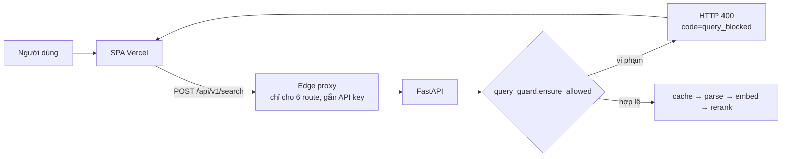

# Bộ chặn truy vấn khiếm nhã / nhạy cảm

Mã: [retrieval/query_guard.py](../retrieval/query_guard.py) · Test: [tests/test_query_guard.py](../tests/test_query_guard.py)

## Vị trí trong hệ thống



Bộ chặn chạy **ở backend, trước cache, embedding và LLM**, vì đó là nơi duy nhất không thể bỏ qua bằng
cách gọi thẳng API. Truy vấn bị chặn không tốn quota embedding/LLM và không bao giờ vào `llm_cache`.
Áp dụng cho `/v1/search`, `/v1/embed` (mọi phần tử của `texts`) và `/v1/rerank` (`query`).

## Hợp đồng phản hồi

```http
HTTP/1.1 400 Bad Request
{"detail": "Hệ thống không hỗ trợ tìm kiếm nội dung khiêu dâm hoặc nhạy cảm. Hãy nhập tên địa danh, …",
 "code": "query_blocked", "category": "sexual"}
```

`category` ∈ `profanity | sexual | violence | hate | political`. Phản hồi **không lặp lại** nội dung người
dùng gõ và không tiết lộ từ khóa đã khớp. Giao diện hiển thị khung riêng "Truy vấn không được hỗ trợ",
không có nút "Thử lại" và không tự retry (`kind = blocked`).

## Cách khớp

Khớp **cả cụm từ theo token**, không khớp chuỗi con, nên "Đền Dâm Đàm", "du lịch", "buổi sáng" không bị
chặn nhầm. Mỗi từ trong `LEXICON` thuộc một trong hai chế độ:

| Chế độ | Khi nào | Ví dụ |
|---|---|---|
| `strict` | Bản bỏ dấu trùng một từ thường ngày, nên chỉ khớp khi gõ **đủ dấu** | đụ ≈ *du lịch*, đéo ≈ *đeo*, lồn ≈ *lon*, buồi ≈ *buổi*, đĩ ≈ *đi*, phản động ≈ *phần đông* |
| `folded` | Từ không có nghĩa thường ngày, khớp cả khi gõ **không dấu** | địt, sex, porn, fuck |

Kỹ thuật lách luật được xử lý: hoa/thường, Unicode tổ hợp, ký tự toàn chiều rộng (`Ａｓｓ`), ký tự rộng 0,
chữ Cyrillic giống Latin (`pоrn`), kéo dài chữ (`đụụụ`), chèn ký tự hoặc gõ rời (`d.i.t`, `d i t m e`,
`V.C.L`), leetspeak (`l0n`, `c4c`, `sh!t`). Token đã bị che giấu theo các cách trên được so khớp thêm ở
dạng không dấu, kể cả với từ `strict`.

## Số đo

| Kiểm tra | Kết quả |
|---|---|
| Tên 11.735 thực thể + alias trong catalog | **0 bị chặn nhầm** |
| 244 truy vấn benchmark | **0 bị chặn nhầm** |
| 3 ví dụ của đề bài | Không bị chặn |
| Mô tả ảnh (100.806) và `metadata_text` (106.093) | **0 bị chặn nhầm** sau khi sửa. Lần quét đầu phát hiện 2 lỗi thật: `óc chó` (quả óc chó) và `cm` (centimet, do nén chữ lặp); đã sửa và thêm vào test |
| Test | 55 ca trong `tests/test_query_guard.py` (chặn, lách luật, không chặn nhầm, hợp đồng API) |
| Chi phí | ~1 ms / truy vấn |

## Hạn chế đã biết

- **Chỉ là danh sách từ khóa:** không hiểu ngữ nghĩa. Câu xúc phạm không dùng từ trong danh sách, hoặc câu
  gợi dục nhưng không có từ nhạy cảm, vẫn lọt qua. Cần mô hình phân loại văn bản nếu muốn phủ rộng hơn.
- **Từ `strict` gõ không dấu và không che giấu sẽ lọt** (ví dụ `du ma`, `lon`): đây là đánh đổi có chủ đích để
  không chặn nhầm `du lịch`, `lon nước`.
- **`f@ck`** lọt vì `@` thường thay chữ `a`, không phải `u`. Thêm biến thể vào `LEXICON` nếu cần.
- **Nhóm `political` cố ý rất ngắn** (5 cụm) và nên được chủ sản phẩm rà soát: ranh giới "chính trị nhạy
  cảm" là quyết định chính sách, không phải kỹ thuật.
- **`khỏa thân`** bị chặn kể cả trong ngữ cảnh nghệ thuật (tượng, tranh); đổi bằng cách bỏ khỏi `LEXICON`.
- Bộ chặn chỉ kiểm tra **truy vấn**, không kiểm tra ảnh trả về; nội dung ảnh do Phần A (nsfw / violence /
  politics) đảm nhiệm.
- Tắt tạm thời khi chạy đánh giá bằng `QUERY_GUARD=off`.

## Mở rộng danh sách

Sửa `LEXICON` trong `retrieval/query_guard.py`, rồi **chạy quét false-positive trên catalog** trước khi
deploy:

```bash
python -m scripts.scan_query_guard      # in các tên/mô tả bị chặn; kỳ vọng 0 với tên thực thể
```
