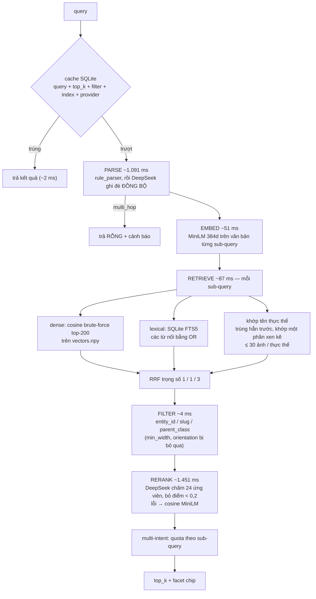

# Phần B (truy xuất ảnh) — pipeline hiện tại và các điểm yếu

> **Tiến độ sửa:** Phase 1 (điểm yếu #1 phần parse, #2) đã xong — xem
> [retrieval-fix-phase1.md](retrieval-fix-phase1.md). Các điểm yếu khác chưa sửa.
> 2026-10-21: nhánh dense text đổi MiniLM 384d -> `qwen3-embedding-4b` 2560d qua endpoint
> OpenAI-compatible (`EMBED_BACKEND=api`, query có tiền tố `Instruct:`); index 80k build lại
> (23,6 phút), Qdrant self-test recall@10 = 1,0. So sánh 10 truy vấn mô tả:
> `reports/phase2/compare_text_embeddings.json`. Index MiniLM cũ: `data/local/backup_minilm_80k/`.

Ngày review: 2026-10-20. Báo cáo dựa trên **code đang chạy** trong `retrieval/`, không dựa trên
thiết kế trong `docs/retrieval.md`. Số liệu lấy từ lần chạy `pham_van_vuong`
(`docs/pipeline-run-pham_van_vuong.md`, `reports/pham_van_vuong/`), cộng thêm một phép kiểm tra
rule parser chạy lại trên catalog hiện tại (mục 2, điểm yếu #2).

---

## 1. Pipeline đang chạy

Toàn bộ nằm trong `retrieval/local_search.py`. Đường gọi: `POST /v1/search` →
`retrieval.search.search` → `retrieval.local_search.run`.

Index hiện có **35.252 ảnh / 4.481 thực thể** (phạm vi `pham_van_vuong`), không phải 80k.
Cấu hình đang dùng: `LLM_PROVIDER=deepseek`, `RERANK_TOP_K=24`, embedding
`paraphrase-multilingual-MiniLM-L12-v2` 384 chiều.



### So với thiết kế

| Thành phần | Thiết kế (`docs/retrieval.md`, `config/models.yaml`) | Đang chạy |
|---|---|---|
| Embedding | SigLIP2 1152d, ảnh + text | MiniLM 384d, chỉ văn bản metadata |
| ANN | Qdrant HNSW | cosine brute-force trên `vectors.npy` (memmap) |
| Rerank | cross-encoder `bge-reranker-v2-m3` | DeepSeek chấm metadata; fallback cosine MiniLM |
| Parse | rule + LLM speculative, timeout 600 ms | rule + DeepSeek đồng bộ, không timeout riêng |
| Multi-hop | `graph.resolve_hops` | trả rỗng kèm cảnh báo |
| Set query | `parents_of` → `siblings_of` → multi-vector | xử lý như truy vấn văn bản thường |
| Lọc trùng | `dedup_by_phash` | chưa cài |

---

## 2. Điểm yếu, xếp theo mức độ

### #1 — Vượt SLO độ trễ

- Đo được (lần đầu, có DeepSeek): **p50 2.483 ms · p95 2.825 ms · max 8.996 ms**, so với SLO p95 1.500 ms.
- Nguyên nhân: parse (~1,1 s) và rerank (~1,45 s) DeepSeek chạy nối tiếp trên đường xử lý chính
  (`retrieval/local_search.py:55-62` và `:158-162`). Hai bước này chiếm ~95% thời gian.
- `retrieval/speculative.py` đã có (rule-parse + retrieve trước, LLM song song, timeout 600 ms) nhưng
  chưa được gọi từ `/v1/search`.

### #2 — Rule parser xếp nhầm tên địa danh, trả về 0 ảnh

Chạy rule parser trên toàn bộ 4.481 tên thực thể trong catalog:

| Kết quả | Số tên | Tỉ lệ |
|---|---|---|
| Bị xếp `multi_hop` → search trả **rỗng** | 104 | 2,3% |
| Không được xếp `single` (multi_hop + multi_intent + set_query) | 973 | 21,7% |

Ví dụ:

| Truy vấn | Rule parser ra | Hậu quả |
|---|---|---|
| Hòn Chồng Nha Trang | `multi_hop` | 0 ảnh |
| Tượng đài Mẹ Việt Nam Anh hùng | `multi_hop` | 0 ảnh |
| Lăng Chủ tịch Hồ Chí Minh | `multi_hop` | 0 ảnh |
| Linh đài Đức Mẹ Măng Đen Kon Tum | `multi_hop` | 0 ảnh |
| Chùa Một Cột, Hà Nội | `multi_intent` ["chùa một cột", "hà nội"] | quota chia đôi cho "hà nội" |

Nguyên nhân: `HOP_MARKERS` ("mẹ", "anh", "em", "cha", "chồng", "chủ tịch"…) và `MULTI_MARKERS`
(",", " và ", " với ", " cùng ") khớp cả bên trong tên riêng (`retrieval/rule_parser.py:12-15`).

Lỗi lộ hẳn khi `LLM_PROVIDER=none` hoặc khi DeepSeek lỗi. Khi DeepSeek chạy, `intent_type` của nó ghi
đè kết quả rule. Chưa kiểm chứng DeepSeek có xếp đúng các ca trên không.

Tái hiện:

```powershell
.\.venv\Scripts\python.exe -X utf8 -c "from retrieval import rule_parser as r; print(r.parse('Hòn Chồng Nha Trang').intent_type)"
```

### #3 — Embedding chỉ là văn bản metadata, không có thông tin pixel

- Vector được tính từ `tên thực thể. nhóm. mô tả` (`storage/local.py`, cột `metadata_text`).
- 35.252 ảnh chỉ có **29.908 chuỗi metadata khác nhau**, nên khoảng 15% ảnh có vector y hệt một ảnh khác
  và không phân biệt được với nhau.
- Theo số đo của Phần A, **16.110/80k dòng không có mô tả**; các ảnh này chỉ được biểu diễn bằng tên + nhóm.
- Truy vấn tả nội dung ảnh mà mô tả không nhắc tới ("mái ngói đỏ", "chụp ban đêm") không tìm được.
- Phần A đã tính SigLIP2 embedding ảnh (`data/verify/emb.npz`) nhưng Phần B không dùng.

### #4 — Kết quả của Phần A không được đưa vào Phần B

- Bảng `images` chỉ có `rownum, image_id, entity_id, image_url, description, source_url,
  metadata_text, record_json`. Không có `verify`, `width`, `watermark`.
- Vì vậy `apply_quality_penalty` (`retrieval/rerank.py:40-48`) **luôn trả 0**: ảnh chưa đạt chuẩn,
  ảnh nhỏ, ảnh có watermark đều không bị trừ điểm.
- Audit 200 ảnh của Phần A: VLM thấy watermark/logo ở **65/194** ảnh. Các ảnh này vẫn được trả về.
- File `reports/verify/*_verified.csv` (cột `verify` yes/no) chưa được nạp vào index.

### #5 — Rerank không ổn định và tốn tiền

- DeepSeek chỉ chấm **24 ứng viên** (`RERANK_TOP_K=24`), sau đó ngưỡng 0,2 có thể cắt còn ít hơn `top_k`.
- Ca "Lăng Ông Thủy Tướng (Vạn Thủy Tú khu vực ĐNB)": cả 10 ảnh đúng đều có trong pool, nhưng DeepSeek chấm
  2 ảnh ≤ 0,3, thấp hơn ảnh của thực thể trùng tên ở Tiền Giang → Recall@10 = 0,8.
- Khi không có key hoặc DeepSeek lỗi, "rerank" chỉ là cosine MiniLM lặp lại — không thêm thông tin
  so với bước dense. Cross-encoder chưa được cài.

### #6 — Không có multi-hop

- Đồ thị chỉ có cạnh `IN_CLASS` (thực thể → nhóm). CSV không có quan hệ người/tổ chức.
- `graph.load` và `graph.resolve_hops` vẫn là `NotImplementedError`.
- `local_search.run` trả rỗng cho mọi truy vấn `multi_hop` — kết hợp với #2 thành lỗi người dùng thấy được.

### #7 — Set query không dùng đồ thị

- `local_search.run` không gọi `graph.siblings_of` / `parents_of`. "các đền thờ" được xử lý như một
  truy vấn văn bản.
- Đo được: class precision **0,8** (8/10 ảnh thuộc nhóm "Đền thờ").

### #8 — Bộ lọc kích thước và hướng ảnh vô hiệu

CSV không có kích thước ảnh. `min_width` và `orientation` bị bỏ qua kèm cảnh báo, không lọc được gì.

### #9 — Đánh giá chưa phản ánh chất lượng thật

- Recall@10 0,993 · Hit@10 1,0 · nDCG@10 0,996 · MRR 1,0 trên 30 ca — nhưng truy vấn chính là **tên
  thực thể**, nên điểm cao là điều dự kiến.
- Chưa có goldset cho truy vấn mô tả, multi-hop, set query hay truy vấn có tên trùng.
- `precision@10_quality = 0` là do thiếu `quality.json`, không phải kết quả đo.
- Độ trễ chưa đo trên 80k ảnh như SLO ghi; index hiện là 35k.

### #10 — Không lọc ảnh trùng gần trong kết quả

`fusion.dedup_by_phash` chưa cài. Phần A đã chứng minh pHash không dùng được (AUC 0,522 trên 18.445 cặp),
nên nếu cài thì nên dùng cosine trên embedding ảnh thay vì pHash.

---

## 3. Đề xuất thứ tự sửa

| Thứ tự | Việc | Giải quyết | Chi phí |
|---|---|---|---|
| 1 | Sửa rule parser: kiểm tra query có khớp tên thực thể đã biết trước khi xét marker quan hệ; không coi "," là dấu tách ý khi phần sau là tỉnh/thành. Thêm test hồi quy với 104 tên đang bị xếp nhầm | #2, một phần #6 | thấp, chỉ `retrieval/rule_parser.py` + test |
| 2 | Nối `speculative.py` vào `/v1/search`; thay rerank DeepSeek đồng bộ bằng cross-encoder local (hoặc giữ cosine) | #1, #5 | trung bình |
| 3 | Nạp `verify` từ `*_verified.csv` vào bảng `images`; thêm vector ảnh SigLIP2 làm nhánh dense thứ hai trong RRF | #3, #4, nền cho #10 | trung bình–cao (cần embedding đủ ảnh) |
| 4 | Xây goldset: truy vấn mô tả, set query, tên trùng, multi-hop; đo latency trên đúng quy mô index | #9 | công gán nhãn người |
| 5 | Set query qua `siblings_of`; dedup theo cosine embedding ảnh | #7, #10 | thấp–trung bình |

Bước 1 và 2 đủ để hết lỗi trả rỗng và có khả năng đưa p95 xuống dưới 1.500 ms. Bước 4 nên làm trước
khi tối ưu thêm chất lượng xếp hạng, để có số đo thật thay vì smoke test theo tên thực thể.
