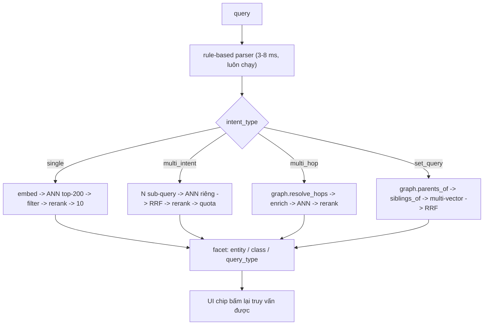
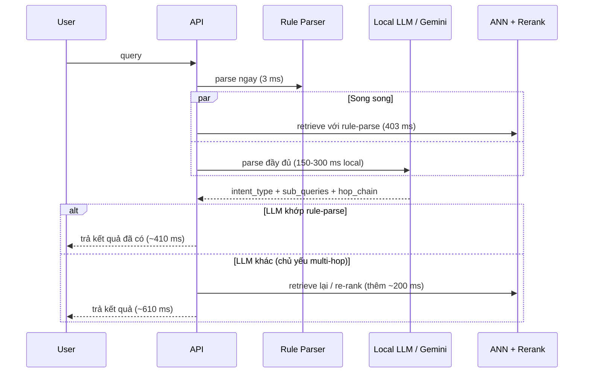

# PHẦN B — Retrieval

## 1. Ba loại truy vấn + set query



### (a) Single intent — "bãi biển Nha Trang"
Fast path: nếu query khớp `entity_slug`/alias đã biết → bỏ luôn bước ANN.
Ngược lại: embed → HNSW top-200 → metadata filter → rerank 100→10.

### (b) Multi-intent — "hồ bơi và công viên nước ở Phú Quốc"
```
tách N sub-query -> ANN top-100 riêng cho từng cái
  -> RRF: score(d) = sum_i w_i / (k + rank_i(d)), k = 60
  -> dedup theo pHash + entity_id
  -> rerank chung top-100 -> 10
  -> QUOTA: mỗi sub-query bảo đảm >= 2 slot (tránh 1 ý định lấn át)
```

### (c) Multi-hop — "ảnh con trai chủ tịch Phạm Nhật Vượng"
```
hop_chain = ["con trai", "chủ tịch", "Phạm Nhật Vượng"]
  -> Vingroup --CHAIRMAN_OF--> Phạm Nhật Vượng --PARENT_OF--> Phạm Nhật Quân
  -> resolve ra entity_id đích
  -> embed(query + leaf_label của entity đích)
  -> ANN + filter + rerank
```
Traversal chỉ **đọc index đã build sẵn**, không suy luận nhiều vòng với tool.

### (d) Set query / nhiều thực thể

| Chế độ | Query mẫu | Cơ chế | Kết quả |
|---|---|---|---|
| **Instance** | "ảnh con hổ" | 1 vector → ANN | 10 ảnh **cùng 1 entity** |
| **Class / tập hợp** | "những con vật sống trong rừng" | `entity(con hổ)` → `IN_CLASS(động vật rừng)` → **siblings** → multi-vector → RRF | 10 ảnh trải trên nhiều entity cùng lớp |
| **Multi-entity so sánh** | "ảnh con hổ và con mèo" | 2 vector → 2 ANN → RRF + **quota 5/5** | 5 ảnh hổ + 5 ảnh mèo |

**"Output cũng search được query đấy"**: mỗi ảnh trả kèm `entity_id`, `entity_slug`, `leaf_label`,
`query_type`, `parent_class`. UI render thành **chip bấm được** → click là chạy lại truy vấn ngay.

## 2. Speculative parse — bắt buộc khi SLO p95 = 1500 ms



| Kịch bản multi-hop | LLM parse | Phần còn lại | Tổng p95 | Kết luận |
|---|---|---|---|---|
| Gemini, cache **miss** | 1.200 ms | 403 ms | **≈ 1.603 ms** | ❌ vượt SLO |
| Gemini, cache hit | 350 ms | 403 ms | ≈ 753 ms | ✅ |
| **Local Qwen3.5-2B/4B** | 150–300 ms | 403 ms | **≈ 553–703 ms** | ✅ |
| Mode `none` (rule) | 8 ms | 403 ms | ≈ 411 ms | ✅ (đổi lại mất recall multi-hop) |

Timeout `LLM_PARSE_TIMEOUT_MS=600`: quá ngưỡng thì dùng luôn kết quả rule-parse.
**p95 không bao giờ phụ thuộc độ trễ LLM API.**

## 3. Graph — build < 5 s

Triple: `HAS_TYPE`, `IN_CLASS`, `IN_REGION`, `NEAR`, `CHAIRMAN_OF`, `PARENT_OF`.

| Quy mô | Thời gian build |
|---|---|
| 500 entity (CSV nhóm 1) | **≈ 0,8 s** |
| ~12.000 entity (80K ảnh) | **≈ 3,5 – 4,5 s** |
| Incremental (thêm 1 file) | < 0,5 s |

Graph nhỏ (< 100 MB ở mức 80K ảnh) → traversal online chỉ **10–40 ms**.

## 4. Endpoint

| Endpoint | Method | Mô tả |
|---|---|---|
| `/v1/search` | POST | Pipeline đầy đủ |
| `/v1/embed` | POST | **Chỉ** embedding — đo chất lượng embed độc lập |
| `/v1/rerank` | POST | **Chỉ** rerank — đo chất lượng rerank độc lập |
| `/v1/entities` | GET | Entity + facet |
| `/v1/graph` | GET/POST | Truy vấn / rebuild graph |
| `/v1/ingest` | POST | Nạp batch ảnh mới |
| `/v1/backfill` | POST | Queue bổ sung ảnh thiếu |

## 5. Hạn chế

- Mode `none`: multi-hop recall giảm mạnh (rule-based parser không tách được hop chain).
- Multi-hop phụ thuộc độ phủ graph; query ngoài graph → fallback LLM sinh sub-query văn bản → ANN thuần.
- 242 entity 0 ảnh + 478 entity < 5 ảnh → Recall@10 bị chặn trần cho nhóm này; **phải báo cáo tách riêng**.
