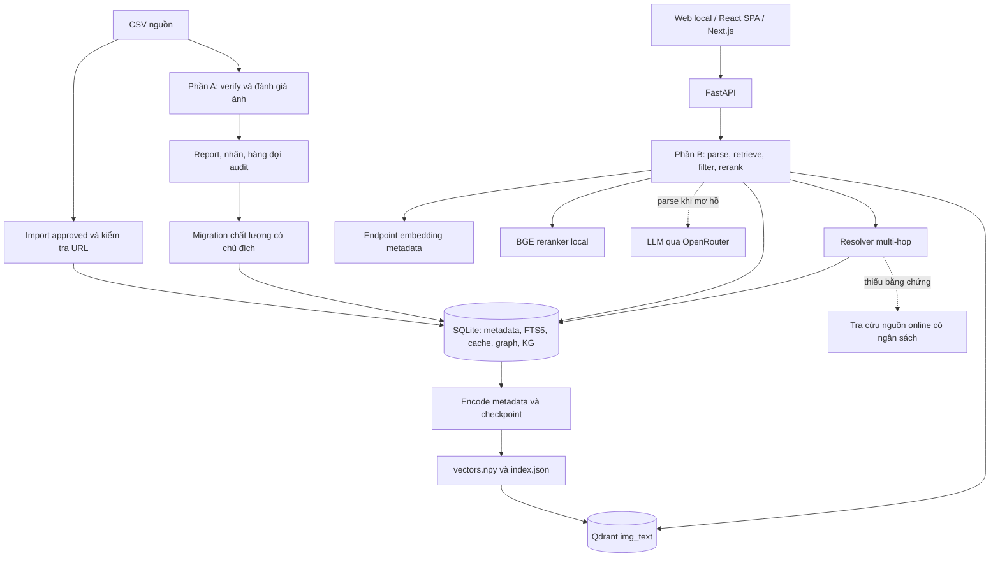

# Tài liệu kỹ thuật — Heritage Image Retrieval

Ngày rà soát: **21/10/2026**, múi giờ Asia/Saigon. Phiên bản pipeline truy xuất: `b3-guarded-parse-fair-multi`; định dạng index: `1`.

Tài liệu mô tả mã nguồn và dữ liệu có trong workspace tại thời điểm rà soát. Kết quả đo, điều kiện benchmark và các điểm chưa được kiểm chứng được trình bày ở [báo cáo performance](performance-benchmark.vi.md). Các bài kiểm thử và quy trình nghiệm thu ở [test case](test-cases.vi.md).

## 1. Mục tiêu và phạm vi thực hiện

Hệ thống phục vụ tìm ảnh di sản, địa danh, văn hóa và các thực thể trong catalog bằng câu truy vấn tiếng Việt. Có hai phần:

- **Phần A:** kiểm tra, gán nhãn và đánh giá ảnh bằng encoder, bộ phân loại nhẹ, lớp quyết định Jev và VLM theo ngân sách.
- **Phần B:** truy xuất ảnh từ catalog đã được chấp thuận, kết hợp tìm kiếm vector, tìm theo từ khóa và khớp tên thực thể; hỗ trợ nhiều ý định và quan hệ nhiều bước trong phạm vi KG.

Đường triển khai thực tế là **FastAPI + SQLite/FTS5 + file NumPy + Qdrant tùy cấu hình**. Các thành phần Redis, Postgres, S3/MinIO và worker trong Docker Compose thuộc thiết kế mở rộng; một số thao tác vẫn là stub. Không dùng sự hiện diện của container hoặc cấu hình YAML để kết luận các tính năng đó đã hoạt động đầy đủ.

### 1.1. Snapshot dữ liệu

| Thuộc tính | Giá trị và cách xác định |
|---|---|
| Nguồn đang chọn | `data/data_anh_pass_master.csv`, qua `SOURCE_CSV` |
| Dòng CSV theo báo cáo đếm | 130.429 |
| Ảnh trong SQLite, manifest và số hàng `vectors.npy` | **130.428**, đã đối chiếu lại bằng đọc file và truy vấn SQLite |
| Thực thể / nhóm `parent_class` | **11.749 / 670**, đọc trực tiếp SQLite |
| Vector metadata | `float32`, kích thước **130.428 × 2.560** |
| Metadata khác nhau đã encode | 106.093 theo manifest |
| Ảnh có cả chiều rộng và chiều cao | 42.665, tương đương khoảng **32,71%** |
| Ảnh mang `verify=yes`, `verify_source=human` | 130.428; đây là trạng thái được migrate từ nguồn đã duyệt |
| Ảnh có nhãn watermark | 3.150, khoảng **2,42%** |
| Nhánh vector ảnh của Phần B | Chưa có `data/local/visual_index.json` |

Một dòng có URL `x-raw-image://` bị loại; `reports/master/index_counts.json` vẫn ghi `ok=false` vì yêu cầu đủ **130.429** ảnh. Parity giữa các kho không đồng nghĩa đạt đủ số dòng nguồn. Số điểm Qdrant là số trong báo cáo đã lưu; lần rà soát này không gọi Qdrant trực tiếp.

Nguồn: [manifest](../data/local/index.json), [báo cáo đếm](../reports/master/index_counts.json), [migration](../reports/master/migrate_v2.json), [bằng chứng rà soát](../reports/project_review/evidence.json).

## 2. Kiến trúc tổng thể

Luồng nhập catalog đã duyệt và luồng verify được chạy qua CLI riêng. `--mode approved` không tự chạy toàn bộ pipeline kiểm duyệt pixel. Việc chuyển nhãn verify sang catalog có script migration; không có bằng chứng worker tự động đồng bộ hai phần.

### 2.1. Các module chính

| Module | Vai trò thực tế |
|---|---|
| `api/main.py`, `api/schemas.py` | HTTP, kiểm API key, validation, timing, khai báo response, mount UI local |
| `storage/local.py` | Import theo scope, schema SQLite, FTS5, đọc ảnh, cache |
| `retrieval/local_index.py` | Manifest, encode metadata có checkpoint, tìm cosine chính xác bằng NumPy |
| `retrieval/vector_store.py` | Tìm HNSW qua Qdrant hoặc backend NumPy; collection text và visual |
| `retrieval/catalog.py`, `rule_parser.py` | Catalog tên trong RAM, nhận diện thực thể, chia ý định và modifier |
| `retrieval/speculative.py`, `llm_router.py` | Parse LLM chạy nền có timeout, cache và guard |
| `retrieval/local_search.py` | Điều phối search, gộp nguồn, filter, chia slot và response |
| `retrieval/rerank.py` | BGE/Qwen local, API reranker, LLM hoặc cosine; penalty chất lượng |
| `retrieval/hop.py`, `kg_online.py`, `kg_sources.py` | KG có bằng chứng, phân giải quan hệ, tra cứu và kiểm câu trích |
| `pipeline/verify/` | Gate, tải ảnh, encoder, feature, split, head, Jev, router và báo cáo |
| `scripts/eval_*.py`, `evals/harness.py`, `loadtest/` | Đánh giá chất lượng, latency, A/B và hạ tầng load test |

Mã nguồn dẫn chiếu trong các phần sau dùng đường dẫn tương đối từ repo; không phải toàn bộ module trong cùng thư mục đều nằm trên đường xử lý request.

### 2.2. Các giao diện web

`api/main.py` chuyển `/` sang `/ui/`, phục vụ `web/local/` trực tiếp. `web/spa/` là giao diện React/Vite riêng, có trang Search, Moderation, Benchmark và Docs. `web/app/` là ứng dụng Next.js được Dockerfile web sử dụng. Cần xác định đúng giao diện khi kiểm thử hoặc triển khai; kết quả unit test SPA không xác nhận cả ba giao diện.

## 3. Pipeline dữ liệu của Phần B

### 3.1. Import và chuẩn hóa

1. Đọc CSV UTF-8, có hỗ trợ BOM. Các cột bắt buộc gồm `entity_id`, `canonical_name`, `slug`, `category`, `image_url`, `flag`.
2. Nếu truyền `--username`, chỉ nhập các dòng thuộc scope đó. Fingerprint catalog phụ thuộc nguồn và scope.
3. Chỉ nhận dòng `flag=approved` và URL HTTP(S). CLI ghi các dòng không đạt vào quarantine.
4. Khử URL trùng trên toàn bộ phần dữ liệu được nhập. Cùng URL có thể chỉ gắn với bản ghi được gặp trước.
5. Tạo `image_id` bằng UUID5 từ URL; `rownum` là thứ tự để ánh xạ hàng vector với điểm Qdrant.
6. Tạo `metadata_text` bằng cách nối **tên + category + description**. Nạp bản không dấu vào FTS5; giữ nguyên metadata để encode.
7. Ghi vào SQLite trong transaction; import lại cùng fingerprint có thể tái sử dụng catalog.

Đổi CSV có thể thay catalog và làm index cũ mất hiệu lực. Chất lượng URL HTTP(S) chưa chứng minh ảnh tải được; import metadata không tải toàn bộ pixel.

Nguồn: [storage/local.py](../storage/local.py), [pipeline/local_run.py](../pipeline/local_run.py).

### 3.2. Embedding và index

- Snapshot hiện tại dùng `qwen3-embedding-4b`, **2.560 chiều**, backend API tương thích OpenAI. Document gửi metadata nguyên văn; query được thêm tiền tố `Instruct: ...` và `Query: ...`.
- Vector được chuẩn hóa L2. Với vector đã chuẩn hóa, tích vô hướng tương đương cosine.
- Các ảnh có metadata giống nhau được dùng chung kết quả encode, nhưng vẫn có hàng vector và danh tính ảnh riêng.
- Build ghi theo chunk, kiểm shape và giá trị hữu hạn, flush vector trước khi cập nhật checkpoint manifest qua file tạm.
- Việc tái sử dụng index phụ thuộc count, fingerprint, model, dimension, backend, độ dài input và phiên bản index. Backend NumPy còn đối chiếu catalog/model khi nạp.
- Qdrant `img_text` dùng point ID bằng `rownum`, cosine, HNSW **m=16, ef_construct=128**; khi tìm dùng `ef >= max(QDRANT_SEARCH_EF, top_k)`, mặc định `QDRANT_SEARCH_EF=128`.
- Nhánh NumPy tìm chính xác trên toàn bộ ma trận; nhánh Qdrant tìm xấp xỉ để giảm chi phí tìm kiếm.

`config/models.yaml` vẫn ghi một cấu hình SigLIP/HNSW khác. Tham số ở trên lấy từ mã đang được gọi và manifest, thay vì lấy YAML làm cấu hình runtime mặc định.

Nguồn: [local_index.py](../retrieval/local_index.py), [embed.py](../retrieval/embed.py), [vector_store.py](../retrieval/vector_store.py).

### 3.3. Metadata chất lượng và graph

`scripts/migrate_images_v2.py` ghép kết quả tải ảnh, nhãn verify và watermark vào catalog. Khi cung cấp CSV đã được duyệt tay, nhãn người được ưu tiên. Đây là nguồn gốc của trạng thái `verify_source=human`; lần rà soát này không gán lại nhãn ảnh.

`retrieval/graph.py` có graph phân loại `IN_CLASS` trong SQLite. KG quan hệ dùng bộ bảng riêng: `kg_node`, `kg_alias`, `kg_edge`, `kg_link`, `kg_lookup`. Graph phân loại không cung cấp quan hệ cha/con hoặc vợ/chồng; các quan hệ đó đi qua `retrieval/hop.py`.

## 4. Pipeline Phần A: verify ảnh

```mermaid
flowchart LR
    A[CSV] --> B[Gate URL và trùng URL theo entity]
    B --> S[Chia train, val, test theo nhóm tên]
    S --> C[Tải, decode, SHA256, kiểm trùng nội dung]
    C --> D[SigLIP2 ảnh, tên và mô tả]
    D --> E[Vector ảnh cùng 14 feature]
    E --> F[Head tuyến tính và hiệu chỉnh]
    F --> G[Jev nhận trạng thái văn bản]
    G --> H[Router theo bất định và ngân sách]
    H --> I[VLM cho tập được chọn]
    I --> J[Báo cáo proxy và hàng đợi nhãn người]
```

### 4.1. Gate, split và tải ảnh

Gate loại URL sai, host bị chặn, URL chứa khoảng trắng; ảnh không có đuôi được xử lý theo `--noext`, CLI mặc định `download`. Khử URL trùng trong từng entity. Gate verify khác với điều kiện import catalog approved, nên số ảnh đi qua hai luồng có thể khác nhau.

Split gom tên sau chuẩn hóa, bỏ hậu tố ngoặc ở cuối; các nhóm gần nhau tiếp tục được gộp bằng token Jaccard ≥ 0,9. Phân tầng theo category bucket, mặc định dành 30% nhóm cho TEST và 20% phần còn lại cho VAL. Tỷ lệ theo số ảnh có thể khác tỷ lệ theo nhóm. Tải ảnh và SHA256 giúp phát hiện nội dung trùng; mã hiện tại loại bản TEST của nội dung xuất hiện ở nhiều split. Việc kiểm trùng không bảo đảm loại hết trường hợp trùng giữa TRAIN và VAL hoặc ảnh biến đổi gần giống nhau.

Nguồn: [gate.py](../pipeline/verify/gate.py), [split.py](../pipeline/verify/split.py), [run.py](../pipeline/verify/run.py).

### 4.2. Encoder, feature và head

Encoder mặc định `google/siglip2-base-patch16-256`, dùng ảnh và text tower cùng không gian. Pilot đã lưu có vector ảnh 768 chiều và tổng input head **782 chiều**, gồm vector ảnh + 14 feature. Feature gồm độ gần với ảnh cùng nhóm, ảnh gần nhất, tên, mô tả, số ảnh cùng nhóm, prior host/category, tín hiệu mô tả, kích thước, tỷ lệ khung hình và dung lượng.

Head là Logistic Regression có chuẩn hóa feature và cân bằng lớp. Chọn `C` theo log-loss VAL; dùng GroupKFold tạo dự đoán ngoài fold trên TRAIN khi đủ điều kiện; isotonic calibration trên VAL và báo ECE crossfit. TEST không được dùng để chọn `C` trong hàm huấn luyện. Nhãn bootstrap đến từ VLM, nên kết quả trên nhãn này đo đồng thuận với thầy.

### 4.3. Jev và router ngân sách

Jev nhận trạng thái **văn bản** được rút từ feature và xác suất head; trả `yes/no/defer` cùng tín hiệu tin cậy. Đây không phải một lần VLM nhìn trực tiếp ảnh. Khi có logprob thì dùng logprob; nếu thiếu thì dùng confidence tự khai và hiệu chỉnh. Head là lớp dự phòng khi Jev không khả dụng.

Router xếp ưu tiên từ bất định, tình trạng thiếu ảnh `yes` của nhóm và quyết định `defer`; chọn tối đa ngân sách theo `alpha`. Mặc định pilot `alpha=0,15`. Nhóm có dưới 5 ảnh được ghi nhận là cần bổ sung; nhóm đã có ít nhất 8 ảnh `yes` chắc chắn được giảm tiêu tốn ngân sách theo rule. VLM chỉ xử lý phần được route, có cơ chế chấm lại một phần và xử lý bất đồng.

Ngân sách 15% áp dụng cho **bước VLM sau router trên tập target**, không phải cam kết chỉ 15% tổng ảnh từng được gửi VLM: bootstrap có thể đã gán nhãn toàn bộ pilot và có thêm lượt chấm lại.

Nguồn: [head.py](../pipeline/verify/head.py), [jev.py](../pipeline/verify/jev.py), [router.py](../pipeline/verify/router.py), [run.py](../pipeline/verify/run.py).

### 4.4. Phạm vi đã triển khai

Luồng verify ở `pipeline/verify/` chạy được theo mã và có báo cáo pilot. Luồng cascade cũ ở `pipeline/stage1_heuristics.py`, `stage2_classifier.py`, `stage3_vlm.py` không phải cùng pipeline: classifier ONNX cũ còn `NotImplementedError`, một số backend VLM cũ chưa triển khai. Worker queue ở `pipeline/worker_loop.py` cũng chưa xử lý job thực tế. Không lấy throughput giả định từ `config/cascade.yaml` làm throughput đo của verify hiện tại.

## 5. Pipeline xử lý một truy vấn

### 5.1. Cache và parse

1. Validate query không rỗng, `top_k` trong 1–100 và tập khóa filter được hỗ trợ.
2. Tạo cache key từ query, top-k, filter, manifest, phiên bản pipeline, vector backend, thông tin kích thước, chính sách parser và reranker.
3. Nếu cache hit, trả kết quả đã lưu với request ID và timing mới.
4. Nếu miss, nạp catalog tên, rule parse thực thể và tách sub-query; xác định độ tin cậy.
5. `high`: mỗi sub-query neo vào một tên thực thể với mức phủ token ≥ 60%; `medium`: set query; còn lại `low`.
6. Mặc định `LLM_PARSE_MODE=ambiguous_only`: chỉ khởi chạy LLM khi rule chưa chắc, song song với retrieve theo rule.
7. Chờ LLM trong phần ngân sách còn lại, mặc định **600 ms tính từ lúc khởi chạy**. Kết quả khác rule có thể kích hoạt retrieve bổ sung.

Guard mặc định chặn LLM ghi đè rule `high`, chặn `set_query → single`, bỏ parse `multi_hop` do LLM đề xuất. Timeout/lỗi giữ rule; request nền vẫn có thể hoàn tất và ghi cache parse. Cơ chế này giới hạn thời gian chờ parse; tổng thời gian request còn phụ thuộc embedding, rerank và lần retrieve bổ sung.

Cache nằm trong SQLite `llm_cache`; hàm cache không có TTL. Key hiện chưa chứa toàn bộ thay đổi có thể có như nội dung KG hoặc cờ cho phép override rule. Khi đổi chính sách ngoài các thành phần đã có trong key, cần kiểm tra cách vô hiệu hóa cache.

Nguồn: [local_search.py](../retrieval/local_search.py), [speculative.py](../retrieval/speculative.py), [storage/local.py](../storage/local.py).

### 5.2. Tạo ứng viên và fusion

Mỗi sub-query kết hợp các danh sách:

| Nguồn | Cơ chế | Giới hạn / trạng thái |
|---|---|---|
| Dense metadata | Encode query, tìm `img_text` | Top 200 mỗi sub-query |
| Dense visual | Encode query trong không gian SigLIP2, tìm `img_visual` | Top 200 nếu visual manifest hoàn chỉnh; chưa bật trong snapshot |
| Từ khóa | SQLite FTS5/BM25 trên metadata không dấu | Top 100, thử AND trước rồi OR |
| Tên thực thể | Khớp tên chuẩn hóa, ưu tiên trùng hoàn toàn, xen kẽ khớp một phần | Tối đa 30 ảnh/entity; giới hạn 20 entity khớp một phần |

Hư từ FTS được loại trên dạng còn dấu rồi mới bỏ dấu, để phân biệt `cho/chợ`, `đến/đền`. Fusion dùng RRF với trọng số **text/visual/lexical/exact = 1/1/1/3**. Công thức thực thi: `sum(w_i / (60 + rank_i))`, trong đó `rank_i` bắt đầu từ **0**.

Ứng viên đi qua filter trên tối đa 400 ID đầu của từng danh sách được xét; sau đó lấy pool rerank `max(top_k, RERANK_TOP_K)`. Workspace đang đặt `RERANK_TOP_K=24`. Đây là giới hạn pool ứng viên, không phải số ảnh được bảo đảm trả về.

### 5.3. Filter và chất lượng

API nhận các khóa `entity_id`, `entity_slug`, `parent_class`, `min_width`, `orientation`. Filter API ưu tiên hơn modifier suy từ query.

- Khi catalog có dữ liệu kích thước, filter kích thước truyền bằng API dùng chính sách strict: bỏ ảnh chưa biết kích thước.
- Filter kích thước suy ra từ câu dùng chính sách permissive: giữ ảnh chưa biết và cảnh báo.
- Nếu catalog chưa có dữ liệu kích thước, mã hiện tại bỏ qua filter kích thước và cảnh báo, kể cả filter API. Đây là ngoại lệ cần kiểm tra khi nghiệm thu.
- `NULL` watermark/verify được xuất thành `unknown`, không tự suy ra nhãn âm.
- Penalty dùng `verify=no`, ảnh nhỏ và `has_watermark=1`. Ảnh có nguồn duyệt `human` không bị penalty watermark theo chính sách đang cài đặt.

Hit có `quality.pixel_checked=false`: search không chạy kiểm duyệt pixel theo request. Trạng thái người đã duyệt và trạng thái ảnh đã được kiểm pixel trong lần tìm kiếm là hai thông tin riêng.

### 5.4. Rerank và dự phòng

Backend mặc định V2 là `local_ce`, model `BAAI/bge-reranker-v2-m3`. Các văn bản ứng viên giống nhau chỉ được chấm một lần rồi ánh xạ điểm về từng ảnh. Mặc định không cắt các hit dưới ngưỡng 0,2 của LLM cũ.

Nếu rerank lỗi thuộc nhóm được xử lý, search thử cosine embedding; nếu bước đó cũng lỗi, giữ thứ tự fusion và thêm warning. Nếu endpoint embedding trả lỗi được bọc bằng `EmbeddingUnavailable`, nhánh dense text được bỏ qua để tiếp tục FTS + khớp tên. Những kết quả suy giảm được nhận diện sẽ không được ghim vào search cache. Các lỗi ngoài phạm vi exception được bắt vẫn có thể làm request thất bại.

Các chế độ API reranker, LLM và embedding còn tồn tại để so sánh hoặc cấu hình. A/B đã lưu cho thấy BGE nhanh hơn Qwen3-Reranker-0.6B trên cùng pool, nhưng rerank tự do làm giảm chất lượng truy vấn tên chính xác; đó là lý do có chính sách ưu tiên thực thể ở mục 6.

## 6. Cách truy xuất từng loại query

### 6.1. Single intent — tìm một thực thể hoặc mô tả

Ví dụ: `Văn Miếu`, `Chùa Một Cột Hà Nội`, hoặc một mô tả như `chùa cổ mái ngói`.

Parser ưu tiên span tên thực thể để không tách các từ quan hệ nằm trong tên. Hybrid retrieve tạo pool, filter rồi rerank. Với query có confidence `high` và anchor tên, kết quả được chia ba tầng: **entity trùng đúng tên → entity khớp một phần → còn lại**. Reranker chỉ xếp thứ tự trong mỗi tầng.

Đối với mô tả không neo vào tên, hệ thống dựa nhiều vào embedding metadata và BM25. Chưa có goldset đủ để kết luận chất lượng các thuộc tính chỉ thấy qua pixel như màu sắc, góc chụp hoặc chi tiết kiến trúc.

### 6.2. Multi-intent — nhiều chủ thể trong một câu

Ví dụ: `Chùa Hương và Bích Động`.

Tách câu thành sub-query, retrieve và rerank **riêng từng ý**. Nếu có anchor tên, chỉ giữ ảnh thuộc tập entity khớp tên của ý đó; nếu không có anchor, bằng chứng hiện tại là thứ hạng retrieve, yếu hơn đối chiếu entity. `allocate_fair` lấy round-robin, loại ID trùng và dừng ở `top_k`. Không tự thêm ảnh ngoài các queue để lấp đủ số lượng.

Response trả `sub_queries`, `supported_candidates`, `coverage`, `returned`, `evidence` và `hit.matched_subqueries`. Khi `top_k` nhỏ hơn số ý hoặc thiếu ứng viên cho một ý, trả warning. `coverage=covered` phản ánh bằng chứng của pipeline; không bảo đảm đúng `entity_id` mà người đánh giá kỳ vọng. Benchmark có ví dụ 20/20 covered nhưng chỉ 19/20 đúng cả hai ID.

### 6.3. Set query — tìm một tập theo loại

Ví dụ: `các chùa Khmer Nam Tông`, `các nhà nổi & nhà bè trên sông/vịnh`.

Parser nhận tín hiệu tập hợp; đường search hiện tại vẫn dùng hybrid retrieve và rerank theo các sub-query được parse. Khi cần ràng buộc lớp chính xác, client có thể truyền `filters.parent_class`. Mã search không thực hiện một bước duyệt toàn bộ graph phân loại để bảo đảm bao phủ mọi thành viên của tập.

Vì vậy, set query là **top-k kết quả liên quan tới một lớp**, chưa phải phép liệt kê đầy đủ một tập dữ liệu. Benchmark ghi nhận 6/20 câu mong muốn set query bị parse sang loại khác; ký tự `&` trong tên lớp gây một số ca chia ý sai. Chưa có quota bảo đảm đa dạng entity cho mọi set query.

### 6.4. Multi-hop — tìm qua chuỗi quan hệ

Ví dụ về cú pháp được hỗ trợ: `lăng của con trai vua Gia Long`. Câu có thể có nhiều đích, vì một người có nhiều con; không được ngầm chọn một người nếu KG chưa xác định duy nhất.

Resolver thực hiện:

1. Nhận target nơi chốn, tách quan hệ đọc từ ngoài vào; áp dụng chuỗi từ seed ra ngoài, tối đa 4 bước quan hệ trong planner.
2. Link seed bằng alias trong KG.
3. Duyệt `PARENT_OF` theo chiều cha/mẹ → con hoặc ngược lại; `SPOUSE_OF` hai chiều; lọc giới tính nếu câu yêu cầu.
4. Nếu target là nơi chốn, thêm cạnh `BURIED_AT`, `WORSHIPPED_AT` hoặc `MEMORIAL_AT`.
5. Chỉ dùng cạnh `verified=1` hoặc `reviewed=1`. Link đích qua `kg_link` tới entity có ảnh.
6. Lấy ảnh đúng entity đích, xen kẽ các entity ID; nhánh này dùng thứ tự đích đã xác minh, không chạy BGE như search thông thường.

KG hiện đã có seed và bằng chứng: báo cáo ghi 17 người, 205 cạnh người–nơi chốn sinh từ tên catalog, 14/15 claim người–người kiểm được. Đây là trạng thái mới hơn mô tả “chưa có KG” trong tài liệu V2 cũ.

Thiếu cạnh người–người có thể kích hoạt tra cứu online khi được bật, qua ngân sách mặc định 2.500 ms và tác vụ nền. Nguồn có thể được kiểm bằng trang tải về hoặc snippet tìm kiếm phù hợp; cần xem `verifier` của từng cạnh. Kiểm được câu trích không tự bảo đảm nguồn đúng hoặc quan hệ được suy ra đúng về ngữ nghĩa.

| `resolution.status` | Hành vi |
|---|---|
| `resolved` | Có chuỗi quan hệ tin cậy và entity đích có ảnh |
| `pending_online_lookup` | Tác vụ online đang chạy nền; client có thể thử lại sau |
| `seed_not_linked` | Không link được seed |
| `no_evidence` | Thiếu cạnh tin cậy; không kết luận quan hệ không tồn tại |
| `target_not_in_catalog` | Có đích nhưng chưa có ảnh; có thể trả gợi ý nơi liên quan |
| `unsupported_relation` | Loại quan hệ chưa hỗ trợ |

Những trạng thái chưa giải được trả `hits=[]` và giải thích. Ví dụ quan hệ anh/em, cháu hoặc chức vụ tổ chức còn ngoài phạm vi resolver hiện tại. Luồng multi-hop chưa có benchmark chất lượng và latency đại diện.

Nguồn: [hop.py](../retrieval/hop.py), [kg_seed.py](../scripts/kg_seed.py), [kg_online.py](../retrieval/kg_online.py), [seed report](../reports/kg/seed.json).

## 7. API và vận hành

| API | Vai trò / giới hạn |
|---|---|
| `GET /v1/health` | Trả cấu hình, catalog và manifest; không cần key; không kiểm tra sẵn sàng toàn bộ dependency |
| `POST /v1/search` | Truy xuất, nhận query/top-k/filter; có timing, warning, coverage và resolution |
| `POST /v1/embed` | Encode text; input ảnh hiện qua caption DeepSeek rồi encode text, khác nhánh visual SigLIP2 |
| `POST /v1/rerank` | Chấm và xếp danh sách ứng viên |
| `/v1/entities`, `/v1/graph` | Duyệt catalog, graph phân loại và rebuild theo endpoint tương ứng |
| `/v1/verify/*` | Nhãn người, báo cáo và chức năng hỗ trợ verify theo router |
| `/v1/reports/*` | Đọc các report đã được router cho phép |
| `POST /v1/ingest` | Chưa ingest async; hiện hướng dẫn chạy CLI và phát sinh RuntimeError, được chuyển thành HTTP 503 |
| `/v1/backfill*` | Còn số liệu mẫu và queue stub; chưa phải cơ chế bổ sung ảnh hoạt động |

Schema search: query 1–2.000 ký tự; `top_k` 1–100. API key nội bộ được kiểm bằng `TEST_API_KEY` khi bật enforce; chưa có vòng đời key theo DB, scope và rate limit người dùng đầy đủ. HTTP middleware ghi `X-Response-Time`; `total_ms` của response là thời gian trong search, có phạm vi khác header.

`PRELOAD_MODELS` khởi động catalog và reranker bằng thread nền. Health có thể báo `ok` trong khi model chưa nạp xong; cần warm-up và kiểm readiness riêng khi đo latency khởi động.

Endpoint embedding/rerank bên ngoài dùng limiter trong **một tiến trình**, cấu hình workspace `EMBED_API_RPM=95`; limiter mặc định trong mã là 0 nếu thiếu biến. Chờ limiter mặc định tối đa 30 giây rồi vẫn gửi request; timeout HTTP embedding mặc định 60 giây và có retry. Do đó SLO 1.500 ms là mục tiêu đo theo điều kiện, chưa phải deadline cưỡng chế cho mỗi request. Nhiều worker không chia sẻ bộ đếm limiter.

## 8. Lý do chọn giải pháp và đánh đổi

| Lựa chọn | Căn cứ trong dự án | Đánh đổi |
|---|---|---|
| SQLite + FTS5 | Metadata, lexical và cache hoạt động local; test dễ dựng catalog nhỏ | Cần kiểm thử ghi đồng thời, dung lượng cache và vận hành nhiều process |
| Dense + BM25 + tên thực thể | Bao phủ ngữ nghĩa, từ khóa hiếm và tên riêng tiếng Việt | Metadata sai hoặc thiếu vẫn truyền sang kết quả; fusion cần goldset để tối ưu trọng số |
| Qdrant + NumPy | ANN cho phục vụ; NumPy làm phương án chính xác và hỗ trợ test | Phải quản lý parity khi rebuild; ANN self-test chưa chứng minh semantic relevance |
| BGE local | A/B pool đóng băng: p95 150,9 ms, độ chính xác theo lớp ngang Qwen3-0.6B trong thí nghiệm | Chất lượng tên chính xác giảm nếu rerank tự do; cần phân tầng entity |
| Rule trước, LLM có guard | Tránh phá tên entity, có kết quả khi thiếu key; giảm gọi LLM cho câu chắc chắn | Rule còn lỗi với tên lớp chứa liên từ; LLM chậm thường không kịp 600 ms |
| Rerank riêng + round-robin | Nhiều ý cùng có cơ hội xuất hiện, có thể báo thiếu coverage | Điểm giữa các ý không hoàn toàn tương đương; anchor có thể khớp nhiều entity trùng tên |
| KG có bằng chứng | Chuỗi quan hệ có thể truy vết, không tự tìm ảnh thay khi thiếu cạnh | Phạm vi KG nhỏ; chất lượng nguồn và mapping tên cần đánh giá độc lập |
| Head + Jev + VLM theo ngân sách | Tận dụng feature rẻ, dành VLM cho ảnh khó | Bootstrap và calibration phụ thuộc thầy; chưa có nhãn người đủ để xác nhận chất lượng |

Các lựa chọn model ở đây được lý giải từ kết quả A/B đã lưu, không phải so sánh toàn bộ model hiện có trên thị trường.

## 9. Hạn chế và hướng xử lý ưu tiên

| Ưu tiên | Hạn chế đã quan sát | Hướng xử lý và bằng chứng nghiệm thu cần có |
|---|---|---|
| P0 | Goldset có 5 query đều là placeholder; chưa có relevance độc lập | Gán nhãn ảnh/query, đóng băng split và báo chỉ số theo từng loại query |
| P0 | Master concurrency 4 có p95 6.322 ms | Đo lại endpoint, queue, limiter và xử lý local; xác nhận p95 dưới tải qua HTTP |
| P0 | Python trong môi trường ảo không khởi chạy được ở lần rà soát | Khôi phục interpreter, dựng môi trường đúng lock rồi chạy pytest và lưu JUnit |
| P1 | Set query chỉ 14/20 đúng intent; multi-intent khác nhau giữa coverage và entity ID | Sửa nhận diện lớp/liên từ, kiểm mapping entity trùng tên, thêm relevance do người gán |
| P1 | Kích thước chỉ biết 32,71%; watermark 2,42%; visual chưa bật | Bổ sung dữ liệu, đo tỷ lệ biết/không biết và A/B nhánh visual trên cùng bộ query |
| P1 | Cache không TTL, key không phản ánh mọi thay đổi KG/chính sách | Thêm cơ chế version/invalidation phù hợp và test thay đổi dữ liệu |
| P1 | Chưa có deadline tổng, limiter theo process, preload chưa là readiness | Đo cold start/tail latency, ngân sách dependency và nhiều worker |
| P2 | Worker, backfill, một số backend và phép dedup gần còn stub | Hoàn thiện từng luồng rồi bổ sung integration test có dữ liệu thật |

Không có dữ liệu để khẳng định chi phí trên một triệu ảnh, throughput kiểm duyệt GPU hoặc SLO mọi chế độ LLM. Đơn giá/throughput trong tài liệu thiết kế cũ chỉ là giả định cho tới khi có lượt đo tương ứng.

## 10. Tài liệu liên quan và thứ tự đọc

1. [Performance và benchmark](performance-benchmark.vi.md): toàn bộ metric có bằng chứng, công thức và giới hạn phép đo.
2. [Test case và tái lập](test-cases.vi.md): ma trận hành vi, test hiện có, cách nghiệm thu và lệnh chạy.
3. [244 ca benchmark dạng CSV](../reports/project_review/benchmark-cases.csv): truy vấn, loại intent, số hit và metric từng ca từ snapshot master.
4. [Evidence JSON](../reports/project_review/evidence.json): hash nguồn, kiểm tra SQLite/NPY, tóm tắt metric và trạng thái các lần chạy kiểm tra.
