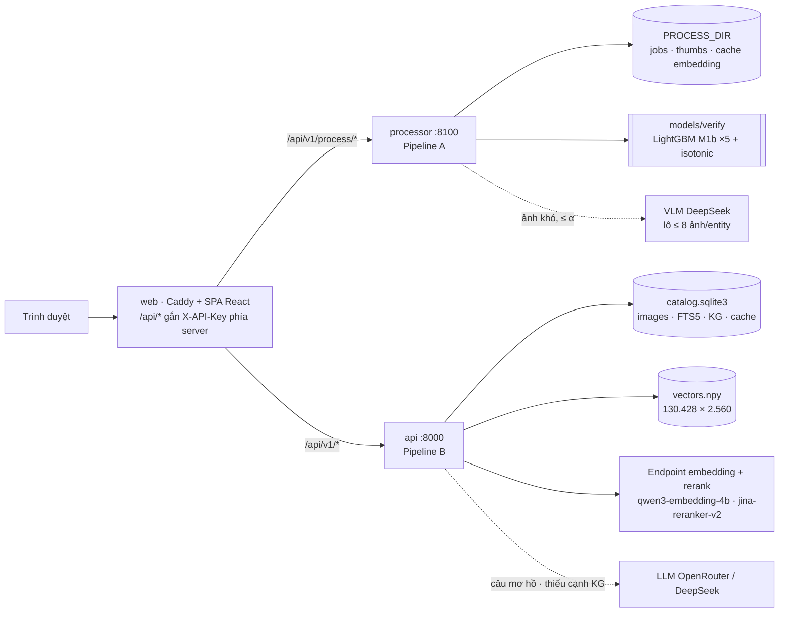
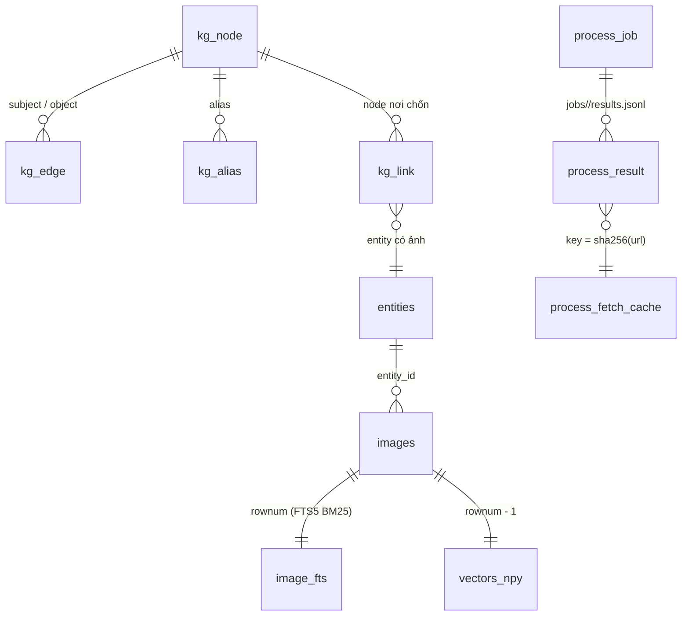
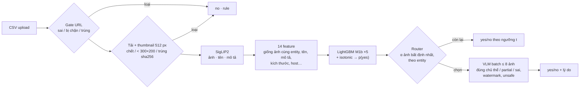
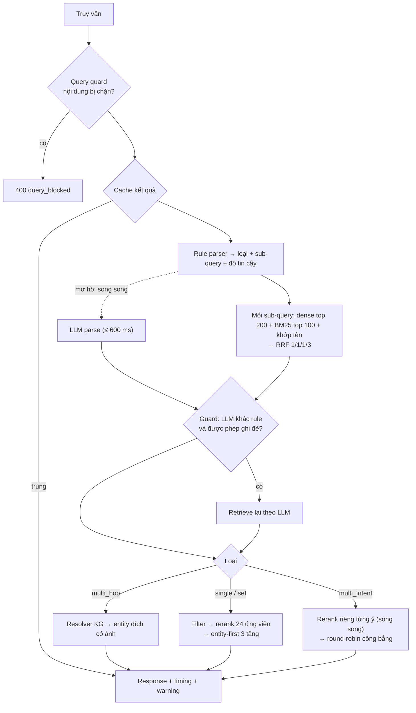

# Tài liệu kỹ thuật — Heritage Image Retrieval

Cập nhật: **22/10/2026**. Tài liệu mô tả mã nguồn và dữ liệu đang có trong repo. Mọi con số dẫn từ một lượt đo có file kết quả kèm theo:
- [Báo cáo performance và benchmark](performance-benchmark.vi.md): metric, cách đo, lệnh tái lập.
- [Test case](test-cases.vi.md): phương pháp dựng test case và kết quả từng ca.

## 1. Bài toán và cách chia hệ thống

| Pain point | Cách giải | Thành phần |
|---|---|---|
| **A.** Lọc / kiểm duyệt ảnh crawl thủ công thì chậm, cần domain knowledge; dùng LLM chấm từng ảnh thì không scale tới 10–100 triệu ảnh | Cascade chi phí tăng dần: rule → SigLIP2 + LightGBM (gần như miễn phí) → router chỉ gửi phần ảnh bất định nhất cho VLM theo ngân sách | **Processing service** (`processing/`), trang *Xử lý dữ liệu* |
| **B.** Truy xuất ảnh cho 3 loại truy vấn: single intent, multi-intent, multi-hop, < 3 s trên ≥ 80.000 ảnh | Hybrid retrieval (dense + BM25 + khớp tên) + rerank cross-encoder; tách ý cho multi-intent; KG có bằng chứng cho multi-hop; hạn chờ tổng 2,7 s cho mỗi request | **API truy xuất** (`api/`, `retrieval/`), trang *Tìm kiếm* |

Hai pipeline là **hai service và hai image Docker độc lập**: lỗi hoặc tắt service xử lý không ảnh hưởng tìm kiếm.
- API truy xuất không cần torch: image 395 MB, khởi động trong vài giây.
- Service xử lý mang torch + SigLIP2 + LightGBM.

## 2. Kiến trúc tổng thể

| Môi trường | Web | Pipeline B | Pipeline A |
|---|---|---|---|
| `docker compose up` (bàn giao) | `web` :8080 | `api` :8000, index ở `./data/local` | `processor` :8100, CPU |
| Cloud | Vercel (SPA + Edge proxy) | HF Space Docker (private), index kéo từ HF dataset | Bật khi đặt `PROCESS_URL`; mặc định chưa triển khai (cần torch, GPU nếu muốn nhanh) |
| Dev local | Vite :5173 | `uvicorn api.main:app` | `uvicorn processing.main:app --port 8100` (GPU qua `.venv-gpu`) |

Sơ đồ CI/CD và quy trình deploy: [deploy.md](deploy.md).

### 2.1. Schema dữ liệu

Schema đầy đủ ở dạng DBML: [db/schema.dbml](../db/schema.dbml).

## 3. Pipeline A — xử lý và kiểm duyệt ảnh

### 3.1. Luồng xử lý

| Tầng | Code | Chi phí | Vai trò |
|---|---|---|---|
| Gate | [gate.py](../pipeline/verify/gate.py) | ~0 (1,4 s / 80k dòng) | Loại URL không hợp lệ, host bị chặn, khoảng trắng, URL trùng trong entity |
| Tải | [fetch.py](../pipeline/verify/fetch.py) | I/O | Giải mã, thumbnail, **tiêu chí độ phân giải** (< 300×200), sha256 để bắt trùng nội dung. Cache theo `sha256(url)`: xử lý lại không tải lại |
| SigLIP2 | [encoder.py](../pipeline/verify/encoder.py) | 279 ảnh/s trên RTX 4050 | Vector ảnh, tên, mô tả trong cùng không gian |
| Feature | [features.py](../pipeline/verify/features.py) | < 1 ms | Độ giống ảnh cùng entity (`cos_centroid`, `cos_nn`), khớp tên/mô tả, kích thước, prior host/category |
| Classifier | [processing/model.py](../processing/model.py) | 2,4 ms / 1.000 ảnh | Ensemble 5 LightGBM trên 782 chiều (vector ảnh + 14 scalar), hiệu chỉnh isotonic |
| Router | [router.py](../pipeline/verify/router.py) | ~0 | Chọn tối đa α·N ảnh bất định nhất, ưu tiên entity thiếu ảnh tốt; bỏ entity < 5 ảnh hoặc đã đủ ≥ 8 ảnh chắc chắn |
| VLM | [vlm.py](../pipeline/verify/vlm.py) | $0,14 / 1.000 ảnh được gửi | Chấm theo lô ≤ 8 ảnh cùng entity: chủ thể, **watermark**, **nội dung không an toàn** (khiêu dâm, bạo lực, chính trị) |

### 3.2. Cấu hình production và căn cứ chọn

Cấu hình được chọn theo bốn giai đoạn trên **34.780 ảnh có nhãn người** (`data/test.csv`, 33,4% bị loại); chi tiết ở [verify-router-benchmark.md](verify-router-benchmark.md).
- Split theo nhóm tên: TRAIN 19.349 / VAL 4.866 / TEST 10.565.
- Mọi lựa chọn làm trên VAL; TEST chỉ dùng để báo cáo.

| Lựa chọn | Phương án được chọn | Căn cứ (TEST) |
|---|---|---|
| Nhãn để train | Nhãn người | Head học từ nhãn VLM thầy: AUC 0,649. Học từ nhãn người: 0,718 |
| Classifier | LightGBM trên 782 chiều (**M1b**) | AUC 0,735, Recall no 43,2%. Logistic: 37,9%. LightGBM chỉ 14 feature: 19,0%. MLP / stacking không hơn |
| Ngân sách VLM α | 15% | Ở ràng buộc Recall yes ≥ 85%, VLM cộng thêm 1,6 điểm Recall no. 20% tốt hơn 2,7 điểm nhưng trên VAL hòa (±0,5) nên chọn phương án rẻ hơn |
| Đọc câu trả lời VLM | `bo_watermark`: đúng chủ thể là duyệt | Người duyệt giữ 51% số ảnh bị VLM gắn watermark. Prompt gốc loại oan 43% ảnh tốt |
| Ngưỡng t | 0,55 | Tối đa Recall no với ràng buộc Recall yes ≥ 85%, entity retention ≥ 95% (trên VAL) |

So với cấu hình cũ (head học nhãn VLM, t = 0,5, α = 15%, prompt gốc), ở **cùng** mức giữ ảnh tốt và cùng chi phí VLM, cấu hình mới:
- bắt thêm ảnh xấu: Recall no 59,2% → 65,7%;
- kho sạch hơn: Precision yes 76,2% → 80,1%;
- giữ thêm ảnh tốt: 65,3% → 69,2%.

### 3.3. Processing service và giao diện

- **Upload:** `POST /v1/process/jobs` nhận CSV UTF-8, phân tách bằng dấu phẩy hoặc chấm phẩy.
  - Cột bắt buộc: `image_url` và tên entity.
  - Nhận cả định dạng master (`canonical_name`, `category`) lẫn định dạng file nhãn (`entity_name`, `leaf_label`).
  - Có cột `verify` thì kết quả được chấm với nhãn người.
  - Sai định dạng → HTTP 422 ngay, kèm danh sách cột hiện có.
- **Hàng đợi:** một worker, vì GPU / SigLIP2 dùng chung. Trạng thái job ghi ra `status.json`; khởi động lại thì job đang chạy dở được đánh dấu `interrupted`.
- **Theo dõi và kết quả:** tiến độ từng tầng (`done/total`, giây); `results.csv` (CSV gốc + `decision`, `stage`, `reason`, `p_yes`, `routed`, bằng chứng VLM); xem từng ảnh kèm thumbnail, lọc theo quyết định / tầng / lý do / ảnh lệch nhãn người.
- **Chi phí:** tính từ token VLM thật (`deepseek_usage.jsonl`) × đơn giá trong `.env`.

### 3.4. Mở rộng tới 10–100 triệu ảnh

| Tầng | Thông lượng đo được | Cách scale |
|---|---|---|
| Tải ảnh | 13 ảnh/s mỗi máy, 48 luồng (host gốc chậm, p95 ~ 5 s/ảnh) | **Nút thắt.** Scale ngang theo số máy / luồng; cache theo URL |
| SigLIP2 | 279 ảnh/s (RTX 4050 laptop) | 100M ảnh ≈ 100 GPU-giờ |
| LightGBM | > 400.000 ảnh/s (CPU) | Không đáng kể |
| VLM 15% | 18 ảnh/s với 8 luồng | Song song theo hạn mức API |

Chi phí cấu hình production là **$0,020 / 1.000 ảnh** (VLM + GPU giả định $0,35/giờ), tức **≈ $2.020 cho 100M ảnh**, chưa gồm băng thông tải ảnh. Nếu cho VLM chấm mọi ảnh thì ≈ $13.600 / 100M; nếu dùng Claude chấm từng ảnh thì còn cao hơn nhiều bậc.

## 4. Pipeline B — truy xuất

### 4.1. Dựng index (offline)

1. **Import:** CSV đã duyệt → SQLite ([storage/local.py](../storage/local.py)).
   - Chỉ nhận dòng `flag=approved` có URL HTTP(S); khử URL trùng.
   - `image_id = UUID5(url)`.
   - `metadata_text = tên + category + mô tả`.
   - FTS5 trên bản đã bỏ dấu.
   - Đo được: **35 s** cho 130.428 ảnh.
2. **Embedding:** `metadata_text` qua `qwen3-embedding-4b` (2.560 chiều, chuẩn hóa L2) → `vectors.npy`, có checkpoint ([local_index.py](../retrieval/local_index.py)).
   - Metadata trùng chỉ encode một lần (106.093 / 130.428).
   - Đo được: 35,6 phút, bị chặn bởi hạn mức 100 request/phút của endpoint.
3. **KG** cho multi-hop: node người / nơi chốn, cạnh có nguồn và câu trích ([multihop-kg.md](multihop-kg.md)).

Vector search mặc định là **NumPy cosine chính xác** trên 130.428 × 2.560 (~200 ms), nên không cần Qdrant; Qdrant HNSW vẫn hỗ trợ qua `VECTOR_BACKEND=qdrant`.

### 4.2. Xử lý một truy vấn

**Hạn chờ tổng của mỗi request** là `SEARCH_DEADLINE_S` = 2,7 s ([retrieval/budget.py](../retrieval/budget.py)). Mỗi lời gọi ra ngoài lấy phần thời gian còn lại, thay vì mỗi tầng tự có một hạn riêng cộng dồn:

| Tình huống | Xử lý | Hệ quả |
|---|---|---|
| Embedding truy vấn chậm hoặc hết hạn mức | Bỏ nhánh dense | Vẫn trả kết quả từ FTS5 + khớp tên |
| Rerank chậm hoặc hết hạn mức | Giữ thứ tự RRF | Không gọi thêm endpoint |
| Limiter hết slot trong hạn | Báo lỗi ngay, không xếp hàng chờ | Request không bị kéo dài |
| LLM parse chậm | Chờ tối đa 600 ms, giữ rule | LLM vẫn chạy nền để ghi cache |
| Tra KG online | Ngân sách 1,8 s | Quá hạn trả `pending_online_lookup` |

Mọi kết quả suy giảm đều mang warning và **không được cache**.

### 4.3. Cách truy xuất từng loại

- **Single intent** (`Lăng Tự Đức`, `phố cổ Hội An về đêm`):
  - Retrieve hybrid, filter, rồi rerank.
  - Khi rule neo chắc vào tên entity (confidence `high`), kết quả chia 3 tầng: entity trùng đúng tên → khớp một phần → còn lại; reranker chỉ xếp trong từng tầng. Lý do: A/B cho thấy để rerank tự do thì nDCG tên giảm từ 1,00 xuống 0,95.
  - Ứng viên không khớp tên cần điểm cross-encoder ≥ 0,2.
- **Multi-intent** (`chợ Bến Thành và nhà thờ Đức Bà Sài Gòn`):
  - Rule (và LLM khi câu mơ hồ) tách sub-query; địa danh dùng chung được gắn cho mọi ý.
  - Mỗi ý được retrieve và rerank riêng, song song.
  - Ý có tên entity thì chỉ giữ ảnh thuộc entity khớp tên; ý không có tên thì phải đạt ngưỡng liên quan.
  - `allocate_fair` lấy xen kẽ (round-robin) để mọi ý đều có mặt; response báo `coverage` từng ý.
- **Set query** (`các chùa Khmer Nam Tông`): retrieve theo lớp; client có thể ép `filters.parent_class`. Trả **top-k liên quan tới lớp**, không liệt kê đầy đủ tập.
- **Multi-hop** (`lăng của con trai vua Gia Long`) — [hop.py](../retrieval/hop.py):
  1. Tách đích (lăng / mộ / đền…) và chuỗi quan hệ.
  2. Link người gốc qua alias.
  3. Duyệt `PARENT_OF` / `SPOUSE_OF` có lọc giới tính.
  4. Thêm cạnh `BURIED_AT` / `WORSHIPPED_AT` / `MEMORIAL_AT`.
  5. Ánh xạ sang entity có ảnh.

  Chỉ dùng cạnh `verified` hoặc `reviewed`. Không tìm được chuỗi thì trả **0 ảnh kèm `resolution.status`** (`seed_not_linked`, `no_evidence`, `target_not_in_catalog`…), không đoán.

### 4.4. API

| Endpoint | Service | Ghi chú |
|---|---|---|
| `POST /v1/search` | api | `query`, `top_k` 1–100, `filters`. Header `Cache-Control: no-cache` để bỏ qua cache (đo lạnh) |
| `GET /v1/health`, `/v1/stats` | api | Không cần key / cấu hình, catalog, index |
| `GET /v1/reports/*` | api | Đọc file report benchmark đã lưu (JSON) |
| `POST /v1/process/jobs`, `GET /v1/process/jobs[/{id}[/items\|/result.csv]]` | processor | Upload CSV, tiến độ, kết quả |
| `GET /v1/process/health`, `/v1/process/sample.csv` | processor | Model đang dùng, CSV mẫu 307 ảnh có nhãn |

Ngoài `health` và `thumbs`, mọi endpoint cần `X-API-Key`; proxy web gắn key phía server nên trình duyệt không thấy key.

## 5. Lý do chọn giải pháp

| Lựa chọn | Căn cứ | Đánh đổi |
|---|---|---|
| Cascade rẻ → đắt cho Phần A | Tầng rẻ xử lý 85% ảnh gần như miễn phí; VLM chỉ cho 15% | Tầng rẻ chỉ đạt AUC 0,735: hơn nửa ảnh xấu vẫn lọt (mục 6) |
| LightGBM thay logistic | +5,3 điểm Recall no ở cùng ràng buộc; train 25 s, suy luận 2,4 ms / 1.000 ảnh | Ensemble 5 model, 5,8 MB |
| Hai service riêng | API truy xuất không cần torch (image 395 MB, khởi động vài giây); Pipeline A cần GPU / torch | Hai image để build |
| Dense + BM25 + khớp tên + RRF | Bao phủ ngữ nghĩa, từ hiếm và tên riêng tiếng Việt; khớp tên đúng có trọng số 3 | Metadata sai thì kết quả sai theo |
| NumPy exact thay ANN | 130k × 2.560: ~200 ms, không cần dựng / đồng bộ Qdrant | Tăng tuyến tính; > 1M ảnh nên dùng HNSW (đã có `VECTOR_BACKEND=qdrant`) |
| Rerank qua endpoint (jina-reranker-v2) | BGE local trên 2 vCPU mất 26 s / truy vấn; endpoint 150–420 ms | Phụ thuộc hạn mức API ngoài |
| Rule trước, LLM có guard | Có kết quả khi thiếu key / LLM chậm; LLM không phá tên entity | Rule còn sót cách diễn đạt lạ |
| KG có bằng chứng cho multi-hop | Truy vết được, từ chối thay vì bịa | Phạm vi KG nhỏ (người hoàng tộc Nguyễn, gia đình Hồ Chí Minh…) |
| Hạn chờ tổng 2,7 s | 100% truy vấn < 3 s kể cả khi vượt hạn mức endpoint | Kết quả khi suy giảm kém hơn (không có dense / rerank) |

## 6. Hạn chế

1. **Tầng rẻ của Pipeline A chưa thay được người.** Ở cấu hình production chỉ bắt được 44,8% ảnh xấu; kho sau lọc còn khoảng 24,5% ảnh người sẽ loại. Phần lớn ảnh bị loại vì "không tiêu biểu / không đúng địa danh", không vì lỗi kỹ thuật: các tín hiệu zero-shot watermark / nsfw / chính trị có AUC chỉ 0,50–0,56 với nhãn này.
2. **Nhãn Pipeline A do một người gán, chưa có lý do loại** (cột `note` trống) nên chưa đo được recall theo từng tiêu chí (độ phân giải, watermark, phản động, khiêu dâm, chính trị). Tập nhãn cũng không có ca nội dung không an toàn (VLM gắn `unsafe` cho 0/15.023 ảnh), nên **chưa kiểm chứng được tiêu chí an toàn**.
3. **Catalog không có ảnh đúng cho hai ví dụ của đề** ("bãi biển Nha Trang", "hồ bơi và công viên nước ở Phú Quốc"). Với các truy vấn ngoài catalog, hệ thống vẫn trả 3–10 ảnh gần nhất thay vì báo không có kết quả. Ngưỡng liên quan hiện chỉ áp cho ảnh không khớp tên.
4. **Multi-hop giới hạn trong KG:** quan hệ cha / mẹ / con / vợ / chồng và nơi an táng / thờ. Thiếu cạnh thì trả 0 ảnh (ví dụ vợ vua Tự Đức). Câu hỏi về "con trai chủ tịch Phạm Nhật Vượng" được từ chối đúng vì người này không có trong KG / catalog.
5. **Hạn mức endpoint embedding + rerank là 100 request/phút** dùng chung. Throughput truy vấn chưa cache bị chặn khoảng 30–45 truy vấn/phút; vượt mức thì tự suy giảm (vẫn < 3 s). Nút thắt thông lượng là hạn mức này, không phải CPU.
6. **Pipeline A và B chưa nối tự động.** Ảnh được duyệt ở Pipeline A chưa tự vào index tìm kiếm; import mới thay toàn bộ catalog và phải embed lại (~42 phút cho 130k ảnh).
7. **Processor trong Docker chạy CPU.** SigLIP2 chậm hơn GPU nhiều lần; có GPU thì chạy service bằng `.venv-gpu` (README §4).
