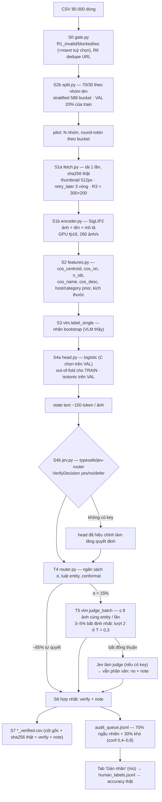

# Pipeline verify ảnh (Phần A) — Gate → SigLIP2 → head → Jev → router → VLM

Hiện thực theo `docs/CAI_TIEN_PIPELINE_JEV_TYPESAFE_FULL/` (2 tài liệu + 7 skill), chạy trên
`data/data_anh_pass_80000_full_pham_van_vuong.csv`. Mọi con số dưới đây là **đo thật** ngày
2026-10-20 trừ khi ghi "tài liệu nói". File kết quả: `reports/verify/`, artefact: `data/verify/`.

> **Tình trạng Jev:** code gọi Jev qua OpenRouter đã xong và có test, nhưng **chưa chạy với API
> thật** vì `OPENROUTER_API_KEY` trong `.env` còn trống. Pilot dưới đây dùng head đã hiệu chỉnh làm
> tầng quyết định. Điền key → chạy lại một lệnh → báo cáo tự so sánh head với Jev (mục 4).

---

## 1. Review folder `CAI_TIEN_PIPELINE_JEV_TYPESAFE_FULL`

### 1.1 Số liệu tài liệu — kiểm chứng lại trên file 80k

| Tài liệu nói | Đo lại | Kết luận |
|---|---|---|
| Gate loại 2.434 dòng (noext 1.642 · blocked 787 · ws 4 · invalid 1), còn 77.566 | đúng từng số | ✅ |
| 669 category → **479 bucket** | 669 category → **588 bucket** (chính hàm `category_bucket` của tài liệu) | ❌ sai số |
| 11.278 group tên chuẩn hoá · 41,3% entity < 5 ảnh sống | 11.278 · 4.614 group (41,3%) | ✅ |
| `description` rỗng 16.110 dòng, đều `from_db = 0` | 16.110, đều `from_db = 0` | ✅ |
| 368 host ≥ 30 dòng phủ 57.954 dòng | 368 / 57.954 | ✅ |
| Split train 56.433 / test 23.567 | (sau gộp tên, xem 1.2) train 44.750 · val 11.063 · test 23.395 — test 29,5% | ✅ tỉ lệ |
| pHash: trung vị Hamming intra 32 = cross 32, **AUC 0,369** (66 ảnh) | 3.150 ảnh, 18.445 cặp mỗi loại: trung vị 32 = 32, **AUC 0,522**; R4 (≤ 6) trúng 0,2% cặp cùng entity | ✅ kết luận "pHash vô dụng" · ❌ con số 0,369 là nhiễu mẫu nhỏ |
| Thay pHash bằng cosine embedding | SigLIP2 cosine: trung vị intra 0,734 vs cross 0,512, **AUC 0,938** | ✅ có cơ sở mạnh |
| `LUONG_VERIFY_HIEN_TAI.md`, benchmark mù 71,4%, giá 0,19 USD/1k | file không có trong repo | ⚠ không kiểm chứng được |

### 1.2 Lỗi thiết kế tìm thấy — và đã xử lý thế nào

| # | Vấn đề | Bằng chứng | Xử lý |
|---|---|---|---|
| 1 | **`R1_noext` loại nhầm ảnh thật.** Tài liệu gọi đây là 1.642 dòng "gọi VLM vô ích" | Tải thử 120 URL ngẫu nhiên bị rule này loại: **111 (92,5%) decode được** (Shopee `susercontent`, lemon8, `vietnam.vn`, `/_next/image`, googleusercontent; có ảnh 1440×1920). Ngược lại `R1_blocked`: 30/30 không phải ảnh | Mặc định `--noext download`: giữ lại, để bước tải ảnh quyết định. Rule gốc vẫn bật được bằng `--noext reject` |
| 2 | **Jev qua OpenRouter khác Jev trong tài liệu** | Catalog OpenRouter (20/10/2026) chỉ có `typesafe/jev-router`: *"picks the best model and reasoning effort for each request… runs on Jev"*. Giá `-1` (tính theo model được route), nhận cả ảnh, có `structured_outputs` và `logprobs`. **Không có** `provider_details['confidence']`, không có giá cố định $0,042/MTok, không dùng `TYPESAFE_API_KEY` / `pydantic-ai TypeSafeModel` | Xem mục 2.3: ép schema bằng `json_schema` strict + Pydantic; confidence lấy từ logprob của token `verify` và **hiệu chỉnh lại trên VAL** |
| 3 | **Ví dụ gộp tên mâu thuẫn ngưỡng.** "Chùa X" / "Chùa X (Hà Nội)" có Jaccard 0,5, nên ngưỡng ≥ 0,9 không gộp được | tính tay | Khoá nhóm = tên bỏ phần ngoặc đơn cuối, rồi mới gộp Jaccard ≥ 0,9. 11.278 tên → 10.883 khoá → 10.824 nhóm |
| 4 | DINOv3 là repo bị khoá | HF trả 401 | Dùng `google/siglip2-base-patch16-256` (mở, đa ngữ, có nhánh text cho `cos_name`/`cos_desc`). Đổi bằng `VERIFY_ENCODER` |
| 5 | Lưu 15,6 GB ảnh gốc | ổ C còn 39 GB (92% đầy) | Chỉ giữ thumbnail 512 px; sha256 tính trên byte gốc trước khi bỏ. 3.151 ảnh ≈ 190 MB |
| 6 | State mẫu đưa `host_prior: 7.79` (log tần suất) cho LLM | một con số log không có ý nghĩa với model ngôn ngữ | State ghi tên host + số dòng thật (`host: laodong.vn (host_n 2420)`) |
| 7 | Code mẫu `route()` không có các luật theo entity mà phần chữ mô tả; thiếu `from enum import StrEnum` | đọc code | `router.select` có đủ: bỏ entity < 5 ảnh sống, bỏ entity đã ≥ 8 yes chắc chắn, ưu tiên entity thiếu yes, greedy theo ngân sách, kiểm conformal |
| 8 | ECE sau hiệu chỉnh đo trên chính VAL đã dùng để fit | lần chạy smoke ra 0,0003 — ảo | ECE hiệu chỉnh đo cross-fit 2 nửa VAL, và đo lại trên TEST |

---

## 2. Kiến trúc đã hiện thực



### 2.1 Bản đồ stage → code

| Stage (skill) | File | Đầu ra (`data/verify/`) |
|---|---|---|
| S0 gate (01) | `pipeline/verify/gate.py` | `gate_report.json` |
| S2b split (06) | `pipeline/verify/split.py` | `split.json` |
| S1 tải (01, 02) | `pipeline/verify/fetch.py` + `storage/images.py` (chặn IP nội bộ, ≤ 15 MB) | `fetch.jsonl`, `thumbs/` |
| S1 embedding (02) | `pipeline/verify/encoder.py` | `emb.npz` (gộp dần qua các lần chạy) |
| S2 feature/state (03) | `pipeline/verify/features.py` | `states.jsonl` |
| S3 bootstrap (05) | `pipeline/verify/vlm.py: label_single` | `labels_boot.jsonl` |
| S4 head + Jev (04) | `pipeline/verify/head.py`, `jev.py` | `decisions_jev.jsonl` |
| T4 router (05) | `pipeline/verify/router.py` | trong `report.json` |
| T5 VLM batch (05) | `pipeline/verify/vlm.py: judge_batch` | `vlm_results.jsonl` |
| S6/S7 hợp nhất, audit, export (07) | `pipeline/verify/run.py` | `audit_queue.jsonl`, `reports/verify/*_verified.csv` |
| Đo lường (06) | `pipeline/verify/metrics.py`, `report.py` | `reports/verify/report.{json,md}`, `risk_coverage.svg` |
| Gán nhãn người (06, 07) | `api/routers/verify.py` + tab "Gán nhãn" trong `web/local/index.html` | `human_labels.jsonl` |

### 2.2 Quy ước nhãn

`yes` = **đúng thực thể và sạch** (không watermark/logo/chữ quảng cáo/số điện thoại, không nhạy cảm).
Ở prompt 8 ảnh, `partial` (khác chủ thể nhưng cùng không gian văn hoá) → `no` + note "CẦN VERIFY TAY".

### 2.3 Gọi Jev qua OpenRouter (`pipeline/verify/jev.py`)

- `POST {OPENROUTER_BASE_URL}/chat/completions`, `model = JEV_MODEL` (`typesafe/jev-router`).
- `response_format = json_schema` **strict**, schema sinh từ Pydantic `VerifyDecision`
  (`verify ∈ {yes, no, defer}`, `match` enum 3 giá trị, `ly_do` enum 8 giá trị, `confidence`).
  Kết quả được validate lại bằng Pydantic. Sai schema thì gọi lại; hỏng hẳn thì tính là `defer`.
- **Chỉ gửi state text, không bao giờ gửi ảnh** (có test kiểm tra).
- Confidence:
  - Ưu tiên `conf_logprob` = P(token giá trị `verify`), chuẩn hoá trên yes/no/defer từ `top_logprobs`.
  - Nếu model được route không trả logprob thì dùng `confidence` model tự khai.
  - Dù nguồn nào, confidence đều được **hiệu chỉnh isotonic trên VAL** (nhãn bootstrap, hoặc nhãn người khi có) trước khi router dùng. Báo cáo ghi ECE trước và sau hiệu chỉnh.
- Ghi `routed_model`, token, `usage.cost` (USD thật do OpenRouter tính), độ trễ vào `data/local/jev_usage.jsonl`.
  Câu trả lời được cache, nên chạy lại không trả tiền lần 2.
- Lỗi:
  - 401/402/403: dừng mềm ngay, không gọi thêm; phần còn lại dùng head.
  - 429 và 5xx: tất cả worker cùng chờ (cooldown chung), backoff `1,5·2ⁿ`.
- Thêm vai trò **judge**: khi 2 lượt VLM bất đồng, đưa state + 2 output cho Jev. Jev trả yes/no thì lấy; còn `defer` thì ra `no` + note.

---

## 3. Kết quả pilot — 400 nhóm thực thể, đúng "bước kiểm chứng rẻ nhất" tài liệu đề xuất

Lệnh: `python -m pipeline.verify --entities 400 --budget 0.15` · seed 42 · tập đánh giá = TEST.

### 3.1 Từng stage

| Stage | Kết quả | Thời gian |
|---|---|---|
| S0 gate (80k) | 79.208 sống (noext giữ lại) · loại blocked 787, ws 4, invalid 1 | 1,4 s |
| S2b split (79k) | 6.063 / 1.522 / 3.239 nhóm train/val/test · 0 nhóm nằm 2 phía | 1,2 s |
| Pilot | 400 nhóm, 3.240 dòng | — |
| S1 tải | 3.151 ok · 83 chết sau 3 vòng · 6 trùng sha256 trong entity · `retry_later` cứu 11/94 link lỗi lần đầu · 1 ảnh test trùng byte với ảnh train (đã bỏ) | 397 s (32 luồng; gồm 110 s chờ retry) |
| S1 encoder | 3.150 ảnh, 768 chiều; **260 ảnh/s** sau khi thêm prefetch đa luồng (lần đầu 65 ảnh/s; embedding khớp, cosine ≥ 0,9996) | 12 s |
| S3 bootstrap | 3.150 nhãn VLM · yes 69,3% · **677 token vào + 83 ra / ảnh** (3.016 request tính phí) | 540 s (8 luồng) |
| S4 head | C = 0,01 · train 1.888 / val 367 nhãn · ECE val thô 0,076 → hiệu chỉnh (cross-fit) 0,047 · trên TEST 0,063 → **0,034** | 0,5 s |
| T4 router | α = 15% → 134/895 ảnh test · bỏ 116 dòng của entity < 5 ảnh, 433 dòng của entity đã ≥ 8 yes chắc chắn · 44 entity cần bổ sung ảnh · conformal: θ từ VAL cho ra 14,4% trên TEST (≤ 15% ✅) | — |
| T5 VLM batch | 134 ảnh trong **39 lần gọi** · **394 token vào + 61 ra / ảnh được chấm** (ít hơn 42% token vào so với gọi từng ảnh, nhưng chỉ rẻ hơn khoảng 24% về tiền vì ít cache-hit hơn) · lượt 2 (T = 0,3) trên 36 ảnh: đồng thuận 32/36 (89%), 4 ca → `no` + note | 19 s |

### 3.2 Chất lượng — **proxy** (so với nhãn VLM bootstrap, *không phải accuracy*)

Risk–coverage của head (tập TEST, 895 ảnh có nhãn thầy) — `reports/verify/risk_coverage.svg`:

| α (phần ít tự tin nhất bị cắt) | 0% | 5% | 10% | 15% | 20% | 30% |
|---|---|---|---|---|---|---|
| Đồng thuận phần giữ lại | 91,3% | 92,5% | 92,9% | **93,7%** | 94,0% | 93,6% |

AURC 0,052 · ECE confidence 0,033.

Cascade (head + VLM batch trên 15%):
- Đồng thuận tổng 89,3%: phần head giữ 92,1%, phần chuyển VLM 73,1%.
- **Cascade đồng thuận thấp hơn head một mình (91,3%).** Lý do không phải VLM kém, mà là **2 prompt VLM mâu thuẫn nhau trên đúng tập khó**. Trên 134 ảnh được chuyển, ma trận (prompt 1 ảnh, prompt 8 ảnh):
  - yes, yes = 53 · **yes, no = 34** · no, yes = 2 · no, no = 45.
  - 25/34 ca lệch là prompt 8 ảnh xếp `partial`. Ví dụ: "Nội thất nhà thờ, hàng ghế đỏ" cho thực thể nhà thờ Tân Định; "Quạt lông tím, khác chủ thể" cho thực thể quạt hầu.
- Ai đúng thì **chỉ nhãn người phân xử được**. Đây chính là bẫy #3 của skill_06: đo "đồng thuận với thầy" thì cascade bị phạt khi đổi thầy.

Cấp thực thể (118 nhóm test): 62,7% có ≥ 3 ảnh yes, 40,7% có ≥ 5. Chỉ tiêu "≥ 5 ảnh" như tài liệu cảnh báo là bất khả thi với gần nửa entity.

Theo host (yes rate của thầy): `media.vov.vn` 19%, `i.ex-cdn.com` 41%, `laodong.vn` 90%, `cdn.tgdd.vn` 95%.
Host prior là feature mạnh, nhưng ngược với giả định của tài liệu ("tgdd = thương mại, dễ dị ứng").

### 3.3 Chi phí đo được

| Hạng mục | Request | Token vào / ra |
|---|---|---|
| S3 bootstrap (1 ảnh/lần) | 3.016 | 2.042.988 / 251.658 |
| T5 batch lượt 1 | 39 | 52.775 / 8.232 |
| T5 batch lượt 2 | 24 | 30.433 / 4.537 |
| Jev | 0 (chưa có key) | — |

Quy ra USD theo giá chính thức deepseek-flash (20/10/2026; cao điểm: vào 0,30 · cache-hit 0,006 · ra 1,20 USD/1M token; ngoài giờ cao điểm bằng 1/2):

| | Cao điểm | Ngoài giờ cao điểm |
|---|---|---|
| Pilot (3.079 request) | 0,75 USD | 0,38 USD |
| 1 ảnh/lần (bootstrap) | 0,238 USD / 1k ảnh | 0,119 USD / 1k ảnh |
| 8 ảnh/lần, tính trên ảnh được chấm | 0,180 USD / 1k ảnh | 0,090 USD / 1k ảnh |
| Ngoại suy 77.566 ảnh: VLM 100% | 18,47 USD | 9,24 USD |
| Ngoại suy 77.566 ảnh: cascade α = 15% (+ bootstrap 5.000 + lượt 2 cho 4%) | 4,16 USD + Jev | 2,08 USD + Jev |

---

## 4. Việc bạn cần làm

### 4.1 Điền key OpenRouter và chạy Jev

```dotenv
# .env
OPENROUTER_API_KEY=sk-or-v1-...      # https://openrouter.ai/keys
JEV_MODEL=typesafe/jev-router
JEV_REASONING_EFFORT=                # trống = router tự chọn; low cho rẻ/nhanh
```

```powershell
.\.venv-gpu\Scripts\python.exe -X utf8 -m pipeline.verify --entities 400 --budget 0.15
```

- Mọi bước cũ đều lấy từ cache. Chỉ phát sinh khoảng 1.260 request Jev (367 ảnh VAL + 895 ảnh TEST) và VLM cho phần router chọn lại.
- Báo cáo sẽ có thêm `layers_proxy_eval.jev` cạnh `head`, cùng ECE thô/hiệu chỉnh của Jev, `confidence_source` (logprob hay tự khai), `routed_models` và chi phí USD thật.
- Nên chạy trước `--entities 40` để xem token/giá thực tế của router.

### 4.2 Gán nhãn người (300 ảnh) để có accuracy thật

1. Mở `http://127.0.0.1:8000/` → tab **Gán nhãn (Phần A)**. Phím tắt `Y` / `N` / `S`.
   Gán nhãn **mù**: trang không hiển thị dự đoán của máy.
2. Hàng đợi gồm 210 ảnh ngẫu nhiên (cho accuracy không thiên lệch) và 90 ảnh khó (confidence 0,4–0,8, cho active learning).
3. Chạy lại lệnh ở 4.1. Mục `human_eval` sẽ báo accuracy của:
   - cascade (tổng và riêng phần ngẫu nhiên);
   - head;
   - Jev;
   - **VLM thầy**, tức con số tương đương "71,4%" của tài liệu.
   Đây là các con số duy nhất được phép gọi là accuracy.

### 4.3 Mở rộng lên toàn bộ 77k

`--entities 0`. Ước tính từ số đo pilot:
- Tải ảnh khoảng 2 giờ: khoảng 11 ảnh/s với 32 luồng, giới hạn ở phía host.
- Encoder khoảng 5 phút.
- Bootstrap giới hạn bằng `--bootstrap 5000` (phân tầng theo bucket, như tài liệu). Mặc định 0 = gán nhãn mọi ảnh, phù hợp cho pilot.
- Jev 100% ảnh: giá theo model được route, xem `cost.jev_this_run.usd` của pilot rồi nhân lên.

---

## 5. Giới hạn còn lại

- **Chưa có nhãn người**: mọi chất lượng ở mục 3 là đồng thuận với DeepSeek, không phải accuracy.
  Mục tiêu "A_keep ≥ 0,82" của tài liệu chưa kiểm chứng được.
- **Jev chưa chạy thật**: hành vi của router (model nào, có trả logprob không, giá, độ trễ) chỉ biết khi có key.
  Nếu logprob không có, confidence dựa vào số tự khai đã hiệu chỉnh.
- Hai prompt VLM mâu thuẫn nhau ở ca `partial` (mục 3.2). Cần nhãn người để chọn quy ước rồi sửa prompt.
- Head train bằng nhãn VLM nên học cả thiên lệch của thầy. Retrain với nhãn người (skill_07) chưa tự động.
  Hiện nhãn người chỉ dùng để đánh giá.
- Learning curve (accuracy theo số nhãn người) chưa vẽ: cần nhãn người trước.
- Pilot gán nhãn bootstrap 100% ảnh (để có proxy trên TEST). Ở quy mô 77k dùng `--bootstrap 5000`; khi đó proxy trên TEST chỉ tính trên phần có nhãn.
- Ảnh không đuôi file được giữ lại theo số đo; nếu muốn đúng rule gốc của tài liệu thì dùng `--noext reject`.

## 6. Test

`tests/test_verify_pipeline.py` (12 test, offline) kiểm tra:
- luật gate và `noext`;
- dedupe theo entity;
- split không rò rỉ và gộp "X" / "X (Hà Nội)";
- risk–coverage và ECE;
- luật router và conformal;
- Jev: payload `json_schema`, confidence từ logprob, không gửi ảnh, dừng ở 402, không có key;
- VLM batch bắt buộc chấm đủ mọi ảnh;
- API gán nhãn mù và validate input.

Toàn repo: **59/59 pass**, `ruff check .` sạch.
