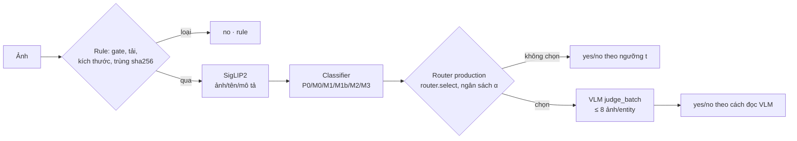

# Tối ưu Pipeline A: classifier, router, ngân sách VLM, cấu hình production

Ngày đo: 22/10/2026. Nhãn người: `data/test.csv` (34.780 ảnh, 33,4% `no`).

- Split theo nhóm tên (seed 42): TRAIN 19.349 / VAL 4.866 / TEST 10.565 ảnh.
- **Mọi lựa chọn (model, ngưỡng, cách đọc VLM, ngân sách) đều làm trên VAL**; TEST chỉ dùng để báo cáo.
- Báo cáo sinh tự động: [reports/verify_router/report.md](../reports/verify_router/report.md).

Lớp dương là `no` (ảnh phải loại):

| Chỉ số | Ý nghĩa |
|---|---|
| **Recall no** | Tỉ lệ ảnh xấu bị chặn |
| **Precision yes** | Độ sạch của kho sau lọc |
| **Recall yes** | Tỉ lệ ảnh tốt được giữ lại |
| **Retention** | Tỉ lệ entity (có ≥ 1 ảnh tốt) vẫn còn ≥ 1 ảnh tốt được duyệt |

## 1. Cách đo

- **VLM được chấm một lần cho mọi ảnh VAL + TEST** (15.023 ảnh, $1,96). Nhờ vậy mọi ngân sách được mô phỏng chính xác mà không phải gọi lại API.
- Router dùng **đúng hàm production** [router.py](../pipeline/verify/router.py), gồm các rule entity: bỏ qua entity có < 5 ảnh; không chi cho entity đã có ≥ 8 ảnh `yes` chắc chắn.
- Trên VAL, với mỗi (classifier, ngân sách), chọn ngưỡng `t` (0,05–0,95) và một trong 5 cách đọc câu trả lời VLM:
  - `goc`: đúng chủ thể **và** sạch, như prompt production;
  - `bo_watermark`: đúng chủ thể, không xét watermark;
  - `partial_yes`: chủ thể "partial" cũng tính là yes;
  - `chi_sai`: chỉ loại khi subject = "sai";
  - `learned`: logistic trên [p, subject, watermark], đánh giá bằng cross-validation trên VAL.
- **Mục tiêu tối ưu:** tối đa Recall no, với ràng buộc **Recall yes ≥ 85%** và **retention ≥ 95%**. Hòa trong ±0,5 điểm thì chọn cấu hình rẻ hơn.
- **Tái lập:**
  1. `python -m scripts.eval_verify_human` (tải ảnh + SigLIP2)
  2. `python -m scripts.bench_verify_collect` (VLM, $2,90)
  3. `python -m scripts.bench_verify_router`

## 2. Giai đoạn 1–2: thay classifier (không VLM)

Số đo trên TEST, ngưỡng chọn trên VAL theo ràng buộc ở trên:

| Model | Input · nhãn train | AUC | Recall no | Precision yes | Recall yes | Retention | ms/1.000 ảnh |
|---|---|---:|---:|---:|---:|---:|---:|
| P0 (production) | 782 chiều · **nhãn VLM thầy** | 0,649 | 31,3* | — | 83,6* | 96,2 | 2,3 |
| M0 | 782 chiều · nhãn người | 0,718 | 37,9 | 73,9 | 87,7 | 95,4 | 2,3 |
| M1 | **LightGBM, 14 feature** | 0,650 | 19,0 | 69,4 | 91,8 | 96,1 | 0,3 |
| **M1b** | **LightGBM, 782 chiều** | 0,735 | **43,2** | **75,1** | 85,5 | 95,2 | 1,9 |
| M2 | MLP trên embedding đóng băng | 0,735 | 37,9 | 74,0 | 88,2 | 96,7 | 1,1 (GPU) |
| M3 | Stacking (M0, M1b, M2) | 0,738 | 39,5 | 74,4 | 87,9 | 96,5 | 5,7 |

\* P0 không đạt Recall yes 85% trên VAL ở bất kỳ ngưỡng nào: VLM thầy gắn `no` cho 47% ảnh bootstrap, trong khi người chỉ loại 33%.

**Kết luận giai đoạn 1–2:**
- **Chỉ thay classifier (LightGBM trên 14 feature) thì kém hơn.** Tín hiệu chính nằm trong embedding.
- **LightGBM trên đúng input hiện tại (M1b)** tốt nhất ở cùng ràng buộc: +5,3 điểm Recall no so với M0.
- MLP trên embedding đóng băng (M2) có AUC ngang M1b nhưng Recall no thấp hơn ở điểm vận hành này. Stacking (M3) **không cộng thêm** được gì đáng kể.
- **Đổi nhãn train từ VLM thầy sang nhãn người là thay đổi lớn nhất:** P0 → M0 tăng AUC 0,649 → 0,718.

## 3. Giai đoạn 3: router và ngân sách VLM

Số đo trên TEST, cấu hình chọn trên VAL:

| Ngân sách | M1b Recall no | M1b Precision yes | M1b Recall yes | M1b Retention | $/1.000 ảnh | p95 ms |
|---:|---:|---:|---:|---:|---:|---:|
| 0% | 43,2 | 75,1 | 85,5 | 95,2 | 0,0003 | 5.112 |
| 5% | 43,8 | 75,3 | 85,5 | 94,9 | 0,007 | 5.961 |
| 10% | 45,1 | 75,6 | 84,9 | 94,4 | 0,014 | 6.199 |
| **15%** | **44,8** | **75,5** | **85,2** | **94,2** | **0,020** | **6.367** |
| 20% | 47,5 | 76,4 | 84,7 | 94,9 | 0,027 | 6.512 |

Recall yes trên TEST của 10% và 20% thấp hơn ngưỡng 85% khoảng 0,2–0,3 điểm: ràng buộc được đặt trên VAL.

Bảng đầy đủ cho cả 6 classifier × 5 ngân sách nằm trong báo cáo tự sinh.

- Ở mức Recall yes 85%, **VLM chỉ cộng thêm 1,5–4 điểm Recall no** cho ngân sách 15–20%. Lý do: chính VLM cũng chỉ khớp người khoảng 73% (xem [verify-human-benchmark.md](verify-human-benchmark.md)).
- **Cách đọc VLM của production (`goc`) hiếm khi được chọn.** VAL thường chọn `bo_watermark`, `partial_yes` hoặc `learned`, vì tiêu chí watermark lệch với quy ước của người duyệt.

### So sánh cùng điểm vận hành với production hiện tại

Production hiện tại: P0, t = 0,5, α = 15%, prompt gốc. Các model mới được chỉnh trên VAL để Recall yes và retention **không thấp hơn** production:

| Cấu hình | Recall no | Precision yes | Recall yes | Retention | Accuracy |
|---|---:|---:|---:|---:|---:|
| **Production hiện tại** | 59,2 | 76,2 | 65,3 | 88,9 | 63,3 |
| M1b@15%, cùng điểm vận hành | **65,7** | **80,1** | **69,2** | 86,3 | **68,0** |
| M3@15%, cùng điểm vận hành | **67,1** | **80,4** | 67,6 | 87,6 | 67,4 |

Ở cùng chi phí VLM (15%), cách mới **bắt thêm 6,5–8 điểm ảnh xấu và đồng thời giữ thêm 2–4 điểm ảnh tốt**. Riêng retention trên TEST thấp hơn production 1–2,6 điểm, dù trên VAL đã được chỉnh để không thấp hơn.

Production hiện tại **loại oan 35% ảnh tốt** và làm 11% entity mất hết ảnh tốt.

## 4. Giai đoạn 4: cấu hình production đề xuất

**M1b (LightGBM, nhãn người) + router α = 15% + đọc VLM `bo_watermark` + ngưỡng t = 0,55**

| Tiêu chí | TEST | Ghi chú |
|---|---:|---|
| Recall no | 44,8% | Production hiện tại: 59,2%, nhưng đổi bằng 35% loại oan |
| Precision yes (độ sạch kho) | 75,5% | Không lọc gì: 66,7% |
| Recall yes | 85,2% | Ràng buộc ≥ 85% (đạt) |
| Entity retention | 94,2% | VAL 95,2%, TEST hụt ràng buộc 95% **0,8 điểm** |
| Gửi VLM | 14,6% ảnh | 1.541 / 10.565 |
| Chi phí | **$0,020 / 1.000 ảnh** | 10M ảnh ≈ $202, 100M ≈ $2.020 (chưa gồm tải ảnh) |
| Latency mỗi ảnh | p50 3,4 s · p95 6,4 s | Do **tải ảnh từ host gốc** chi phối |
| Throughput / máy | 13,2 ảnh/s | Nút thắt: tải (48 luồng); GPU 287 ảnh/s, VLM 126 ảnh/s dư |

Lý do không chọn các phương án khác:
- **Ngân sách 20%:** thêm 2,7 điểm Recall no, nhưng tốn hơn 35% và retention trên VAL không hơn. Trên VAL, nó nằm trong vùng hòa ±0,5 điểm với 15%, nên quy tắc "hòa thì rẻ hơn" chọn 15%.
- **M3:** chậm gấp 3 lần (5,7 ms/1.000 ảnh) mà không hơn M1b ở điểm vận hành này.
- **Ngân sách 0%:** rẻ nhất, chỉ kém 1,6 điểm Recall no. Đây là lựa chọn hợp lý nếu muốn **không phụ thuộc API ngoài**.

## 5. Hạn chế

- **Một người gán nhãn**, chưa đo đồng thuận người–người. Chưa có lý do loại (`note`), nên không có recall theo từng tiêu chí của đề.
- **Recall no 45% nghĩa là hơn nửa ảnh xấu vẫn lọt**, kho còn khoảng 24,5% ảnh người sẽ loại. Tầng rẻ + VLM hiện **chưa thay được người duyệt** cho tiêu chí "ảnh tiêu biểu cho địa danh".
- **VLM được chấm theo lô 8 ảnh/entity trên toàn bộ ảnh.** Production chỉ gửi ảnh được route, cộng ngữ cảnh tối đa 4 ảnh, và chấm 2 lượt cho ảnh khó, nên ngữ cảnh lô khác một chút.
- **Đơn giá VLM có thể thấp hơn thực tế khoảng 1,5%**, vì 42/2.893 lô trúng cache của client. Phí GPU dùng giả định $0,35/giờ.
- **Latency được cộng từng tầng từ số đo riêng lẻ** (thời gian tải từng ảnh, batch SigLIP2, batch VLM), không phải đo một luồng chạy thật đồng thời.
